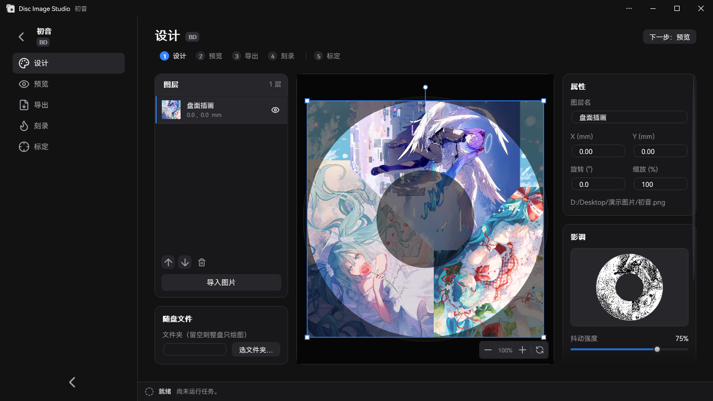
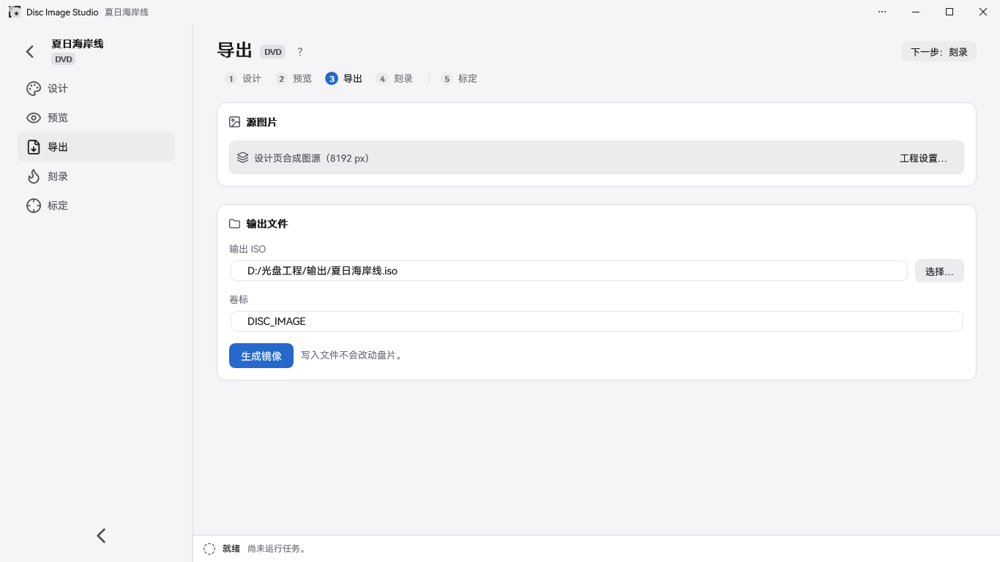

<div align="center">

[简体中文](README.md) | [繁體中文](README.zh-TW.md) | [English](README.en.md) | [日本語](README.ja.md) | [Türkçe](README.tr.md) | [Español](README.es.md) | **Čeština**


<h2>Všestranný nástroj pro generování a vypalování viditelných obrazů na optické disky</h2>

Disc Image Studio je multiplatformní nástroj pro generování a vypalování obrazů na povrch disků, který vám pomůže vypálit obrazy viditelné pouhým okem na jakýkoli DVD / CD / jednovrstvý Blu-ray disk pomocí jakékoli vypalovací mechaniky.


[](LICENSE)

</div>

> Český překlad README · [Originál](README.en.md). Podrobná dokumentace je dostupná v původních jazycích.

---

## Výsledky


---

## Přehled

Disc Image Studio převádí obrázek na data, která splňují omezení fyzické vrstvy disků CD, DVD a jednovrstvých BD-R. Po vypálení se na povrchu disku zobrazí vzor viditelný pouhým okem.

## Náhled rozhraní






---

## Rychlý start

Ve Windows x64 stáhněte a spusťte soubor končící na `win-x64.exe`; ve Windows 11 ARM64 zvolte nativní verzi končící na `win-arm64.exe`. V Linuxu nebo macOS stáhněte **experimentální CLI** archiv odpovídající vašemu procesoru, rozbalte jej a spusťte `./disc-image-studio --help`. Každý balíček vydání obsahuje runtime .NET. [Vydání na GitHubu](https://github.com/JiaFeiMiao-K-Cat/DiscImageStudio/releases)

### 1. Vytvoření projektu

Na domovské stránce zvolte CD, DVD nebo Blu-ray, určete umístění výstupu a vytvořte projekt.

### 2. Návrh povrchu disku

Na stránce Návrh importujte obrázek, rozmístěte jej pomocí vrstev a v panelu **Tón** vpravo upravte dithering, gamu, jas a úrovně šedi.

### 3. Náhled a export

Na stránce Náhled zkontrolujte projekci na disk, poté na stránce Export vygenerujte ISO / RAW / WAV+CUE nebo pomocí přímého vypalování zapište přímo na prázdný disk.

Přímé vypalování je experimentální. Používejte pouze testovací média, která si můžete dovolit zničit.

## Funkce

### Generování dat disku

- **Podpora CD**: Podporuje jakékoli CD. Exportuje zvukové stopy WAV s hlavičkami formátu a doprovodnými soubory CUE kompatibilními s vypalovacím softwarem, jako jsou cdrecord a ImgBurn; k dispozici je také export surových zvukových stop RAW. Viz [kompatibilita vypalování CD](docs/CD_AUDIO_COMPATIBILITY.md).
- **Podpora DVD**: Podporuje jakékoli DVD. Exportuje obrazy ISO.
- **Podpora Blu-ray**: Podporuje jakýkoli jednovrstvý BD-R 25 GB v režimu pouhého kreslení a se soubory UDF 2.01. Viz [ADDING_BLURAY.md](docs/ADDING_BLURAY.md).
- **Soubory na disku**: U CD, DVD a Blu-ray můžete vybrat složku a umístit její soubory na vnitřní nebo vnější okruh přímo na stránce Návrh, případně tato nastavení upravit na stránce Export. Nastavení se ukládá s projektem.
- **Náhled oblasti souborů**: Projekce návrhu hybridních disků a zpětné čtení výstupu zvýrazňují oblast souborů včetně systému souborů modře.
- **Schémata šedi podle média**: CD i DVD používají dvě černo-bílé úrovně: `0D / AA` pro CD a `A5 / 92` v prokládané doméně DVD. Viz [PHYSICAL_MODEL_AUDIT.md](docs/PHYSICAL_MODEL_AUDIT.md).
- **Nástroj pro dithering šedi**: Samostatný program dokáže zpracovat zdrojový obrázek na dvouúrovňový černo-bílý PNG `0/255`. Podporuje otevírání nebo přetahování zdrojových obrázků, náhledy vedle sebe a bezztrátový export PNG. Viz [návod k použití a sestavení](tools/FourLevelDither/README.md).
- **Předvolby disků**: Vestavěné parametry disků pokrývají několik značek CD, DVD a BD. Můžete také přispět vlastními kalibrovanými daty; viz [údržba předvoleb](docs/DISC_PRESETS.md).

### Asistovaná kalibrace

Disc Image Studio nabízí inteligentní a přesný pracovní postup asistované kalibrace. Ve srovnání s ruční vizuální kalibrací zlepšuje algoritmus asistované kalibrace přesnost určitelných fyzických parametrů povrchu disku z 10<sup>-6</sup> na 10<sup>-14</sup>. Před kalibrací vytváří konstantní rozteč stop znatelně zakřivené radiální křížové čáry. Po opětovném vygenerování a vypálení s parametry kubické rozteče stop získanými asistovanou kalibrací jsou čáry blíže přímým radiálním čarám.

| Před kalibrací · Konstantní rozteč stop | Po kalibraci · Kubická rozteč stop |
| --- | --- |
|  |  |
| `P20261004-133519.jpg` | `P20261004-135416.jpg` |

Postup a parametry najdete v [průvodci asistovanou kalibrací](docs/CALIBRATION.md).

### Vypalování

- **Výstup obrazu disku**: Exportujte kompletní soubory ISO / RAW a vypalte je ručně vhodným vypalovacím softwarem.
- **Přímé streamované vypalování (experimentální)**: Generujte a vypalujte data CD, DVD a BD-R současně bez ukládání kompletního obrazu disku. BD-R používá sekvenční zápis MMC.
- **Nepoužívejte média, která nejsou prázdná!**

## Požadavky na systém a hardware

- Desktopová aplikace x64 vyžaduje Windows 10 2004 (2004/20H1, 19041) nebo novější, případně Windows 11. Verze ARM64 vyžaduje Windows 11. Nativní CI pro ARM64 zahrnuje softwarové autotesty a snímky GUI; vypalování fyzických disků zatím nebylo ověřeno.
- Sestavení: .NET 10 SDK (`global.json` uzamyká 10.0.x). Nesamostatná GUI sestavená ze zdrojového kódu vyžaduje .NET 10 Windows Desktop Runtime. Vydaný EXE obsahuje runtime, takže samostatná instalace .NET není nutná.
- Přímé vypalování vyžaduje vypalovací mechaniku CD / DVD / BD rozpoznanou systémem Windows a prázdné médium. BD-R vyžaduje prázdný jednovrstvý disk podporující sekvenční zápis.

## Sestavení a spuštění

```powershell
dotnet build DiscImageStudio.slnx --configuration Release
dotnet run --project src/DiscImageStudio.App --configuration Release
```

Regresní kontroly sestavení:

```powershell
dotnet run --project src/DvdImageSolver --configuration Release -- selftest
dotnet run --project tests/DiscImageStudio.ArchitectureTests --configuration Release
```

Pravidla verzování, EXE generované CI, kontroly konceptů vydání, balení MSIX a postup podepisování najdete v [průvodci vydáním](docs/RELEASING.md).

## Příkazová řádka

Pro Linux s glibc zvolte `linux-x64` nebo `linux-arm64`. Pro macOS zvolte `osx-arm64` pro Apple Silicon nebo `osx-x64` pro Intel. CLI zapisuje obrazové soubory a zvukové stopy, které můžete vypálit kompatibilním nástrojem.

Spuštění CLI ze zdrojového kódu pomocí .NET 10 SDK

```sh
dotnet run --project src/DiscImageStudio.Cli -c Release -- --help
```

CLI čte PNG, JPEG, BMP a GIF a u animovaných obrázků používá první snímek. Instalaci ověříte vygenerováním dvousektorové zvukové stopy a odpovídajícího souboru CUE.

```sh
./disc-image-studio cd-generate --input picture.png --output sample.wav --sectors 2
```

| Příkaz | Popis |
| --- | --- |
| `solve` | Vygeneruje obraz DVD pomocí pevného rychlého mapování textur (směr CW), s volitelným ditheringem pro míchání černo-bílých textur |
| `encode` | Zakóduje jeden ECC blok DVD do úrovní kanálu NRZI |
| `calibrate` | Kalibrační projekce: vzorkuje zdrojový obraz DVD podle geometrie generování a promítne jej na disk podle naměřené geometrie |
| `simulate` | Simuluje zpětné čtení vygenerovaného DVD ISO podle naměřených poloměrů |
| `selftest` | Spustí deterministické regresní autotesty motoru DVD |
| `cd-generate` | Vygeneruje zvukové stopy WAV + CUE / RAW, pokud na disku nejsou soubory; při zadání `--data-dir` vytvoří ISO datového disku CD |
| `cd-preview-warp` | Kalibrační projekce: promítne zdrojový obraz CD podle naměřené geometrie |
| `cd-preview-track` | Vykreslí existující zvukovou stopu WAV nebo RAW CD-DA podle kalibrované geometrie (simulace zpětného čtení) |
| `bd-generate` | Vygeneruje kompletní BD-R ISO a zapíše doprovodný soubor `<iso>.json` |
| `bd-info` / `bd-probe` / `bd-encode` | Exportuje parametry BD, sondy surových dat nebo diagnostiku jednoho ECC clusteru |

Kompletní parametry jednotlivých příkazů najdete v příslušné dokumentaci.

## Uspořádání zdrojového kódu

```text
src/DiscImageStudio.Cli/     Offline hostitel příkazové řádky pro Linux a macOS
src/DiscImageStudio.ImageIO/ WIC a multiplatformní obrazové kodeky
src/DiscImageStudio.Core/    Na médiu nezávislé kontrakty modulů, modely projektů a předvoleb, katalog úloh a příkazů
src/DiscImageStudio.Imaging/ Předzpracování obrazu a pomocné nástroje pro dithering společné pro CD/DVD/BD
src/DiscImageStudio.Burning/ Výčet zařízení Windows IMAPI2, streamovací buffer a bezpečná vrstva vypalování
src/DiscImageStudio.Cd/      Jádro generování CD-DA a modul CD
src/DiscImageStudio.Dvd/     Adaptér modulu motoru DVD
src/DiscImageStudio.BluRay/  Geometrie BD-R, 17PP/ECC, mapování 3T/6T, streamované generování a ISO
src/DiscImageStudio.Iso/     Zapisovače UDF 2.01 / ISO9660
src/DiscImageStudio.App/     WPF GUI, jednotná příkazová řádka a prostředky pro Store
src/DvdImageSolver/          Izolovaný motor pro kódování a řešení DVD
tests/                       Architektonické regresní testy bez testovacího rámce třetí strany
packaging/                   Manifest MSIX a skripty pro balení
tools/                       Samostatné nástroje a skripty pro generování prostředků
docs/                        Dokumentace architektury, motorů, předvoleb, vydání a další
```

## Dokumentace

| Dokument | Obsah |
| --- | --- |
| [ARCHITECTURE.md](docs/ARCHITECTURE.md) | Abstrakce modulů, hranice mezi vrstvami a pravidla rozšiřování |
| [LOCALIZATION.md](docs/LOCALIZATION.md) | Nastavení jazyka a údržba překladových zdrojů |
| [DVD_ENGINE.md](docs/DVD_ENGINE.md) | Konvence řešiče omezení obrazu DVD NRZI, kódovací řetězec a pokrytí autotestů |
| [CD_AUDIO_COMPATIBILITY.md](docs/CD_AUDIO_COMPATIBILITY.md) | Formáty zvukových stop CD, pořadí bajtů a řešení duchů (ghosting) |
| [ADDING_BLURAY.md](docs/ADDING_BLURAY.md) | Fyzikální model modulu Blu-ray, generování a vypalování a rozšiřovací body |
| [DISC_PRESETS.md](docs/DISC_PRESETS.md) | Vrstvený formát JSON a pravidla slučování upravitelných předvoleb disků |
| [CALIBRATION.md](docs/CALIBRATION.md) | Rektifikace fotografií (vyznačení nejvnějšího fyzického okraje disku a okraje středového otvoru), kalibrace křivek a proložení kubické rozteče stop DVD |
| [PHYSICAL_MODEL_AUDIT.md](docs/PHYSICAL_MODEL_AUDIT.md) | Přezkoumání fyzikálních modelů generování CD / DVD |
| [VALIDATION.md](docs/VALIDATION.md) | Místní záznamy ověřování sestavení, regresí a testů na fyzických discích |
| [RELEASING.md](docs/RELEASING.md) | Vydání na GitHubu, balení MSIX, testy podepisování a postup odeslání do Storu |
| [CHANGELOG.md](CHANGELOG.md) | Historie změn verzí |

## Referenční normy

Implementace a fyzikální modely Disc Image Studio vycházejí především z těchto specifikací:

| Médium | Norma a vydání | Rozsah použitý v tomto projektu |
| --- | --- | --- |
| CD-R | [ECMA-394, 1. vydání, prosinec 2010](https://ecma-international.org/publications-and-standards/standards/ecma-394/) — *Recordable Compact Disc Systems CD-R Multi-Speed* ([oficiální PDF](https://ecma-international.org/wp-content/uploads/ECMA-394_1st_edition_december_2010.pdf)) | Médium CD-R, vícerychlostní záznam a kompatibilita CD-DA; tento projekt generuje zvukové stopy CD-DA. |
| Společný formát DVD / DVD-ROM | [ECMA-267, 3. vydání, duben 2001](https://ecma-international.org/publications-and-standards/standards/ecma-267/) — *120 mm DVD – Read-only disk* ([oficiální PDF](https://ecma-international.org/wp-content/uploads/ECMA-267_3rd_edition_april_2001.pdf)) | Datové rámce DVD, ECC, kódování EFMPlus a převodní tabulky přílohy G; pro pravidla zapisovatelných médií se také odkazuje na ECMA-359. |
| DVD-R | [ECMA-359, 1. vydání, prosinec 2004](https://ecma-international.org/publications-and-standards/standards/ecma-359/) — *80 mm (1,46 Gbytes per side) and 120 mm (4,70 Gbytes per side) DVD Recordable Disk (DVD-R)* ([oficiální PDF](https://ecma-international.org/wp-content/uploads/ECMA-359_1st_edition_december_2004.pdf)) | Geometrie jednovrstvého DVD-R, sektory, oprava chyb a kódování; norma pokrývá jednostranná i oboustranná média. Oboustranné neznamená dvouvrstvé. |
| BD-R | [ISO/IEC 30190:2021, 3. vydání, leden 2021](https://www.iso.org/standard/80770.html) — Specifikace pro výměnu a ukládání informací na 120 mm jednovrstvých (25,0 GB) a dvouvrstvých (50,0 GB) zapisovatelných BD | Experimentální režim používá uspořádání stop a sektorů, opravu chyb a kódování pro jednovrstvé disky 25 GB. Dvouvrstvé disky nejsou aktuálně podporovány. |

Společné komponenty kódování CD také vycházejí z [ECMA-130, 2. vydání (CD-ROM, 1996)](https://ecma-international.org/publications-and-standards/standards/ecma-130/).

## Bezpečnost vypalování a médií

- Disc Image Studio neinstaluje ovladače ani služby. Přímé vypalování používá vestavěné Windows IMAPI2 a odmítá média, která nejsou prázdná.
- Přímé vypalování již získalo určitou zpětnou vazbu z testů na fyzických discích, ale pokrytí ověřováním napříč různými zařízeními, médii a cestami vypalování zůstává omezené. Je experimentální; používejte pouze testovací média, která si můžete dovolit zničit. Přerušené vypalování, výpadek napájení nebo nedostatečná rychlost generování mohou disk stále znehodnotit!
- Skutečný viditelný výsledek závisí na disku, vypalovací mechanice, firmwaru a strategii zápisu.
- U hybridních disků se zdrojová složka před zahájením vypalování prohledá a její uspořádání se zafixuje. Pokud se během operace změní velikost zdrojového souboru, úloha se bezpečně ukončí; disk, na který se již začalo zapisovat, však může být stále znehodnocen.
- Sekvenční zápis BD-R neposkytuje přemapování náhradní oblasti. Po přerušení obvykle nelze pokračovat v zápisu na stejný disk.

## Soukromí a bezpečnost

- Disc Image Studio nepřistupuje k síti, nenahrává soubory ani neshromažďuje telemetrii. Viz [zásady ochrany soukromí](PRIVACY.md).
- Bezpečnostní problémy nezveřejňujte ve veřejných issue. Postupujte podle [bezpečnostních zásad](SECURITY.md) a použijte soukromé hlášení na GitHubu.

## Přispívání

Hlášení problémů a příspěvky kódu jsou vítány. Nastavení vývojového prostředí, pravidla hranic modulů, požadavky na testování a postup pull requestů najdete v [průvodci přispíváním](CONTRIBUTING.md).

## Licence

Tento projekt je licencován pod [GNU GPL v3.0 nebo novější](LICENSE) (`GPL-3.0-or-later`). Implementace prokládání CD obsahuje kód převzatý a upravený z projektu CDImage a celý projekt je distribuován pod kompatibilní licencí GPL. Distribuce binárek nebo upravených verzí vyžaduje dodržení požadavků na odpovídající zdrojový kód a dalších platných podmínek. Písma a komponenty třetích stran si zachovávají vlastní licence; viz [oznámení o licenci](LICENSE-NOTICE.md) a [oznámení třetích stran](THIRD-PARTY-NOTICES.txt). Úplné texty jsou k dispozici také offline na stránce O aplikaci.

## Poděkování

Děkujeme [projektu CDImage od arduinocelentano](https://github.com/arduinocelentano/cdimage), který ukázal, jak generováním zvukových stop CD vytvořit viditelné obrazy na povrchu disku. Implementace prokládání CD v tomto projektu byla převzata z jeho souvisejícího kódu a dále upravena; přístup ke kreslení na povrch CD byl také inspirován tímto projektem. Práce původního autora a přispěvatelů projektu CDImage poskytuje tomuto projektu důležitý základ.

---

## Star History

<a href="https://www.star-history.com/?repos=jiafeimiao-k-cat%2Fdiscimagestudio&type=date&legend=top-left">
 <picture>
   <source media="(prefers-color-scheme: dark)" srcset="https://api.star-history.com/chart?repos=jiafeimiao-k-cat/discimagestudio&type=date&theme=dark&legend=top-left" />
   <source media="(prefers-color-scheme: light)" srcset="https://api.star-history.com/chart?repos=jiafeimiao-k-cat/discimagestudio&type=date&theme=light&legend=top-left" />
   
 </picture>
</a>
