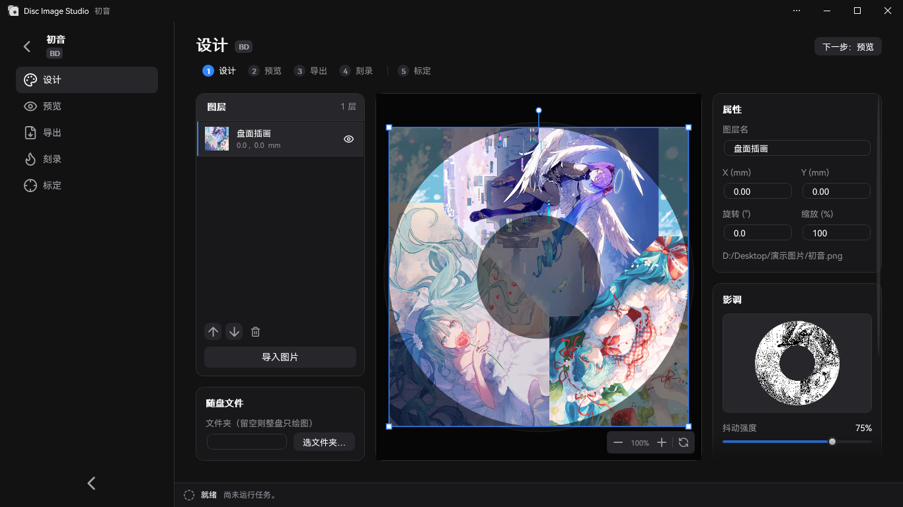
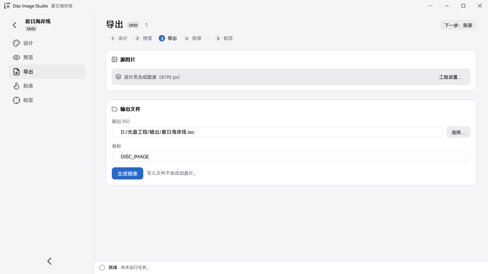

<div align="center">

[简体中文](README.md) | [繁體中文](README.zh-TW.md) | **English** | [日本語](README.ja.md) | [Türkçe](README.tr.md) | [Español](README.es.md) | [Čeština](README.cs.md)


<h2>An all-in-one tool for generating and burning visible images onto optical discs</h2>

Disc Image Studio is a multi-platform disc-surface image generation and burning tool that helps you etch images visible to the naked eye onto any DVD / CD / single-layer Blu-ray disc with any recorder.


[](LICENSE)

</div>

---

## Results


---

## Overview

Disc Image Studio converts an image into data that meets the physical-layer constraints of CD, DVD, and single-layer BD-R discs. After burning, the disc surface displays a pattern visible to the naked eye.

## Interface Preview






---

## Quick Start

On Windows x64, download and run the file ending in `win-x64.exe`; on Windows 11 ARM64, choose the native `win-arm64.exe` build. On Linux or macOS, download the **experimental CLI** archive for your CPU, extract it and run `./disc-image-studio --help`. Each release package includes the .NET runtime. [GitHub Releases](https://github.com/JiaFeiMiao-K-Cat/DiscImageStudio/releases)

### 1. Create a Project

Choose CD, DVD, or Blu-ray on the home page, specify an output location, and create the project.

### 2. Design the Disc Surface

Click **Import images** on the Design page, or drag one or multiple images from Explorer onto the page. Arrange them using layers, and adjust dithering, gamma, brightness, and grayscale levels in the **Tone** panel on the right.

### 3. Preview and Export

Check the disc projection on the Preview page, then generate an ISO / RAW / WAV+CUE on the Export page, or use live burning to write directly to a blank disc.

Live burning is experimental. Use only expendable test media.

## Features

### Disc Data Generation

- **CD support**: Supports any CD. Export WAV audio tracks with format headers and accompanying CUE files, compatible with burning software such as cdrecord and ImgBurn; RAW audio track export is also available. See [CD burning compatibility](docs/CD_AUDIO_COMPATIBILITY.md).
- **DVD support**: Supports any DVD. Export ISO images.
- **Blu-ray support**: Supports any single-layer 25 GB BD-R, with drawing-only mode and UDF 2.01 files. See [ADDING_BLURAY.md](docs/ADDING_BLURAY.md).
- **Files on disc**: For CD, DVD, and Blu-ray, select a folder and place its files on the inner or outer ring directly from the Design page, or adjust these options on the Export page. The settings are saved with the project.
- **File region preview**: Hybrid-disc design projections and artifact readback highlight the file region, including the file system, in blue.
- **Media grayscale schemes**: CD and DVD both use two black-and-white levels: `0D / AA` for CD and `A5 / 92` in the DVD scrambled domain. See [PHYSICAL_MODEL_AUDIT.md](docs/PHYSICAL_MODEL_AUDIT.md).
- **Grayscale dithering tool**: A standalone program can also process a source image into a two-level `0/255` black-and-white PNG. It supports opening or dragging in source images, side-by-side previews, and lossless PNG export. See the [usage and build instructions](tools/FourLevelDither/README.md).
- **Disc presets**: Built-in disc parameters cover several brands of CD, DVD, and BD. You can also contribute your own calibrated data; see [preset maintenance](docs/DISC_PRESETS.md).

### Assisted Calibration

Disc Image Studio provides an intelligent, precise assisted calibration workflow. Compared with manual visual calibration, the assisted calibration algorithm improves the precision of determinable disc-surface physical parameters from 10<sup>-6</sup> to 10<sup>-14</sup>. Before calibration, constant track pitch produces noticeably curved radial crosshair lines. After regenerating and burning with the cubic track-pitch parameters obtained through assisted calibration, the lines are closer to straight radial lines.

| Before calibration · Constant track pitch | After calibration · Cubic track pitch |
| --- | --- |
|  |  |
| `P20261004-133519.jpg` | `P20261004-135416.jpg` |


See the [assisted calibration guide](docs/CALIBRATION.md) for the workflow and parameters.

### Burning

- **Disc image output**: Export complete ISO / RAW files and burn them manually with suitable burning software.
- **Live streaming burn (experimental)**: Generate and burn CD, DVD, and BD-R data simultaneously without saving a complete disc image. BD-R uses MMC sequential writing.
- **Do not use non-blank media!**

## System and Hardware Requirements

- The x64 desktop app requires Windows 10 2004 (2004/20H1, 19041) or later, or Windows 11. The ARM64 app requires Windows 11. Native ARM64 CI covers software self-tests and GUI snapshots; physical disc burning on ARM64 remains unverified.
- Building: .NET 10 SDK (`global.json` pins 10.0.x). A non-self-contained GUI built from source requires the .NET 10 Windows Desktop Runtime. The Release EXE includes the runtime, so a separate .NET installation is unnecessary.
- Live burning requires a CD / DVD / BD recorder recognized by Windows and blank media. BD-R requires a blank single-layer disc that supports sequential writing.

## Build and Run

```powershell
dotnet build DiscImageStudio.slnx --configuration Release
dotnet run --project src/DiscImageStudio.App --configuration Release
```

Build regression checks:

```powershell
dotnet run --project src/DvdImageSolver --configuration Release -- selftest
dotnet run --project tests/DiscImageStudio.ArchitectureTests --configuration Release
```

See the [release guide](docs/RELEASING.md) for versioning rules, CI-generated EXEs, release draft checks, MSIX packaging, and signing procedures.

## Command Line

For Linux with glibc, select `linux-x64` or `linux-arm64`. For macOS, select `osx-arm64` for Apple Silicon or `osx-x64` for Intel. The CLI writes image files and audio tracks that you can burn with a compatible tool.

Run the CLI from source with the .NET 10 SDK

```sh
dotnet run --project src/DiscImageStudio.Cli -c Release -- --help
```

The CLI reads PNG, JPEG, BMP and GIF, using the first frame of animated images. To check your installation, generate a two-sector audio track and its matching CUE sheet.

```sh
./disc-image-studio cd-generate --input picture.png --output sample.wav --sectors 2
```

| Command | Description |
| --- | --- |
| `solve` | Generate a DVD image using fixed fast texture mapping (CW direction), with optional dithering to mix black and white textures |
| `encode` | Encode a single DVD ECC block into NRZI channel levels |
| `calibrate` | Calibration projection: sample the DVD source image using the generation geometry and project it onto the disc using the measured geometry |
| `simulate` | Simulate readback of a generated DVD ISO using measured radii |
| `selftest` | Run deterministic regression self-tests for the DVD engine |
| `cd-generate` | Generate WAV + CUE / RAW audio tracks when no files are included on the disc; generate a CD data disc ISO when `--data-dir` is specified |
| `cd-preview-warp` | Calibration projection: project the CD source image using measured geometry |
| `cd-preview-track` | Render an existing WAV or RAW CD-DA audio track using calibrated geometry (readback simulation) |
| `bd-generate` | Generate a complete BD-R ISO and write an `<iso>.json` sidecar |
| `bd-info` / `bd-probe` / `bd-encode` | Export BD parameters, raw payload probes, or diagnostics for a single ECC cluster |

See the corresponding documentation for each command’s complete parameters.

## Source Layout

```text
src/DiscImageStudio.Cli/     Offline Linux and macOS command-line host
src/DiscImageStudio.ImageIO/ WIC and cross-platform image codecs
src/DiscImageStudio.Core/    Media-independent module contracts, project/preset models, job and command catalog
src/DiscImageStudio.Imaging/ Image preprocessing and dithering helpers shared by CD/DVD/BD
src/DiscImageStudio.Burning/ Windows IMAPI2 device enumeration, stream buffering, and safe burning layer
src/DiscImageStudio.Cd/      CD-DA generation core and CD module
src/DiscImageStudio.Dvd/     DVD engine adapter module
src/DiscImageStudio.BluRay/  BD-R geometry, 17PP/ECC, 3T/6T mapping, streaming generation, and ISO
src/DiscImageStudio.Iso/     UDF 2.01 / ISO9660 writers
src/DiscImageStudio.App/     WPF GUI, unified command line, and Store assets
src/DvdImageSolver/          Isolated DVD encoding/solving engine
tests/                       Architecture regression tests without a third-party test framework
packaging/                   MSIX manifest and packaging scripts
tools/                       Standalone utilities and asset generation scripts
docs/                        Architecture, engine, preset, release, and other documentation
```

## Documentation

| Document | Contents |
| --- | --- |
| [ARCHITECTURE.md](docs/ARCHITECTURE.md) | Module abstractions, boundaries between layers, and extension rules |
| [LOCALIZATION.md](docs/LOCALIZATION.md) | Language settings and translation resource maintenance |
| [DVD_ENGINE.md](docs/DVD_ENGINE.md) | DVD NRZI image constraint solver conventions, encoding chain, and self-test coverage |
| [CD_AUDIO_COMPATIBILITY.md](docs/CD_AUDIO_COMPATIBILITY.md) | CD audio track formats, byte order, and ghosting troubleshooting |
| [ADDING_BLURAY.md](docs/ADDING_BLURAY.md) | Blu-ray module physical model, generation/burning pipeline, and extension points |
| [DISC_PRESETS.md](docs/DISC_PRESETS.md) | Layered JSON format and merging rules for editable disc presets |
| [CALIBRATION.md](docs/CALIBRATION.md) | Photo rectification (marking the disc’s outermost physical edge and center-hole edge), curve calibration, and DVD cubic track-pitch fitting |
| [PHYSICAL_MODEL_AUDIT.md](docs/PHYSICAL_MODEL_AUDIT.md) | Review of the CD / DVD generation physical models |
| [VALIDATION.md](docs/VALIDATION.md) | Local validation records for builds, regressions, and physical disc tests |
| [RELEASING.md](docs/RELEASING.md) | GitHub Releases, MSIX packaging, signing tests, and Store submission procedures |
| [CHANGELOG.md](CHANGELOG.md) | Version change history |

## Reference Standards

Disc Image Studio’s implementation and physical models primarily reference the following specifications:

| Media | Standard and edition | Scope used by this project |
| --- | --- | --- |
| CD-R | [ECMA-394, 1st edition, December 2010](https://ecma-international.org/publications-and-standards/standards/ecma-394/) — *Recordable Compact Disc Systems CD-R Multi-Speed* ([official PDF](https://ecma-international.org/wp-content/uploads/ECMA-394_1st_edition_december_2010.pdf)) | CD-R media, multi-speed recording, and CD-DA compatibility; this project generates CD-DA audio tracks. |
| DVD common format / DVD-ROM | [ECMA-267, 3rd edition, April 2001](https://ecma-international.org/publications-and-standards/standards/ecma-267/) — *120 mm DVD – Read-only disk* ([official PDF](https://ecma-international.org/wp-content/uploads/ECMA-267_3rd_edition_april_2001.pdf)) | DVD data frames, ECC, EFMPlus encoding, and the Annex G conversion tables; ECMA-359 is also referenced for recordable-media rules. |
| DVD-R | [ECMA-359, 1st edition, December 2004](https://ecma-international.org/publications-and-standards/standards/ecma-359/) — *80 mm (1,46 Gbytes per side) and 120 mm (4,70 Gbytes per side) DVD Recordable Disk (DVD-R)* ([official PDF](https://ecma-international.org/wp-content/uploads/ECMA-359_1st_edition_december_2004.pdf)) | Single-layer DVD-R geometry, sectors, error correction, and encoding; the standard covers single-sided and double-sided media. Double-sided does not mean dual-layer. |
| BD-R | [ISO/IEC 30190:2021, 3rd edition, January 2021](https://www.iso.org/standard/80770.html) — Specification for information interchange and storage on 120 mm single-layer (25.0 GB) and dual-layer (50.0 GB) recordable BD | The experimental mode uses the track and sector layout, error correction, and encoding for single-layer 25 GB discs. Dual-layer discs are not currently supported. |

The common CD encoding components also reference [ECMA-130, 2nd edition (CD-ROM, 1996)](https://ecma-international.org/publications-and-standards/standards/ecma-130/).

## Burning and Media Safety

- Disc Image Studio does not install drivers or services. Live burning uses Windows’ built-in IMAPI2 and rejects non-blank media.
- Live burning has received some feedback from physical disc tests, but validation coverage across different devices, media, and burning paths remains limited. It is experimental; use only expendable test media. Interrupted burning, power loss, or insufficient generation speed may still render a disc unusable!
- The actual visible result depends on the disc, recorder, firmware, and write strategy.
- For hybrid discs, the source folder is scanned and its layout is fixed before burning starts. If a source file’s size changes during the operation, the job is safely terminated; a disc that has already started writing may still become unusable.
- BD-R sequential writing does not provide spare-area remapping. After an interruption, writing to the same disc generally cannot continue.

## Privacy and Security

- Disc Image Studio does not access the network, upload files, or collect telemetry. See the [privacy policy](PRIVACY.md).
- Do not disclose security issues in public issues. Follow the [security policy](SECURITY.md) and use GitHub’s private reporting feature.

## Contributing

Issue reports and code contributions are welcome. See the [contributing guide](CONTRIBUTING.md) for development environment setup, module boundary rules, testing requirements, and the pull request process.

## License

This project is licensed under [GNU GPL v3.0 or later](LICENSE) (`GPL-3.0-or-later`). The CD interleaving implementation includes code ported and modified from CDImage, and the project as a whole is distributed under a compatible GPL license. Distributing binaries or modified versions requires compliance with the corresponding-source and other applicable requirements. Third-party fonts and components retain their own licenses; see the [license notice](LICENSE-NOTICE.md) and [third-party notices](THIRD-PARTY-NOTICES.txt). The full texts are also available offline on the app’s About page.

## Acknowledgments

Thanks to [arduinocelentano’s CDImage project](https://github.com/arduinocelentano/cdimage), which demonstrated how to create visible images on a disc surface by generating CD audio tracks. This project’s CD interleaving implementation was ported from its related code and further modified, and the approach to drawing on CD surfaces was also inspired by it. The work of CDImage’s original author and contributors provides an important foundation for this project.

---

## Star History

<a href="https://www.star-history.com/?repos=jiafeimiao-k-cat%2Fdiscimagestudio&type=date&legend=top-left">
 <picture>
   <source media="(prefers-color-scheme: dark)" srcset="https://api.star-history.com/chart?repos=jiafeimiao-k-cat/discimagestudio&type=date&theme=dark&legend=top-left" />
   <source media="(prefers-color-scheme: light)" srcset="https://api.star-history.com/chart?repos=jiafeimiao-k-cat/discimagestudio&type=date&legend=top-left" />
   
 </picture>
</a>
