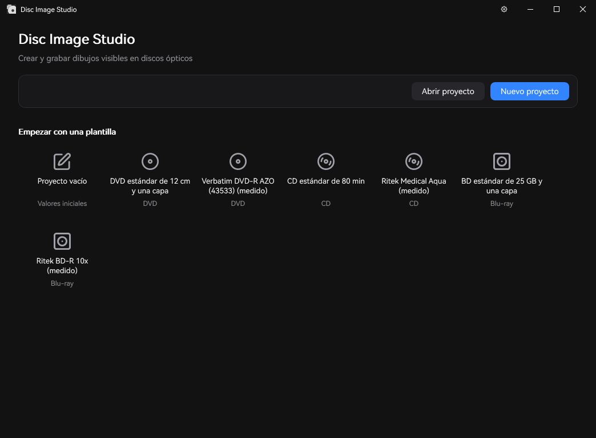
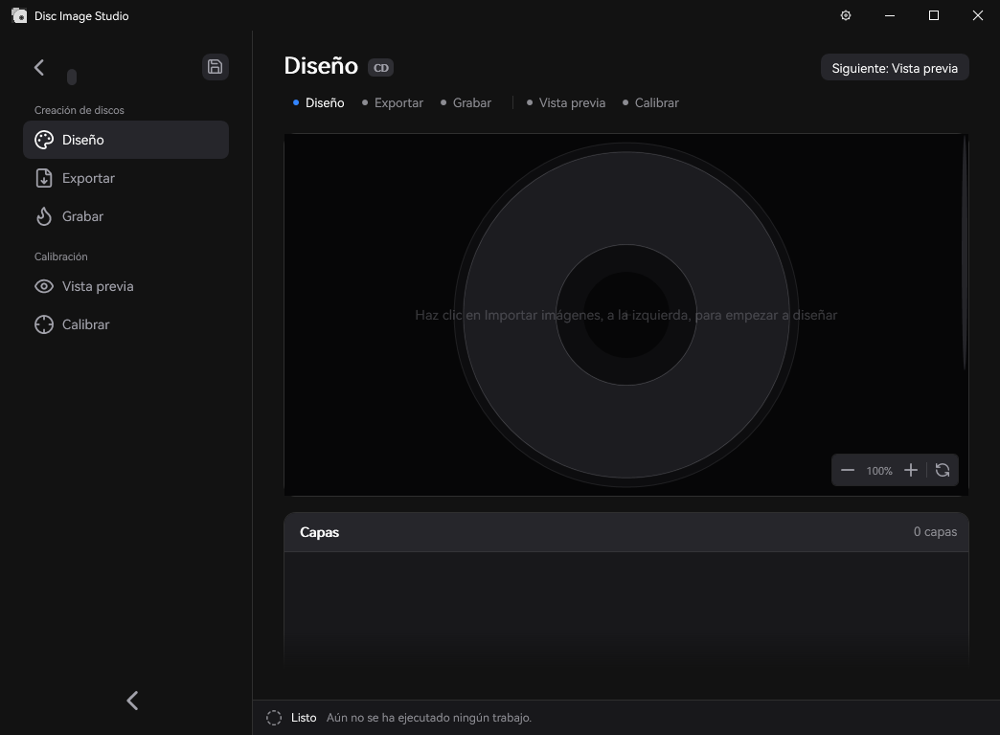
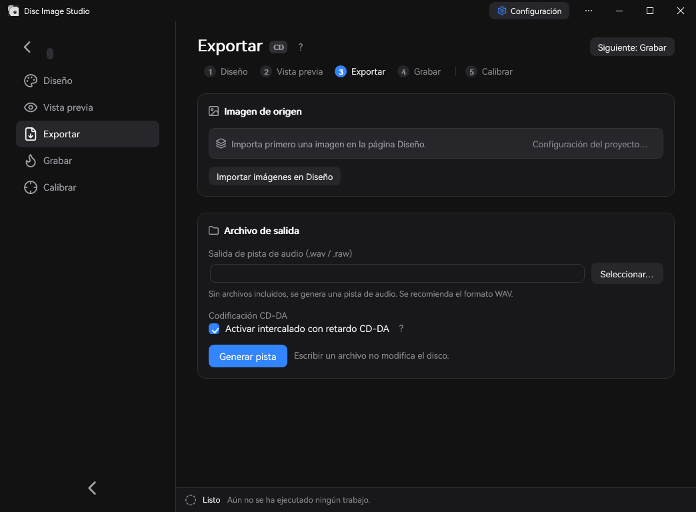

<div align="center">

[简体中文](README.md) | [繁體中文](README.zh-TW.md) | [English](README.en.md) | [日本語](README.ja.md) | [Türkçe](README.tr.md) | **Español** | [Čeština](README.cs.md)


<h2>Una herramienta integral para generar y grabar imágenes visibles en discos ópticos</h2>

Disc Image Studio es una herramienta multiplataforma de generación y grabación de imágenes en la superficie de discos que te ayuda a grabar imágenes visibles a simple vista en cualquier DVD / CD / disco Blu-ray de una capa con cualquier grabadora.


[](LICENSE)

</div>

> Traducción al español · [Original](README.en.md). Las capturas muestran la aplicación Windows con Español seleccionado, renderizada con `ui-snapshot`. La documentación detallada se mantiene en sus idiomas originales.

---

<a id="results"></a>
<a id="效果预览"></a>
## Resultados


---

<a id="overview"></a>
<a id="概述"></a>
## Descripción general

Disc Image Studio convierte una imagen en datos que cumplen las restricciones de la capa física de CD, DVD y BD-R de una capa. Tras grabarlos, la superficie del disco muestra un dibujo visible a simple vista.

<a id="interface-preview"></a>
<a id="界面预览"></a>
## Vista de la interfaz







---

<a id="quick-start"></a>
<a id="快速开始"></a>
## Inicio rápido

En Windows x64, descarga y ejecuta el archivo terminado en `win-x64.exe`; en Windows 11 ARM64, elige la versión nativa terminada en `win-arm64.exe`. En Linux o macOS, descarga el archivo de la **CLI experimental** correspondiente a tu CPU, extráelo y ejecuta `./disc-image-studio --help`. Cada paquete publicado incluye el entorno de ejecución de .NET. [Versiones de GitHub](https://github.com/JiaFeiMiao-K-Cat/DiscImageStudio/releases)

<a id="1-create-a-project"></a>
<a id="1-新建工程"></a>
### 1. Crear un proyecto

Elige CD, DVD o Blu-ray en la página de inicio, indica una ubicación de salida y crea el proyecto.

<a id="2-design-the-disc-surface"></a>
<a id="2-设计盘面"></a>
### 2. Diseñar la superficie del disco

Importa una imagen en Diseño, organízala mediante capas y ajusta el tramado, gamma, brillo y niveles de gris en el panel **Tono** de la derecha.

<a id="3-preview-and-export"></a>
<a id="3-预览与导出"></a>
### 3. Ver y exportar

Comprueba la proyección sobre el disco en Vista previa. Después genera una ISO / RAW / WAV+CUE en Exportar, o usa la grabación en directo para escribir directamente en un disco virgen.

La grabación en directo es experimental. Usa únicamente discos de prueba que puedas permitirte perder.

<a id="features"></a>
<a id="功能"></a>
## Funciones

<a id="disc-data-generation"></a>
<a id="光盘数据生成"></a>
### Generación de datos de disco

- **Compatibilidad CD**: admite cualquier CD. Exporta pistas de audio WAV con cabeceras de formato y archivos CUE asociados, compatibles con programas de grabación como cdrecord e ImgBurn; también permite exportar pistas de audio RAW. Consulta la [compatibilidad de grabación CD](docs/CD_AUDIO_COMPATIBILITY.md).
- **Compatibilidad DVD**: admite cualquier DVD. Exporta imágenes ISO.
- **Compatibilidad Blu-ray**: admite cualquier BD-R de 25 GB y una capa, con modo de sólo dibujo y archivos UDF 2.01. Consulta [ADDING_BLURAY.md](docs/ADDING_BLURAY.md).
- **Archivos en el disco**: para CD, DVD y Blu-ray, selecciona una carpeta y coloca sus archivos en la zona interior o exterior desde Diseño, o ajusta estas opciones en Exportar. Los ajustes se guardan con el proyecto.
- **Vista previa de la zona de archivos**: las proyecciones del diseño de discos híbridos y la relectura del archivo generado resaltan en azul la zona de archivos, incluido el sistema de archivos.
- **Esquemas de gris según el medio**: CD y DVD usan dos niveles de blanco y negro: `0D / AA` para CD y `A5 / 92` en el dominio aleatorizado de DVD. Consulta [PHYSICAL_MODEL_AUDIT.md](docs/PHYSICAL_MODEL_AUDIT.md).
- **Herramienta de tramado en escala de grises**: un programa independiente también puede convertir una imagen de origen en un PNG en blanco y negro de dos niveles `0/255`. Permite abrir o arrastrar imágenes de origen, compararlas en vistas paralelas y exportar PNG sin pérdida. Consulta las [instrucciones de uso y compilación](tools/FourLevelDither/README.md).
- **Preajustes de discos**: los parámetros integrados abarcan varias marcas de CD, DVD y BD. También puedes aportar tus propios datos calibrados; consulta el [mantenimiento de preajustes](docs/DISC_PRESETS.md).

<a id="assisted-calibration"></a>
<a id="辅助标定"></a>
### Calibración asistida

Disc Image Studio ofrece un flujo de calibración asistida inteligente y preciso. Frente a la calibración visual manual, su algoritmo mejora la precisión de los parámetros físicos determinables de la superficie del disco de 10<sup>-6</sup> a 10<sup>-14</sup>. Antes de calibrar, el paso de pista constante produce líneas radiales de referencia visiblemente curvas. Después de regenerar y grabar con los parámetros de paso de pista cúbico obtenidos mediante la calibración asistida, las líneas se aproximan más a rectas radiales.

| Antes de calibrar · Paso de pista constante | Después de calibrar · Paso de pista cúbico |
| --- | --- |
|  |  |
| `P20261004-133519.jpg` | `P20261004-135416.jpg` |

Consulta la [guía de calibración asistida](docs/CALIBRATION.md) para conocer el procedimiento y los parámetros.

<a id="burning"></a>
<a id="刻录"></a>
### Grabación

- **Salida de imágenes de disco**: exporta archivos ISO / RAW completos y grábalos manualmente con un programa adecuado.
- **Grabación en streaming (experimental)**: genera y graba datos CD, DVD y BD-R a la vez, sin guardar una imagen de disco completa. BD-R usa escritura secuencial MMC.
- **¡No uses discos que ya contengan datos!**

<a id="system-and-hardware-requirements"></a>
<a id="系统与设备要求"></a>
## Requisitos del sistema y del hardware

- La app de escritorio x64 requiere Windows 10 2004 (2004/20H1, 19041) o posterior, o Windows 11. La versión ARM64 requiere Windows 11. La CI nativa de ARM64 incluye autopruebas de software y capturas de la GUI; la grabación de discos físicos aún no está verificada.
- Compilación: SDK .NET 10 (`global.json` fija 10.0.x). Una GUI compilada desde el código fuente sin entorno de ejecución incluido requiere .NET 10 Windows Desktop Runtime. El EXE publicado incluye el entorno de ejecución, por lo que no necesitas instalar .NET por separado.
- La grabación en directo requiere una grabadora CD / DVD / BD reconocida por Windows y un disco virgen. BD-R requiere un disco virgen de una capa que admita escritura secuencial.

<a id="build-and-run"></a>
<a id="构建与运行"></a>
## Compilar y ejecutar

```powershell
dotnet build DiscImageStudio.slnx --configuration Release
dotnet run --project src/DiscImageStudio.App --configuration Release
```

Pruebas de regresión:

```powershell
dotnet run --project src/DvdImageSolver --configuration Release -- selftest
dotnet run --project tests/DiscImageStudio.ArchitectureTests --configuration Release
```

Consulta la [guía de publicación](docs/RELEASING.md) para conocer las reglas de versiones, los EXE generados por CI, la revisión de borradores de versiones, el empaquetado MSIX y la firma.

<a id="command-line"></a>
<a id="命令行"></a>
## Línea de comandos

Para Linux con glibc, elige `linux-x64` o `linux-arm64`. Para macOS, elige `osx-arm64` para Apple Silicon u `osx-x64` para Intel. La CLI escribe imágenes de disco y pistas de audio que puedes grabar con una herramienta compatible.

Ejecutar la CLI desde el código fuente con el SDK .NET 10:

```sh
dotnet run --project src/DiscImageStudio.Cli -c Release -- --help
```

La CLI lee PNG, JPEG, BMP y GIF; usa el primer fotograma de las imágenes animadas. Para comprobar la instalación, genera una pista de audio de dos sectores y su archivo CUE asociado.

```sh
./disc-image-studio cd-generate --input picture.png --output sample.wav --sectors 2
```

| Comando | Descripción |
| --- | --- |
| `solve` | Genera una imagen DVD mediante correspondencia rápida de texturas fija (sentido CW), con tramado opcional para mezclar texturas blancas y negras |
| `encode` | Codifica un bloque ECC DVD en niveles de canal NRZI |
| `calibrate` | Proyección de calibración: muestrea la imagen DVD de origen con la geometría de generación y la proyecta sobre el disco con la geometría medida |
| `simulate` | Simula la relectura de una ISO DVD generada con radios medidos |
| `selftest` | Ejecuta las autopruebas deterministas de regresión del motor DVD |
| `cd-generate` | Genera pistas de audio WAV + CUE / RAW cuando no se incluyen archivos en el disco; genera una ISO de disco de datos CD cuando se indica `--data-dir` |
| `cd-preview-warp` | Proyección de calibración: proyecta la imagen CD de origen con la geometría medida |
| `cd-preview-track` | Renderiza una pista de audio CD-DA WAV o RAW existente con la geometría calibrada (simulación de relectura) |
| `bd-generate` | Genera una ISO BD-R completa y escribe un archivo auxiliar `<iso>.json` |
| `bd-info` / `bd-probe` / `bd-encode` | Exporta parámetros BD, sondas de datos útiles sin procesar o diagnósticos de un clúster ECC |

Consulta los parámetros completos de cada comando en su documentación.

<a id="source-layout"></a>
<a id="源码结构"></a>
## Organización del código fuente

```text
src/DiscImageStudio.Cli/     Host de línea de comandos sin conexión para Linux y macOS
src/DiscImageStudio.ImageIO/ Códecs de imagen WIC y multiplataforma
src/DiscImageStudio.Core/    Contratos independientes del medio, modelos de proyectos/preajustes, catálogo de trabajos y comandos
src/DiscImageStudio.Imaging/ Preprocesado de imagen y tramado compartidos por CD/DVD/BD
src/DiscImageStudio.Burning/ Enumeración de dispositivos Windows IMAPI2, búfer de streaming y capa de grabación segura
src/DiscImageStudio.Cd/      Núcleo de generación CD-DA y módulo CD
src/DiscImageStudio.Dvd/     Módulo adaptador del motor DVD
src/DiscImageStudio.BluRay/  Geometría BD-R, 17PP/ECC, correspondencia 3T/6T, generación en streaming e ISO
src/DiscImageStudio.Iso/     Escritores UDF 2.01 / ISO9660
src/DiscImageStudio.App/     GUI WPF, línea de comandos unificada y recursos de Store
src/DvdImageSolver/          Motor aislado de codificación/resolución DVD
tests/                       Regresiones de arquitectura sin framework de pruebas externo
packaging/                   Manifiesto MSIX y scripts de empaquetado
tools/                       Utilidades independientes y scripts para generar recursos
docs/                        Documentación de arquitectura, motores, preajustes y publicación
```

<a id="documentation"></a>
<a id="文档"></a>
## Documentación

| Documento | Contenido |
| --- | --- |
| [ARCHITECTURE.md](docs/ARCHITECTURE.md) | Abstracciones de módulos, límites entre capas y reglas de extensión |
| [LOCALIZATION.md](docs/LOCALIZATION.md) | Configuración del idioma y mantenimiento de traducciones |
| [DVD_ENGINE.md](docs/DVD_ENGINE.md) | Convenciones del solucionador de restricciones de imagen NRZI DVD, cadena de codificación y cobertura de autopruebas |
| [CD_AUDIO_COMPATIBILITY.md](docs/CD_AUDIO_COMPATIBILITY.md) | Formatos de pistas CD, orden de bytes y diagnóstico de imágenes fantasma |
| [ADDING_BLURAY.md](docs/ADDING_BLURAY.md) | Modelo físico del módulo Blu-ray, generación/grabación y puntos de extensión |
| [DISC_PRESETS.md](docs/DISC_PRESETS.md) | Formato JSON por capas y reglas de combinación de preajustes editables |
| [CALIBRATION.md](docs/CALIBRATION.md) | Rectificación de fotos (borde exterior físico y borde del orificio central), calibración de curvas y ajuste de paso de pista DVD cúbico |
| [PHYSICAL_MODEL_AUDIT.md](docs/PHYSICAL_MODEL_AUDIT.md) | Revisión de los modelos físicos de generación CD / DVD |
| [VALIDATION.md](docs/VALIDATION.md) | Registros locales de compilación, regresiones y pruebas con discos físicos |
| [RELEASING.md](docs/RELEASING.md) | Versiones de GitHub, empaquetado MSIX, pruebas de firma y envío a Store |
| [CHANGELOG.md](CHANGELOG.md) | Historial de cambios |

<a id="reference-standards"></a>
<a id="参考标准"></a>
## Normas de referencia

La implementación y los modelos físicos de Disc Image Studio se basan principalmente en estas especificaciones:

| Medio | Norma y edición | Ámbito usado por este proyecto |
| --- | --- | --- |
| CD-R | [ECMA-394, 1.ª edición, diciembre de 2010](https://ecma-international.org/publications-and-standards/standards/ecma-394/) — *Recordable Compact Disc Systems CD-R Multi-Speed* ([PDF oficial](https://ecma-international.org/wp-content/uploads/ECMA-394_1st_edition_december_2010.pdf)) | Medios CD-R, grabación multivelocidad y compatibilidad CD-DA; este proyecto genera pistas de audio CD-DA. |
| Formato DVD común / DVD-ROM | [ECMA-267, 3.ª edición, abril de 2001](https://ecma-international.org/publications-and-standards/standards/ecma-267/) — *120 mm DVD – Read-only disk* ([PDF oficial](https://ecma-international.org/wp-content/uploads/ECMA-267_3rd_edition_april_2001.pdf)) | Tramas de datos DVD, ECC, codificación EFMPlus y tablas de conversión del Anexo G; también se consulta ECMA-359 para las reglas de los discos grabables. |
| DVD-R | [ECMA-359, 1.ª edición, diciembre de 2004](https://ecma-international.org/publications-and-standards/standards/ecma-359/) — *80 mm (1,46 Gbytes per side) and 120 mm (4,70 Gbytes per side) DVD Recordable Disk (DVD-R)* ([PDF oficial](https://ecma-international.org/wp-content/uploads/ECMA-359_1st_edition_december_2004.pdf)) | Geometría, sectores, corrección de errores y codificación DVD-R de una capa; la norma cubre discos de una y dos caras. Dos caras no significa doble capa. |
| BD-R | [ISO/IEC 30190:2021, 3.ª edición, enero de 2021](https://www.iso.org/standard/80770.html) — Especificación para intercambio y almacenamiento de información en BD grabables de 120 mm de una capa (25,0 GB) y doble capa (50,0 GB) | El modo experimental usa la distribución de pistas y sectores, la corrección de errores y la codificación de discos de 25 GB y una capa. Actualmente no admite doble capa. |

Los componentes comunes de codificación CD también toman como referencia [ECMA-130, 2.ª edición (CD-ROM, 1996)](https://ecma-international.org/publications-and-standards/standards/ecma-130/).

<a id="burning-and-media-safety"></a>
<a id="刻录与介质安全须知"></a>
## Seguridad de grabación y de los discos

- Disc Image Studio no instala controladores ni servicios. La grabación en directo usa IMAPI2 integrado en Windows y rechaza discos no vírgenes.
- Se han recibido algunos resultados de pruebas de grabación en directo con discos físicos, pero la cobertura de dispositivos, medios y rutas de grabación sigue siendo limitada. Es experimental; usa únicamente discos de prueba prescindibles. ¡Interrumpir la grabación, perder la alimentación o generar datos demasiado despacio puede inutilizar el disco!
- El resultado visible real depende del disco, la grabadora, su firmware y la estrategia de escritura.
- En discos híbridos, la carpeta de origen se examina y su distribución se fija antes de grabar. Si cambia el tamaño de un archivo de origen durante la operación, el trabajo se detiene de forma segura; aun así, un disco cuya escritura haya empezado puede quedar inutilizable.
- La escritura secuencial BD-R no ofrece reasignación a una zona de reserva. Tras una interrupción, normalmente no se puede continuar grabando en el mismo disco.

<a id="privacy-and-security"></a>
<a id="隐私与安全"></a>
## Privacidad y seguridad

- Disc Image Studio no accede a la red, sube archivos ni recoge telemetría. Consulta la [política de privacidad](PRIVACY.md).
- No reveles vulnerabilidades en incidencias públicas. Sigue la [política de seguridad](SECURITY.md) y usa los informes privados de GitHub.

<a id="contributing"></a>
<a id="贡献"></a>
## Contribuir

Los informes de problemas y las aportaciones de código son bienvenidos. Consulta la [guía de contribución](CONTRIBUTING.md) para configurar el entorno, conocer los límites entre módulos, los requisitos de pruebas y el proceso de pull requests.

<a id="license"></a>
<a id="许可证"></a>
## Licencia

Este proyecto se distribuye bajo [GNU GPL v3.0 o posterior](LICENSE) (`GPL-3.0-or-later`). La implementación de intercalado CD incluye código portado y modificado de CDImage, y el proyecto completo se distribuye con una licencia GPL compatible. La distribución de binarios o versiones modificadas exige cumplir los requisitos relativos al código fuente correspondiente y los demás requisitos aplicables. Las fuentes y componentes de terceros conservan sus propias licencias; consulta el [aviso de licencia](LICENSE-NOTICE.md) y los [avisos de terceros](THIRD-PARTY-NOTICES.txt). Los textos completos también están disponibles sin conexión en Acerca de, dentro de la app.

<a id="acknowledgments"></a>
<a id="致谢"></a>
## Agradecimientos

Gracias al [proyecto CDImage de arduinocelentano](https://github.com/arduinocelentano/cdimage), que mostró cómo crear imágenes visibles sobre discos generando pistas de audio CD. La implementación de intercalado CD de este proyecto se portó de su código y se modificó después; también inspiró el enfoque del dibujo sobre superficies CD. El trabajo de su autor original y sus colaboradores constituye una base importante para este proyecto.

---

<a id="star-history"></a>
## Historial de estrellas

<a href="https://www.star-history.com/?repos=jiafeimiao-k-cat%2Fdiscimagestudio&type=date&legend=top-left">
 <picture>
   <source media="(prefers-color-scheme: dark)" srcset="https://api.star-history.com/chart?repos=jiafeimiao-k-cat/discimagestudio&type=date&theme=dark&legend=top-left" />
   <source media="(prefers-color-scheme: light)" srcset="https://api.star-history.com/chart?repos=jiafeimiao-k-cat/discimagestudio&type=date&legend=top-left" />
   
 </picture>
</a>
