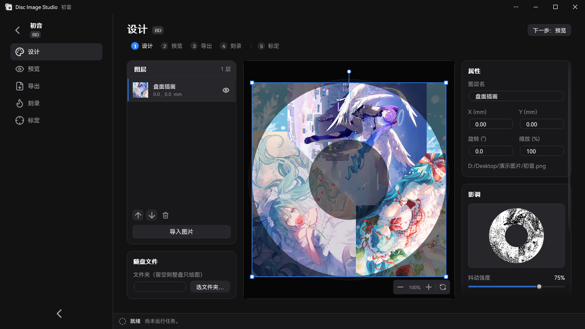
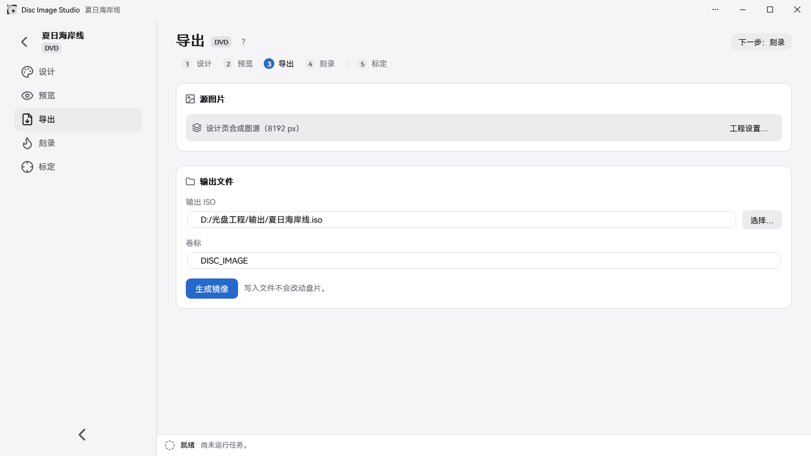

<div align="center">


<h2>光ディスクのレーベル面に可視画像を生成・書き込みできるオールインワンツール</h2>

Disc Image Studio は、Windows で動作する光ディスクのレーベル面画像の生成・書き込みツールです。**どんな**書き込みドライブでも、**どんな** DVD / CD / Blu-ray ディスクにも、肉眼で見える画像を焼き付けられます。


[](LICENSE)

</div>

---

## 仕上がりの例


---

## 概要

Disc Image Studio は、1 枚の画像を CD、DVD、片面一層 BD-R の物理層の制約に適合したデータに変換します。書き込み後、ディスクの記録面に肉眼で見える図柄が浮かび上がります。

## 画面のプレビュー






---

## クイックスタート

[GitHub Releases](https://github.com/JiaFeiMiao-K-Cat/DiscImageStudio/releases) から Release EXE をダウンロードし、展開してそのまま実行してください。EXE には .NET ランタイムが含まれています。

### 1. プロジェクトの新規作成

ホーム画面で CD、DVD、Blu-ray のいずれかを選び、出力先を指定してプロジェクトを作成します。

### 2. 記録面のデザイン

デザイン画面で画像を読み込み、レイヤーでレイアウトを整えます。右側の「影調」モジュールで、ディザリング、ガンマ、明るさ、階調レベルを調整します。

### 3. プレビューとエクスポート

プレビュー画面で記録面への投影を確認し、エクスポート画面で ISO / RAW / WAV+CUE を生成します。または、即時書き込み機能を使って空のディスクに直接書き込みます。

即時書き込みは実験的な機能です。廃棄しても構わないテスト用メディアのみを使用してください。

## 機能

### ディスクデータの生成

- **CD 対応**：あらゆる CD に対応しています。フォーマットヘッダー付きの WAV 音声トラックと対応する CUE をエクスポートでき、cdrecord、ImgBurn などの書き込みソフトと互換性があります。RAW 音声トラックのエクスポートも可能です。詳しくは [CD 書き込み互換性ガイド](docs/CD_AUDIO_COMPATIBILITY.md)をご覧ください。
- **DVD 対応**：あらゆる DVD に対応しています。ISO イメージをエクスポートできます。
- **Blu-ray 対応**：あらゆる片面一層 BD-R 25 GB に対応し、絵柄のみの書き込みと UDF 2.01 ファイルの両方をサポートします。詳しくは [ADDING_BLURAY.md](docs/ADDING_BLURAY.md) をご覧ください。
- **同梱ファイル**：CD／DVD／Blu-ray では、デザイン画面で保存したいフォルダーと内周／外周の位置を直接選択できます。エクスポート画面でも調整でき、設定はプロジェクトとともに保存されます。
- **ファイル領域のプレビュー**：ファイルを含む混在ディスクでは、デザインの投影と完成品の読み戻しで、ファイル領域（ファイルシステムを含む）が黄色で表示されます。
- **メディアごとの階調方式**：CD と DVD はいずれも白黒の 2 階調を使用します。CD は `0D / AA`、DVD のスクランブル領域は `A5 / 92` を使用します。詳しくは [PHYSICAL_MODEL_AUDIT.md](docs/PHYSICAL_MODEL_AUDIT.md) をご覧ください。
- **階調ディザリングツール**：独立したプログラムで、元画像を `0/255` の白黒 2 階調 PNG に変換することもできます。元画像を開くかドラッグして読み込み、並べてプレビューし、ロスレス PNG でエクスポートできます。詳しくは[使い方とビルド方法](tools/FourLevelDither/README.md)をご覧ください。
- **ディスクプリセット**：複数ブランドのディスクパラメーターを内蔵しており、CD／DVD／BD をカバーしています。ご自身でキャリブレーションしたデータを提供していただくこともできます。詳しくは[プリセットのメンテナンスガイド](docs/DISC_PRESETS.md)をご覧ください。

### キャリブレーション支援

Disc Image Studio は、スマートで高精度なキャリブレーション支援フローを提供します。人が目視で行うキャリブレーションと比べて、キャリブレーション支援のアルゴリズムは、特定できる記録面の物理データの精度を 10<sup>-6</sup> から 10<sup>-14</sup> にまで高めます。キャリブレーション前はトラックピッチが一定のため、十字線の放射方向の線がはっきりと曲がっています。キャリブレーション支援で得た 3 次のトラックピッチパラメーターで再生成して書き込むと、線は放射方向の直線により近くなります。

| キャリブレーション前 · 一定のトラックピッチ | キャリブレーション後 · 3 次のトラックピッチ |
| --- | --- |
|  |  |
| `P20261004-133519.jpg` | `P20261004-135416.jpg` |


手順とパラメーターの説明は[キャリブレーション支援ガイド](docs/CALIBRATION.md)をご覧ください。

### 書き込み

- **イメージファイルの出力**：完全な ISO / RAW ファイルをエクスポートし、適切な書き込みソフトで手動で書き込めます。
- **即時ストリーミング書き込み（実験的）**：CD、DVD、BD-R で、生成しながら書き込みます。完全なイメージは保存しません。BD-R は MMC のシーケンシャル書き込みを使用します。
- **空でないメディアは使用しないでください！**

### アプリケーションの形態

- 2 つの入口：引数なしで起動すると GUI が開き、引数付きで起動すると統合コマンドラインになります。
- モジュール化：CD、DVD、Blu-ray は `IOpticalDiscModule` を通じて組み込まれ、コマンドカタログとタスク契約が統一されています。詳しくは[アーキテクチャ解説](docs/ARCHITECTURE.md)をご覧ください。

## システムとデバイスの要件

- Windows 10 2004（2004/20H1、19041）以降、または Windows 11。
- ビルド：.NET 10 SDK（`global.json` で 10.0.x に固定）。自分でビルドした非自己完結型の GUI には、.NET 10 Windows デスクトップランタイムが必要です。Release EXE にはランタイムが含まれているため、.NET を別途インストールする必要はありません。
- 「即時書き込み」機能には、Windows が認識できる CD / DVD / BD 書き込みドライブと空のディスクが必要です。BD-R には、シーケンシャル書き込みに対応した片面一層の空ディスクが必要です。

## ビルドと実行

```powershell
dotnet build DiscImageStudio.slnx --configuration Release
dotnet run --project src/DiscImageStudio.App --configuration Release
```

ビルドの回帰チェック：

```powershell
dotnet run --project src/DvdImageSolver --configuration Release -- selftest
dotnet run --project tests/DiscImageStudio.ArchitectureTests --configuration Release
```

バージョン規則、CI による EXE の生成、Release 下書きのチェック、MSIX のパッケージングと署名の手順は、[リリースガイド](docs/RELEASING.md)をご覧ください。

## コマンドライン

統合プログラムは、引数なしでは GUI を開き、引数付きでは自動化ツールとして動作します。

| コマンド | 説明 |
| --- | --- |
| `solve` | 固定の高速テクスチャマッピング（CW 方向）で DVD イメージを生成します。白黒テクスチャにはディザリングの混合を選択できます |
| `encode` | 単一の DVD ECC ブロックを NRZI のチャネルレベルにエンコードします |
| `calibrate` | キャリブレーション投影：生成時のジオメトリで DVD のソース画像からサンプリングし、実測のジオメトリで記録面に投影します |
| `simulate` | 実測の半径に基づき、生成した DVD ISO の読み戻しをシミュレートします |
| `selftest` | DVD エンジンの決定論的な回帰セルフテストを実行します |
| `cd-generate` | 同梱ファイルがない場合は WAV + CUE / RAW 音声トラックを生成し、`--data-dir` を指定した場合は CD データディスクの ISO を生成します |
| `cd-preview-warp` | キャリブレーション投影：実測のジオメトリで CD のソース画像を投影します |
| `cd-preview-track` | キャリブレーション済みのジオメトリで、既存の WAV または RAW の CD-DA 音声トラックをレンダリングします（読み戻しシミュレーション） |
| `bd-generate` | 完全な BD-R ISO を生成し、`<iso>.json` サイドカーを書き出します |
| `bd-info` / `bd-probe` / `bd-encode` | BD のパラメーター、生のペイロードのプローブ、または単一の ECC クラスターの診断をエクスポートします |

各コマンドの完全なパラメーターは、対応するドキュメントをご覧ください。

## ソースコードの構成

```text
src/DiscImageStudio.Core/    介质无关的模块契约、工程/预设模型、任务与命令目录
src/DiscImageStudio.Imaging/ CD/DVD/BD 共用的图片预处理与抖动辅助
src/DiscImageStudio.Burning/ Windows IMAPI2 设备枚举、流缓冲与安全刻录层
src/DiscImageStudio.Cd/      CD-DA 生成核心与 CD 模块
src/DiscImageStudio.Dvd/     DVD 引擎适配模块
src/DiscImageStudio.BluRay/  BD-R 几何、17PP/ECC、3T/6T 映射、流式生成与 ISO
src/DiscImageStudio.Iso/     UDF 2.01 / ISO9660 写入器
src/DiscImageStudio.App/     WPF GUI、统一命令行与商店资源
src/DvdImageSolver/          保持隔离的 DVD 编码/求解引擎
tests/                       无第三方测试框架的架构回归测试
packaging/                   MSIX 清单与打包脚本
tools/                       独立辅助工具与资产生成脚本
docs/                        架构、引擎、预设、发布等文档
```

## ドキュメント

| ドキュメント | 内容 |
| --- | --- |
| [ARCHITECTURE.md](docs/ARCHITECTURE.md) | モジュールの抽象化、層間の境界、拡張のルール |
| [DVD_ENGINE.md](docs/DVD_ENGINE.md) | DVD の NRZI 画像制約ソルバーの規約、エンコードチェーン、セルフテストの範囲 |
| [CD_AUDIO_COMPATIBILITY.md](docs/CD_AUDIO_COMPATIBILITY.md) | CD 音声トラックの形式、バイトオーダー、ゴーストのトラブルシューティング |
| [ADDING_BLURAY.md](docs/ADDING_BLURAY.md) | Blu-ray モジュールの物理モデル、生成／書き込みの流れ、拡張ポイント |
| [DISC_PRESETS.md](docs/DISC_PRESETS.md) | 編集可能なディスクプリセットの階層型 JSON 形式とマージ規則 |
| [CALIBRATION.md](docs/CALIBRATION.md) | 写真の補正（ディスク本体の最外縁と中心穴の縁を枠で選択）、カーブのキャリブレーション、DVD の 3 次トラックピッチのフィッティング |
| [PHYSICAL_MODEL_AUDIT.md](docs/PHYSICAL_MODEL_AUDIT.md) | CD / DVD 生成の物理モデルの再検証 |
| [VALIDATION.md](docs/VALIDATION.md) | 各回のビルド、回帰テスト、実ディスクでのテストのローカル検証記録 |
| [RELEASING.md](docs/RELEASING.md) | GitHub Release、MSIX のパッケージング、署名テスト、ストアへの提出手順 |
| [CHANGELOG.md](CHANGELOG.md) | バージョンの変更履歴 |

## 参照規格

Disc Image Studio の実装と物理モデルは、主に以下の規格を参照しています。

| メディア | 規格とバージョン | 本プロジェクトで採用している範囲 |
| --- | --- | --- |
| CD-R | [ECMA-394、第 1 版、2010 年 12 月](https://ecma-international.org/publications-and-standards/standards/ecma-394/) — *Recordable Compact Disc Systems CD-R Multi-Speed*（[公式 PDF](https://ecma-international.org/wp-content/uploads/ECMA-394_1st_edition_december_2010.pdf)） | CD-R メディア、マルチスピード記録、CD-DA との互換関係。本プロジェクトは CD-DA 音声トラックを生成します。 |
| DVD 共通フォーマット / DVD-ROM | [ECMA-267、第 3 版、2001 年 4 月](https://ecma-international.org/publications-and-standards/standards/ecma-267/) — *120 mm DVD – Read-only disk*（[公式 PDF](https://ecma-international.org/wp-content/uploads/ECMA-267_3rd_edition_april_2001.pdf)） | DVD のデータフレーム、ECC、EFMPlus エンコード、付録 G の変換テーブル。記録型ディスクのメディア規則は別途 ECMA-359 を参照しています。 |
| DVD-R | [ECMA-359、第 1 版、2004 年 12 月](https://ecma-international.org/publications-and-standards/standards/ecma-359/) — *80 mm (1,46 Gbytes per side) and 120 mm (4,70 Gbytes per side) DVD Recordable Disk (DVD-R)*（[公式 PDF](https://ecma-international.org/wp-content/uploads/ECMA-359_1st_edition_december_2004.pdf)） | 片面一層 DVD-R のジオメトリ、セクター、誤り訂正、エンコード。規格には片面と両面のメディアが含まれますが、両面は二層とは異なります。 |
| BD-R | [ISO/IEC 30190:2021、第 3 版、2021 年 1 月](https://www.iso.org/standard/80770.html) — 120 mm 一層（25.0 GB）および二層（50.0 GB）記録型 BD の情報交換と保存に関する規格 | 実験モードでは、一層 25 GB のトラック、セクター配置、誤り訂正、エンコードを採用しています。現在、二層ディスクには対応していません。 |

CD の共通エンコード部分については、[ECMA-130、第 2 版（CD-ROM、1996）](https://ecma-international.org/publications-and-standards/standards/ecma-130/)も参照しています。

## 書き込みとメディアの安全上の注意

- Disc Image Studio はドライバーやサービスをインストールしません。「即時書き込み」機能は Windows 標準の IMAPI2 を使用し、空でないメディアは拒否します。
- 「即時書き込み」機能には実ディスクでのフィードバックが一部寄せられていますが、さまざまなデバイス、メディア、書き込み経路での検証はまだ限られており、実験的な機能です。廃棄しても構わないテスト用メディアのみを使用してください。書き込みの中断、停電、生成速度の不足によって、ディスクが使用できなくなる可能性があります！
- 実際の見え方は、ディスク、書き込みドライブ、ファームウェア、書き込みストラテジーによって異なります。
- 混在フォルダーは、書き込み開始前にディレクトリをスキャンしてレイアウトを固定します。その間にソースファイルのサイズが変わるとタスクは安全に中止されますが、すでに書き込みが始まったディスクは使用できなくなる可能性があります。
- BD-R のシーケンシャル書き込みでは、スペア領域による再割り当ては行われません。中断した場合、通常は同じディスクに続けて書き込むことはできません。

## プライバシーとセキュリティ

- Disc Image Studio はネットワークに接続せず、ファイルをアップロードせず、テレメトリも収集しません。詳しくは[プライバシーポリシー](PRIVACY.md)をご覧ください。
- セキュリティ上の問題を見つけた場合は、公開の Issue で開示せず、[セキュリティポリシー](SECURITY.md)に従って GitHub の非公開報告機能を使用してください。

## コントリビュート

問題の報告やコードの提出を歓迎します。開発環境の構築、モジュールの境界ルール、テストの要件、Pull Request の流れについては、[コントリビューションガイド](CONTRIBUTING.md)をご覧ください。

## ライセンス

このプロジェクトは [GNU GPL v3.0 or later](LICENSE)（`GPL-3.0-or-later`）で提供されています。CD のインターリーブ実装には、CDImage から移植・改変したコードが含まれており、全体の配布には互換性のある GPL ライセンスを引き継いでいます。バイナリや改変版を配布する場合は、対応するソースコードの提供などの要件に従う必要があります。サードパーティのフォントとコンポーネントは、それぞれのライセンスに従います。詳しくは[ライセンスに関する説明](LICENSE-NOTICE.md)と[サードパーティに関する告知](THIRD-PARTY-NOTICES.txt)をご覧ください。アプリの「バージョン情報」ページでも、全文をオフラインで確認できます。

## 謝辞

[arduinocelentano の CDImage プロジェクト](https://github.com/arduinocelentano/cdimage)に感謝します。このプロジェクトは、CD の音声トラックを生成することでディスクの記録面に可視画像を形成する方法を示しました。本プロジェクトの CD インターリーブ実装は、その関連コードを移植し、改変を続けたものです。CD の記録面に絵を描くアイデアもそこから着想を得ています。CDImage の原作者とコントリビューターの皆さんの成果は、本プロジェクトの重要な基盤となっています。

---

## Star History

<a href="https://www.star-history.com/?repos=jiafeimiao-k-cat%2Fdiscimagestudio&type=date&legend=top-left">
 <picture>
   <source media="(prefers-color-scheme: dark)" srcset="https://api.star-history.com/chart?repos=jiafeimiao-k-cat/discimagestudio&type=date&theme=dark&legend=top-left" />
   <source media="(prefers-color-scheme: light)" srcset="https://api.star-history.com/chart?repos=jiafeimiao-k-cat/discimagestudio&type=date&legend=top-left" />
   
 </picture>
</a>
