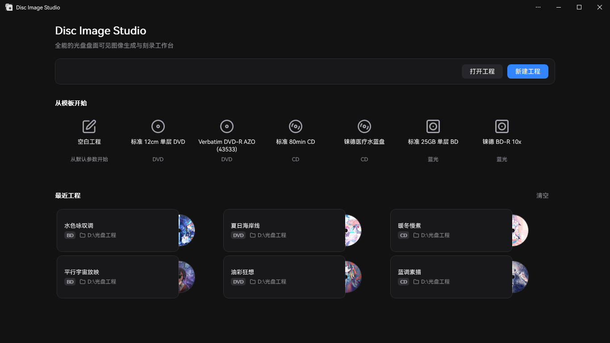
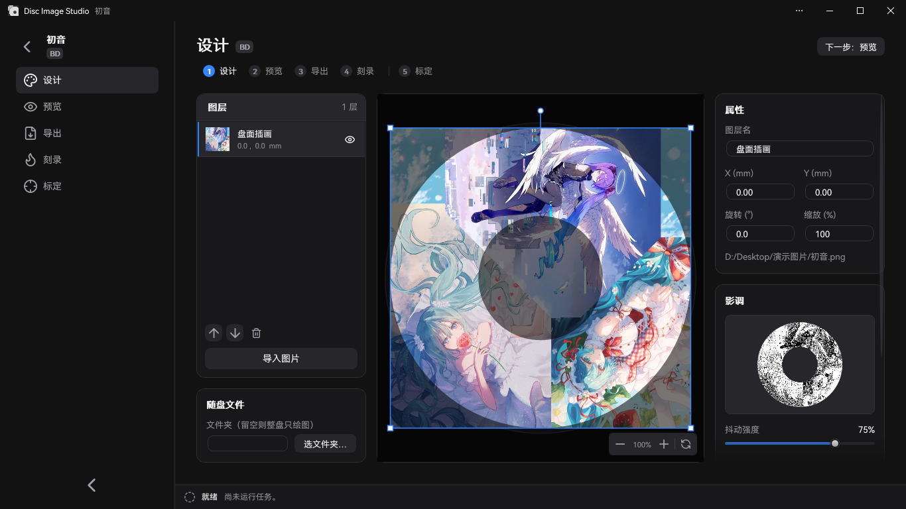
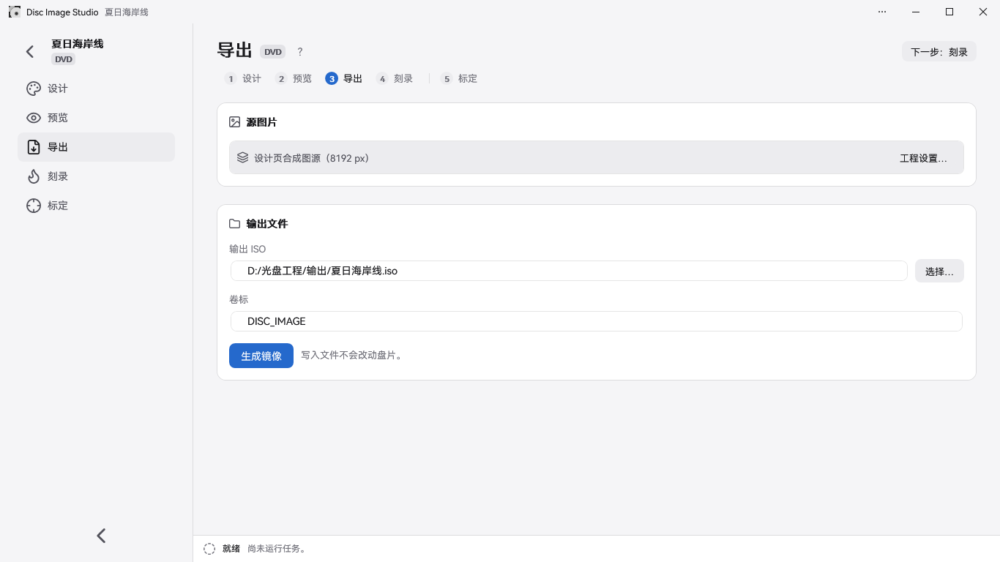

<div align="center">


<h2>全能的光盘盘面可见图像生成与刻录工具</h2>

Disc Image Studio 是一个运行在 Windows 的光盘盘面图像生成与刻录工具，帮助您在符合规格的 DVD / CD / 蓝光 光盘上刻蚀出肉眼可见的图像。


[](LICENSE)

</div>

---

## 效果预览


---

## 概述

Disc Image Studio 可将一张图片转换成符合 CD、DVD 与单层 BD-R 光盘物理层约束的数据，刻录后将使光盘盘面呈现肉眼可见的图案。

## 界面预览







---

## 快速开始

从 [GitHub Releases](https://github.com/JiaFeiMiao-K-Cat/DiscImageStudio/releases) 下载 Release EXE，解压后直接运行；EXE 已包含 .NET 运行时。

### 1. 新建工程

在主页选择 CD、DVD 或蓝光，指定输出位置后创建工程。

### 2. 设计盘面

在设计页导入图片，用图层完成排版，并在右栏「影调」模块调整抖动、伽马、亮度与灰阶档位。

### 3. 预览与导出

在预览页核对盘面投影，在导出页生成 ISO / RAW / WAV+CUE，或直接写入空白盘片。

即时刻录为实验性功能，请只使用可报废的测试介质。

## 功能

### 光盘数据生成

- **CD-DA 支持**：可导出带格式头的 WAV 音轨及配套 CUE，兼容 cdrecord, ImgBurn等刻录软件；也允许导出 RAW 音轨。详见 [CD 刻录兼容说明](docs/CD_AUDIO_COMPATIBILITY.md)。
- **CD 文件模式**：选择随盘文件夹后生成 ISO9660/Joliet 数据盘，支持文件内圈／外圈布局；未选择时生成音轨。
- **DVD 支持**：支持导出 ISO 纯绘图盘及文件与图案混合盘，文件位置可选内圈或外圈。
- **蓝光支持**：单层 BD-R 25 GB，支持纯绘图与 UDF 2.01 文件。详见 [ADDING_BLURAY.md](docs/ADDING_BLURAY.md)。
- **随盘文件**：CD／DVD／蓝光可在设计页直接选择要保存的文件夹及内圈／外圈位置，也可在导出页调整；设置随工程保存。
- **文件区域预览**：混合盘的设计投影和成品读回用黄色标出文件区（含文件系统）。
- **介质灰度方案**：CD 与 DVD 均使用黑白二阶，CD 使用 `0D / AA`，DVD 扰码域使用 `A5 / 92`。详见 [PHYSICAL_MODEL_AUDIT.md](docs/PHYSICAL_MODEL_AUDIT.md)。
- **灰度抖动工具**：独立程序也可将原图处理为 `0/255` 黑白二阶 PNG；支持打开或拖入原图、并排预览及无损 PNG 导出。详见[使用与构建说明](tools/FourLevelDither/README.md)。
- **DVD 三次轨距模型**：支持轨距随半径变化，生成、预览和辅助标定共用同一套几何。详见 [DVD_ENGINE.md](docs/DVD_ENGINE.md)。
- **盘片预设**：内置 JSON + 用户层 JSON 分层配置，覆盖 CD／DVD／BD。详见[预设维护说明](docs/DISC_PRESETS.md)。

### 辅助标定

Disc Image Studio 提供了一套智能且精准的辅助标定流程，相较人工肉眼识别标定，辅助标定算法将可确定的盘面物理数据精确度从 10<sup>-6</sup> 提升到了 10<sup>-14</sup>。校准前采用恒定轨距，十字线的径向线条出现明显弯曲；使用辅助标定得到的三次轨距参数重新生成并刻录后，线条更接近径向直线。

| 校准前 · 恒定轨距 | 校准后 · 三次轨距 |
| --- | --- |
|  |  |
| `P20261004-133519.jpg` | `P20261004-135416.jpg` |


流程与参数说明见[辅助标定说明](docs/CALIBRATION.md)。

### 刻录

- **镜像文件输出**：您可以导出完整 ISO / RAW 文件并使用合适的刻录软件手动刻录。
- **即时流式刻录（实验性）**：CD、DVD 与 BD-R 边生成边刻录，不保存完整镜像；BD-R 走 MMC 顺序写入。
- **不要使用非空白介质！**

### 应用形态

- 双入口：不带参数将打开 GUI；带参数则进入统一命令行。
- 模块化：CD、DVD 与蓝光通过 `IOpticalDiscModule` 接入，统一命令目录与任务契约，详见[架构说明](docs/ARCHITECTURE.md)。

## 系统与设备要求

- Windows 10 2004（2004/20H1，19041）及以上，或 Windows 11。
- 构建：.NET 10 SDK（`global.json` 锁定 10.0.x）；自行构建的非自包含 GUI 需要 .NET 10 Windows 桌面运行时。Release EXE 已包含运行时，无需另行安装 .NET。
- “即时刻录”功能需要一台 Windows 可识别的 CD / DVD / BD 刻录机与空白盘片；BD-R 需要支持顺序写入的单层空白盘。

## 构建与运行

```powershell
dotnet build DiscImageStudio.slnx --configuration Release
dotnet run --project src/DiscImageStudio.App --configuration Release
```

构建回归检查：

```powershell
dotnet run --project src/DvdImageSolver --configuration Release -- selftest
dotnet run --project tests/DiscImageStudio.ArchitectureTests --configuration Release
```

版本规则、CI 生成 EXE、Release 草稿检查、MSIX 打包与签名流程见[发布指南](docs/RELEASING.md)。

## 命令行

统一程序不带参数时将打开 GUI，而带参数时作为自动化工具使用：

| 命令 | 说明 |
| --- | --- |
| `solve` | 使用固定快速纹理映射（CW 方向）生成 DVD 镜像，黑白纹理可选抖动混合 |
| `encode` | 将单个 DVD ECC 块编码为 NRZI 通道电平 |
| `calibrate` | 标定投影：按生成几何从 DVD 源图片取样，按实测几何投到盘面 |
| `simulate` | 按实测半径对生成的 DVD ISO 做读回模拟 |
| `selftest` | 运行 DVD 引擎的确定性回归自检 |
| `cd-generate` | 无随盘文件时生成 WAV + CUE / RAW 音轨；指定 `--data-dir` 时生成 CD 数据盘 ISO |
| `cd-preview-warp` | 标定投影：按实测几何投影 CD 源图片 |
| `cd-preview-track` | 按标定几何渲染已有的 WAV 或 RAW CD-DA 音轨（读回模拟） |
| `bd-generate` | 生成完整 BD-R ISO，并写出 `<iso>.json` sidecar |
| `bd-info` / `bd-probe` / `bd-encode` | 导出 BD 参数、原始负载探针或单个 ECC 簇诊断 |

各命令的完整参数见对应文档。

## 源码结构

```text
src/DiscImageStudio.Core/    介质无关的模块契约、工程/预设模型、任务与命令目录
src/DiscImageStudio.Imaging/ CD/DVD/BD 共用的图片预处理与抖动辅助
src/DiscImageStudio.Burning/ Windows IMAPI2 设备枚举、流缓冲与安全刻录层
src/DiscImageStudio.Cd/      CD-DA 生成核心与 CD 模块
src/DiscImageStudio.Dvd/     DVD 引擎适配模块
src/DiscImageStudio.BluRay/  BD-R 几何、17PP/ECC、3T/6T 映射、流式生成与 ISO
src/DiscImageStudio.Iso/     UDF 2.01 / ISO9660 写入器
src/DiscImageStudio.App/     WPF GUI、统一命令行与商店资源
src/DvdImageSolver/          保持隔离的 DVD 编码/求解引擎
tests/                       无第三方测试框架的架构回归测试
packaging/                   MSIX 清单与打包脚本
tools/                       独立辅助工具与资产生成脚本
docs/                        架构、引擎、预设、发布等文档
```

## 文档

| 文档 | 内容 |
| --- | --- |
| [ARCHITECTURE.md](docs/ARCHITECTURE.md) | 模块抽象、层间边界与扩展规则 |
| [DVD_ENGINE.md](docs/DVD_ENGINE.md) | DVD NRZI 图像约束求解器的约定、编码链与自检覆盖 |
| [CD_AUDIO_COMPATIBILITY.md](docs/CD_AUDIO_COMPATIBILITY.md) | CD 音轨格式、字节序与重影排查 |
| [ADDING_BLURAY.md](docs/ADDING_BLURAY.md) | 蓝光模块的物理模型、生成/刻录链路与扩展点 |
| [DISC_PRESETS.md](docs/DISC_PRESETS.md) | 可编辑盘片预设的分层 JSON 格式与合并规则 |
| [CALIBRATION.md](docs/CALIBRATION.md) | 照片矫正（框选盘片实体最外缘与中心孔边缘）、曲线标定与 DVD 三次轨距拟合 |
| [PHYSICAL_MODEL_AUDIT.md](docs/PHYSICAL_MODEL_AUDIT.md) | CD / DVD 生成物理模型复核 |
| [VALIDATION.md](docs/VALIDATION.md) | 各轮构建、回归与实盘测试的本地验证记录 |
| [RELEASING.md](docs/RELEASING.md) | GitHub Release、MSIX 打包、签名测试与商店提交流程 |
| [CHANGELOG.md](CHANGELOG.md) | 版本变更记录 |

## 参考标准

Disc Image Studio 的实现与物理模型主要参考以下规范：

| 介质 | 标准与版本 | 本项目采用的范围 |
| --- | --- | --- |
| CD-R | [ECMA-394，第 1 版，2010 年 12 月](https://ecma-international.org/publications-and-standards/standards/ecma-394/) — *Recordable Compact Disc Systems CD-R Multi-Speed*（[官方 PDF](https://ecma-international.org/wp-content/uploads/ECMA-394_1st_edition_december_2010.pdf)） | CD-R 介质、多速录制及 CD-DA 兼容关系；本项目生成 CD-DA 音轨。 |
| DVD 公共格式 / DVD-ROM | [ECMA-267，第 3 版，2001 年 4 月](https://ecma-international.org/publications-and-standards/standards/ecma-267/) — *120 mm DVD – Read-only disk*（[官方 PDF](https://ecma-international.org/wp-content/uploads/ECMA-267_3rd_edition_april_2001.pdf)） | DVD 数据帧、ECC、EFMPlus 编码及附录 G 转换表；可记录盘的介质规则另参考 ECMA-359。 |
| DVD-R | [ECMA-359，第 1 版，2004 年 12 月](https://ecma-international.org/publications-and-standards/standards/ecma-359/) — *80 mm (1,46 Gbytes per side) and 120 mm (4,70 Gbytes per side) DVD Recordable Disk (DVD-R)*（[官方 PDF](https://ecma-international.org/wp-content/uploads/ECMA-359_1st_edition_december_2004.pdf)） | 单层 DVD-R 的几何、扇区、纠错和编码；标准包含单面及双面介质，双面不等于双层。 |
| BD-R | [ISO/IEC 30190:2021，第 3 版，2021 年 1 月](https://www.iso.org/standard/80770.html) — 120 mm 单层（25.0 GB）及双层（50.0 GB）可记录 BD 的信息交换与存储规范 | 实验模式采用单层 25 GB 的轨道、扇区布局、纠错和编码；目前不支持双层盘。 |

CD 公共编码部分还参考了 [ECMA-130，第 2 版（CD-ROM，1996）](https://ecma-international.org/publications-and-standards/standards/ecma-130/)。

## 刻录与介质安全须知

- Disc Image Studio 不安装驱动或服务；“即时刻录”功能使用了 Windows 自带的 IMAPI2，拒绝非空白介质。
- “即时刻录”功能已有部分实盘反馈，对不同设备、介质与刻录入口的验证覆盖仍有限，属于实验性功能，请只使用可报废的测试介质。刻录中断、断电或生成速度不足仍可能使盘片报废！
- 实际可见效果取决于盘片、刻录机、固件与写入策略。
- 混合文件夹会在开始刻录前扫描目录并固定布局；期间源文件大小改变会安全终止任务，已开始写入的盘片仍可能报废。
- BD-R 顺序写入不提供备用区重映射；中断后同一盘片通常不能继续写入。

## 隐私与安全

- Disc Image Studio 不联网、不上传文件、不收集遥测，详见[隐私政策](PRIVACY.md)。
- 发现安全问题请不要在公开 Issue 中披露，按[安全政策](SECURITY.md)使用 GitHub 私密报告。

## 贡献

欢迎报告问题与提交代码。开发环境搭建、模块边界规则、测试要求与 Pull Request 流程见[贡献指南](CONTRIBUTING.md)。

## 许可证

项目采用 [GNU GPL v3.0 or later](LICENSE)（`GPL-3.0-or-later`）。CD 交织实现包含从 CDImage 移植并修改的代码，整体分发沿用兼容的 GPL 授权；分发二进制或修改版时须遵守对应源代码等要求。第三方字体与组件遵循各自许可证，详见 [授权说明](LICENSE-NOTICE.md) 和 [第三方声明](THIRD-PARTY-NOTICES.txt)；应用"关于"页也可离线查看完整文本。

## 致谢

感谢 [arduinocelentano 的 CDImage 项目](https://github.com/arduinocelentano/cdimage)，它展示了通过生成 CD 音轨在盘面形成可见图像的方法。本项目的 CD 交织实现由其相关代码移植并继续修改，CD 盘面绘图思路也受其启发。CDImage 原作者及贡献者的工作为本项目提供了重要基础。

---

## Star History

<a href="https://www.star-history.com/?repos=jiafeimiao-k-cat%2Fdiscimagestudio&type=date&legend=top-left">
 <picture>
   <source media="(prefers-color-scheme: dark)" srcset="https://api.star-history.com/chart?repos=jiafeimiao-k-cat/discimagestudio&type=date&theme=dark&legend=top-left" />
   <source media="(prefers-color-scheme: light)" srcset="https://api.star-history.com/chart?repos=jiafeimiao-k-cat/discimagestudio&type=date&legend=top-left" />
   
 </picture>
</a>
