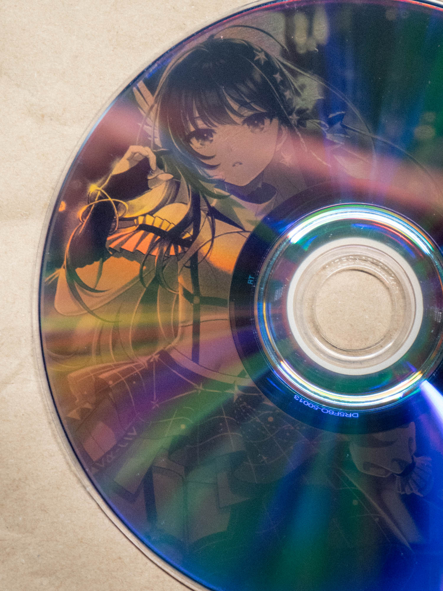
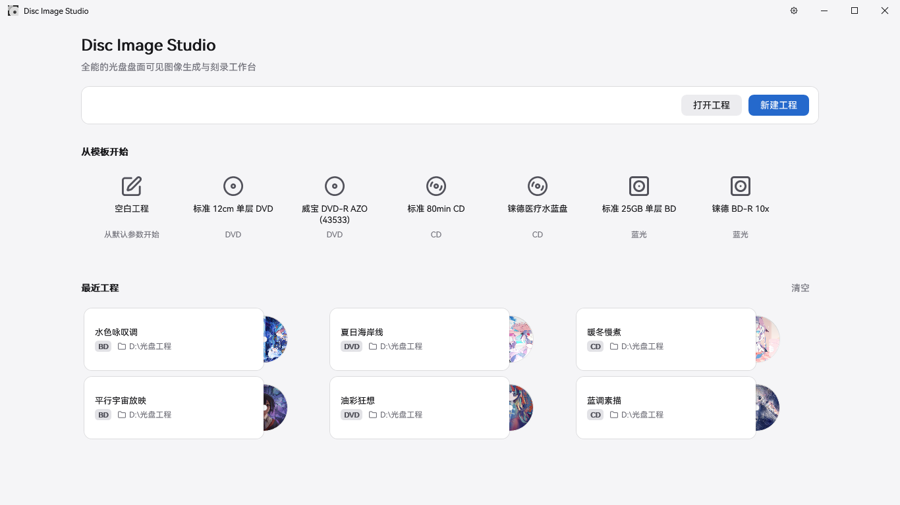
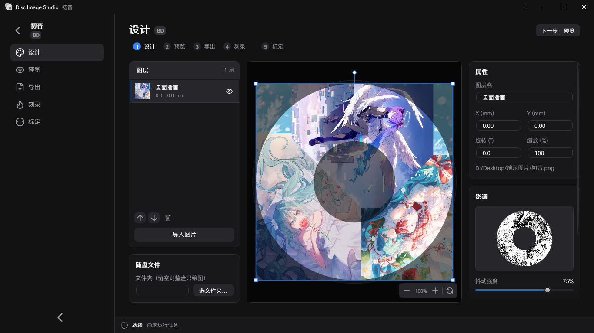
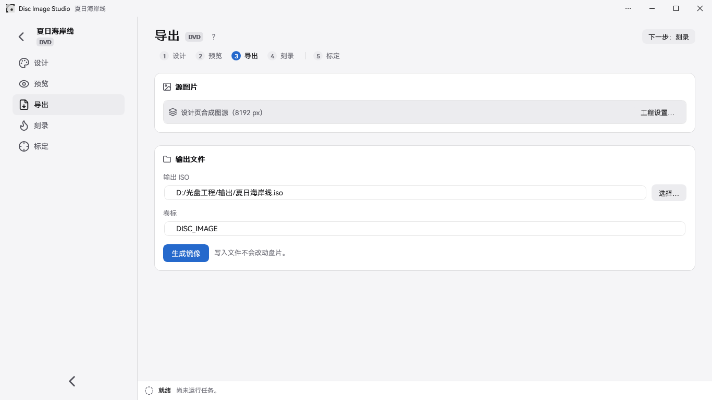

<div align="center">

[简体中文](README.md) | [繁體中文](README.zh-TW.md) | [English](README.en.md) | [日本語](README.ja.md) | [Türkçe](README.tr.md) | [Español](README.es.md) | [Čeština](README.cs.md) | **Português (Brasil)**


<h2>Uma ferramenta completa para gerar e gravar imagens visíveis em discos ópticos</h2>

O Disc Image Studio é uma ferramenta multiplataforma de geração e gravação de imagens na superfície de discos que permite gravar imagens visíveis a olho nu em DVDs, CDs e discos Blu-ray de camada única compatíveis.


[](LICENSE)

<a href="https://trendshift.io/repositories/332271?utm_source=repository-badge&amp;utm_medium=badge&amp;utm_campaign=badge-repository-332271" target="_blank" rel="noopener noreferrer"></a>

<a href="https://discord.gg/rHkD2g7ufH"></a>

</div>

> Tradução para português (Brasil) · [Original](README.en.md). A documentação detalhada permanece nos idiomas originais.

---

## Resultados

<p align="center">
  
  <a href="https://github.com/JiaFeiMiao-K-Cat/DiscImageStudio/issues/61"></a>
  
</p>

---

## Visão geral

O Disc Image Studio converte uma imagem em dados adequados para desenho em discos CD, DVD e Blu-ray de camada única.

## Prévia da interface







---

## Início rápido

No Windows x64, baixe e execute o arquivo terminado em `win-x64.exe`; no Windows 11 ARM64, escolha a versão nativa `win-arm64.exe`. No Linux ou macOS, baixe o arquivo da **CLI experimental** para sua CPU, extraia-o e execute `./disc-image-studio --help`. Cada pacote de versão inclui o runtime do .NET. [Versões no GitHub](https://github.com/JiaFeiMiao-K-Cat/DiscImageStudio/releases)

### 1. Crie um projeto

Escolha CD, DVD ou Blu-ray na página inicial, especifique um local de saída e crie o projeto.

### 2. Projete a superfície do disco

Clique em **Importar imagens** na página Design, ou arraste uma ou várias imagens (PNG, JPEG, BMP, TIFF, GIF e arte vetorial `.svg` de até 32 MiB) do Explorador de Arquivos para a página. Organize-as usando camadas e ajuste dithering, gama, brilho e níveis de cinza no painel **Tom** à direita. Camadas vetoriais `.svg` mantêm renderização vetorial nítida e proporções de `viewBox` durante a edição e são rasterizadas sob demanda para prévia e exportação; a análise de SVG usa `SharpVectors` com recursos externos e scripts ignorados, e efeitos complexos de `<filter>`, máscaras ou seletores avançados de classe CSS podem degradar ou ser ignorados (recomenda-se SVGs com caminhos estáticos achatados).

### 3. Pré-visualize e exporte

Confira a projeção do disco na página Prévia e, em seguida, gere um ISO / RAW / WAV+CUE na página Exportar, ou use a gravação ao vivo para gravar diretamente em um disco virgem.

A gravação ao vivo é experimental. Use apenas mídias de teste descartáveis.

## Recursos

### Geração de dados do disco

- **Suporte a CD**: suporta qualquer CD. Exporte faixas de áudio WAV com cabeçalhos de formato e arquivos CUE correspondentes, compatíveis com softwares de gravação como cdrecord e ImgBurn; também há exportação de faixas de áudio RAW. Consulte [compatibilidade de gravação de CD](docs/CD_AUDIO_COMPATIBILITY.md).
- **Suporte a DVD**: suporta qualquer DVD. Exporte imagens ISO.
- **Suporte a Blu-ray**: suporta BD-R de camada única de 25 GB e BD-RE de camada única verificável como sem área sobressalente, com modo somente desenho e saída de arquivos UDF 2.01. Consulte [ADDING_BLURAY.md](docs/ADDING_BLURAY.md).
- **Arquivos no disco**: para CD, DVD e Blu-ray, selecione uma pasta e coloque seus arquivos no anel interno ou externo diretamente na página Design, ou ajuste essas opções na página Exportar. As configurações são salvas com o projeto.
- **Prévia da região de arquivos**: projeções de design de discos híbridos e a releitura do artefato gerado destacam em azul a região de arquivos, incluindo o sistema de arquivos.
- **Esquemas de escala de cinza da mídia**: CD e DVD usam dois níveis de preto e branco: `0D / AA` para CD e `A5 / 92` no domínio embaralhado do DVD. Consulte [PHYSICAL_MODEL_AUDIT.md](docs/PHYSICAL_MODEL_AUDIT.md).
- **Ferramenta de dithering em escala de cinza**: um programa autônomo também pode processar uma imagem de origem em um PNG preto e branco de dois níveis `0/255`. Ele suporta abrir ou arrastar imagens de origem, prévias lado a lado e exportação de PNG sem perdas. Consulte as [instruções de uso e compilação](tools/FourLevelDither/README.md).
- **Predefinições de disco**: os parâmetros de disco integrados abrangem várias marcas de CD, DVD e BD. Você também pode contribuir com seus próprios dados calibrados; consulte a [manutenção de predefinições](docs/DISC_PRESETS.md).

### Calibração assistida

O Disc Image Studio oferece fluxos de calibração grossa, calibração de borda e calibração fina, estimando os raios interno e externo e a distribuição do passo de trilha a partir de fotos da superfície do disco. Na comparação histórica com discos reais abaixo, antes da calibração usa-se passo de trilha constante, e as linhas radiais da mira aparecem visivelmente curvas; após regenerar e gravar com os parâmetros de passo de trilha cúbico obtidos pela calibração assistida, as linhas ficam mais próximas de linhas radiais retas. A precisão real depende da retificação das fotos, da seleção de pontos e da verificação por replicação; o número de casas decimais salvas nos parâmetros não representa a precisão da medição.

| Antes da calibração · Passo de trilha constante | Após a calibração · Passo de trilha cúbico |
| --- | --- |
|  |  |
| `P20261004-133519.jpg` | `P20261004-135416.jpg` |


No primeiro uso, siga o [tutorial prático de calibração de DVD para Verbatim AZO DVD-R](docs/CALIBRATION_TUTORIAL.en.md) para ver a retificação das fotos, a seleção real de pontos das três etapas de calibração, as mudanças de parâmetros e os valores de referência, e o efeito na superfície do disco após a calibração fina. O fluxo completo e a descrição dos parâmetros estão no [guia de calibração assistida](docs/CALIBRATION.en.md).

### Gravação

- **Saída de imagem de disco**: exporte arquivos ISO / RAW completos e grave-os manualmente com um software de gravação adequado.
- **Gravação em streaming ao vivo (experimental)**: CD, DVD e Blu-ray de camada única são gerados e gravados simultaneamente, sem salvar uma imagem de disco completa.
- Discos de gravação única devem estar em branco. Discos regraváveis só são apagados ou regravados após confirmação na interface.

## Requisitos de sistema e hardware

- O aplicativo desktop x64 requer Windows 10 2004 (2004/20H1, 19041) ou posterior, ou Windows 11. O aplicativo ARM64 requer Windows 11. A CI nativa ARM64 cobre autotestes de software e capturas de tela da GUI; a gravação física de discos em ARM64 permanece não verificada.
- Compilação: .NET 10 SDK (`global.json` fixa a versão 10.0.x). Uma GUI não autocontida compilada a partir do código-fonte requer o .NET 10 Windows Desktop Runtime. O EXE de lançamento inclui o runtime, portanto não é necessária uma instalação separada do .NET.
- A gravação ao vivo requer um gravador reconhecido pelo Windows e mídia compatível. O BD-R requer um disco de camada única em branco que suporte gravação sequencial. O BD-RE requer um layout verificável sem área sobressalente; a primeira formatação depende do suporte RENoSA do gravador.

## Compilar e executar

```powershell
dotnet build DiscImageStudio.slnx --configuration Release
dotnet run --project src/DiscImageStudio.App --configuration Release
```

Verificações de regressão da compilação:

```powershell
dotnet run --project src/DvdImageSolver --configuration Release -- selftest
dotnet run --project tests/DiscImageStudio.ArchitectureTests --configuration Release
```

Consulte o [guia de lançamento](docs/RELEASING.md) para regras de versionamento, EXEs gerados pela CI, verificações de rascunho de lançamento, empacotamento MSIX e procedimentos de assinatura.

## Linha de comando

Para Linux com glibc, selecione `linux-x64` ou `linux-arm64`. Para macOS, selecione `osx-arm64` para Apple Silicon ou `osx-x64` para Intel. A CLI grava arquivos de imagem e faixas de áudio que você pode gravar com uma ferramenta compatível.

Execute a CLI a partir do código-fonte com o .NET 10 SDK

```sh
dotnet run --project src/DiscImageStudio.Cli -c Release -- --help
```

A CLI lê PNG, JPEG, BMP e GIF, usando o primeiro quadro de imagens animadas. Para verificar sua instalação, gere uma faixa de áudio de dois setores e seu arquivo CUE correspondente.

```sh
./disc-image-studio cd-generate --input picture.png --output sample.wav --sectors 2
```

| Comando | Descrição |
| --- | --- |
| `solve` | Gera uma imagem de DVD usando mapeamento de textura rápido fixo (sentido horário, CW), com dithering opcional para misturar texturas preta e branca |
| `encode` | Codifica um único bloco ECC de DVD em níveis de canal NRZI |
| `calibrate` | Projeção de calibração: amostra a imagem de origem do DVD usando a geometria de geração e a projeta no disco usando a geometria medida |
| `simulate` | Simula a releitura de um ISO de DVD gerado usando raios medidos |
| `selftest` | Executa autotestes de regressão determinísticos para o mecanismo de DVD |
| `cd-generate` | Gera faixas de áudio WAV + CUE / RAW quando nenhum arquivo é incluído no disco; gera um ISO de disco de dados CD quando `--data-dir` é especificado |
| `cd-preview-warp` | Projeção de calibração: projeta a imagem de origem do CD usando a geometria medida |
| `cd-preview-track` | Renderiza uma faixa de áudio CD-DA WAV ou RAW existente usando geometria calibrada (simulação de releitura) |
| `bd-generate` | Gera um ISO BD-R completo e grava um arquivo sidecar `<iso>.json` |
| `bd-info` / `bd-probe` / `bd-encode` | Exporta parâmetros de BD, sondagens de payload bruto ou diagnósticos para um único cluster ECC |

Consulte a documentação correspondente para os parâmetros completos de cada comando.

## Estrutura do código-fonte

```text
src/DiscImageStudio.Cli/     Host de linha de comando offline para Linux e macOS
src/DiscImageStudio.ImageIO/ Codecs de imagem WIC e multiplataforma
src/DiscImageStudio.Core/    Contratos de módulo independentes de mídia, modelos de projeto/predefinição, catálogo de tarefas e comandos
src/DiscImageStudio.Imaging/ Auxiliares de pré-processamento de imagem e dithering compartilhados por CD/DVD/BD
src/DiscImageStudio.Burning/ Enumeração de dispositivos IMAPI2 do Windows, armazenamento em buffer de fluxo e camada de gravação segura
src/DiscImageStudio.Cd/      Núcleo de geração CD-DA e módulo de CD
src/DiscImageStudio.Dvd/     Módulo adaptador do mecanismo de DVD
src/DiscImageStudio.BluRay/  Geometria de BD-R, 17PP/ECC, mapeamento 3T/6T, geração em streaming e ISO
src/DiscImageStudio.Iso/     Gravadores UDF 2.01 / ISO9660
src/DiscImageStudio.App/     GUI WPF, linha de comando unificada e ativos da Store
src/DvdImageSolver/          Mecanismo isolado de codificação/solução de DVD
tests/                       Testes de regressão de arquitetura sem framework de testes de terceiros
packaging/                   Manifesto MSIX e scripts de empacotamento
tools/                       Utilitários autônomos e scripts de geração de ativos
docs/                        Arquitetura, mecanismo, predefinições, lançamento e outras documentações
```

## Documentação

| Documento | Conteúdo |
| --- | --- |
| [ARCHITECTURE.md](docs/ARCHITECTURE.md) | Abstrações de módulos, limites entre camadas e regras de extensão |
| [LOCALIZATION.md](docs/LOCALIZATION.md) | Configuração de idioma da interface, fallback para o idioma do sistema e manutenção dos recursos de tradução |
| [DVD_ENGINE.md](docs/DVD_ENGINE.md) | Convenções do solucionador de restrições de imagem NRZI de DVD, cadeia de codificação e cobertura de autotestes |
| [CD_AUDIO_COMPATIBILITY.md](docs/CD_AUDIO_COMPATIBILITY.md) | Formatos de faixas de áudio de CD, ordem de bytes e solução de problemas de ghosting |
| [ADDING_BLURAY.md](docs/ADDING_BLURAY.md) | Modelo físico do módulo Blu-ray, pipeline de geração/gravação e pontos de extensão |
| [DISC_PRESETS.md](docs/DISC_PRESETS.md) | Formato JSON em camadas e regras de mesclagem para predefinições de disco editáveis |
| [CALIBRATION.en.md](docs/CALIBRATION.en.md) | Retificação de fotos, exemplo de seleção de pontos nas três etapas, ajuste cúbico do passo de trilha e nova calibração fina |
| [CALIBRATION_TUTORIAL.en.md](docs/CALIBRATION_TUTORIAL.en.md) | Tutorial prático do Verbatim AZO DVD-R: registros reais das três etapas, imagens de seleção de pontos e efeito após a calibração fina |
| [PHYSICAL_MODEL_AUDIT.md](docs/PHYSICAL_MODEL_AUDIT.md) | Revisão dos modelos físicos de geração de CD / DVD |
| [VALIDATION.md](docs/VALIDATION.md) | Registros de validação local para compilações, regressões e testes físicos de discos |
| [RELEASING.md](docs/RELEASING.md) | GitHub Releases, empacotamento MSIX, testes de assinatura e procedimentos de envio à Store |
| [CHANGELOG.md](CHANGELOG.md) | Histórico de alterações de versão |

## Padrões de referência

A implementação e os modelos físicos do Disc Image Studio referenciam principalmente as seguintes especificações:

| Mídia | Padrão e edição | Escopo usado por este projeto |
| --- | --- | --- |
| CD-R | [ECMA-394, 1ª edição, dezembro de 2010](https://ecma-international.org/publications-and-standards/standards/ecma-394/) — *Recordable Compact Disc Systems CD-R Multi-Speed* ([PDF oficial](https://ecma-international.org/wp-content/uploads/ECMA-394_1st_edition_december_2010.pdf)) | Mídia CD-R, gravação em múltiplas velocidades e compatibilidade CD-DA; este projeto gera faixas de áudio CD-DA. |
| Formato comum de DVD / DVD-ROM | [ECMA-267, 3ª edição, abril de 2001](https://ecma-international.org/publications-and-standards/standards/ecma-267/) — *120 mm DVD – Read-only disk* ([PDF oficial](https://ecma-international.org/wp-content/uploads/ECMA-267_3rd_edition_april_2001.pdf)) | Quadros de dados de DVD, ECC, codificação EFMPlus e as tabelas de conversão do Anexo G; ECMA-359 também é referenciado para regras de mídia gravável. |
| DVD-R | [ECMA-359, 1ª edição, dezembro de 2004](https://ecma-international.org/publications-and-standards/standards/ecma-359/) — *80 mm (1,46 Gbytes per side) and 120 mm (4,70 Gbytes per side) DVD Recordable Disk (DVD-R)* ([PDF oficial](https://ecma-international.org/wp-content/uploads/ECMA-359_1st_edition_december_2004.pdf)) | Geometria, setores, correção de erros e codificação de DVD-R de camada única; o padrão cobre mídias de face única e face dupla. Face dupla não significa camada dupla. |
| BD-R | [ISO/IEC 30190:2021, 3ª edição, janeiro de 2021](https://www.iso.org/standard/80770.html) — Specification for information interchange and storage on 120 mm single-layer (25.0 GB) and dual-layer (50.0 GB) recordable BD | O modo experimental usa o layout de trilhas e setores, a correção de erros e a codificação para discos de camada única de 25 GB. Discos de camada dupla não são suportados no momento. |

Os componentes comuns de codificação de CD também referenciam [ECMA-130, 2ª edição (CD-ROM, 1996)](https://ecma-international.org/publications-and-standards/standards/ecma-130/).

## Gravação e segurança de mídia

- O Disc Image Studio não instala drivers nem serviços. A gravação ao vivo usa o IMAPI2 integrado do Windows e rejeita mídias que não estejam em branco.
- A gravação ao vivo recebeu algum retorno de testes com discos físicos, mas a cobertura de validação entre diferentes dispositivos, mídias e caminhos de gravação continua limitada. É experimental; use apenas mídias de teste descartáveis. Gravações interrompidas, perda de energia ou velocidade de geração insuficiente ainda podem inutilizar um disco!
- O resultado visível real depende do disco, do gravador, do firmware e da estratégia de gravação.
- Para discos híbridos, a pasta de origem é verificada e seu layout é fixado antes do início da gravação. Se o tamanho de um arquivo de origem mudar durante a operação, o trabalho é encerrado com segurança; um disco que já começou a ser gravado ainda pode ficar inutilizável.
- A gravação sequencial em BD-R não oferece remapeamento de área sobressalente. Após uma interrupção, geralmente não é possível continuar gravando no mesmo disco.

## Privacidade e segurança

- Exceto quando você verifica manualmente se há atualizações na página Sobre, acessando o GitHub Releases, o Disc Image Studio não acessa a rede, não envia arquivos nem coleta telemetria. Consulte a [política de privacidade](PRIVACY.md).
- Não divulgue problemas de segurança em issues públicas. Siga a [política de segurança](SECURITY.md) e use o recurso de relato privado do GitHub.

## Como contribuir

Relatos de problemas e contribuições de código são bem-vindos. Consulte o [guia de contribuição](CONTRIBUTING.md) para configuração do ambiente de desenvolvimento, regras de limites de módulos, requisitos de teste e o processo de pull request.

## Licença

Este projeto é licenciado sob a [GNU GPL v3.0 ou posterior](LICENSE) (`GPL-3.0-or-later`). A implementação de intercalação de CD inclui código portado e modificado do CDImage, e o projeto como um todo é distribuído sob uma licença GPL compatível. A distribuição de binários ou versões modificadas exige conformidade com os requisitos de código-fonte correspondente e outras exigências aplicáveis. Fontes tipográficas e componentes de terceiros mantêm suas próprias licenças; consulte o [aviso de licença](LICENSE-NOTICE.md) e os [avisos de terceiros](THIRD-PARTY-NOTICES.txt). Os textos completos também estão disponíveis offline na página Sobre do aplicativo.

## Agradecimentos

Agradecemos ao [projeto CDImage de arduinocelentano](https://github.com/arduinocelentano/cdimage), que demonstrou como criar imagens visíveis na superfície de um disco gerando faixas de áudio de CD. A implementação de intercalação de CD deste projeto foi portada de seu código relacionado e posteriormente modificada, e a abordagem de desenhar em superfícies de CD também foi inspirada nele. O trabalho do autor original e dos contribuidores do CDImage fornece uma base importante para este projeto.

---

## Histórico de estrelas

<a href="https://www.star-history.com/?repos=jiafeimiao-k-cat%2Fdiscimagestudio&type=date&legend=top-left">
 <picture>
   <source media="(prefers-color-scheme: dark)" srcset="https://api.star-history.com/chart?repos=jiafeimiao-k-cat/discimagestudio&type=date&theme=dark&legend=top-left" />
   <source media="(prefers-color-scheme: light)" srcset="https://api.star-history.com/chart?repos=jiafeimiao-k-cat/discimagestudio&type=date&legend=top-left" />
   
 </picture>
</a>
