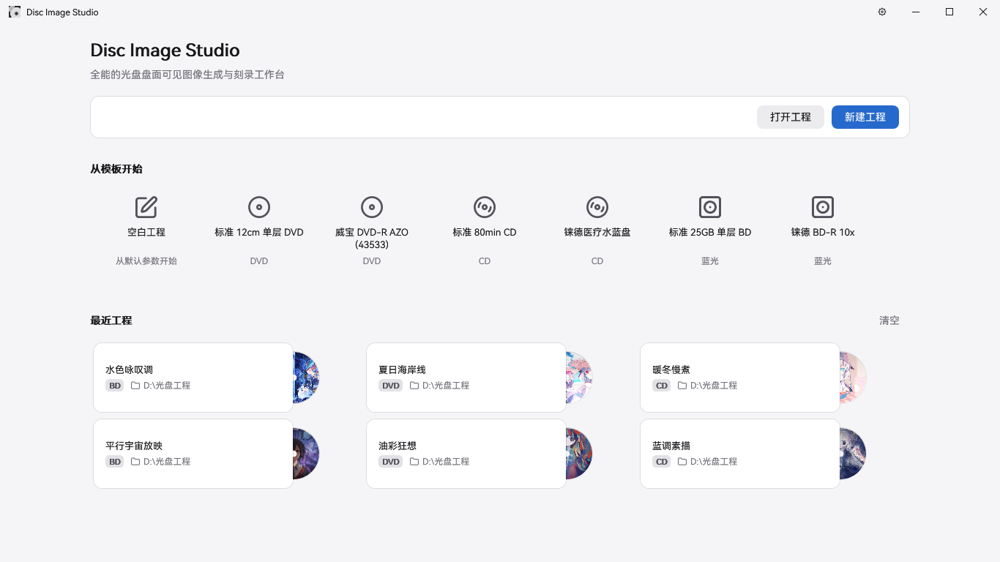
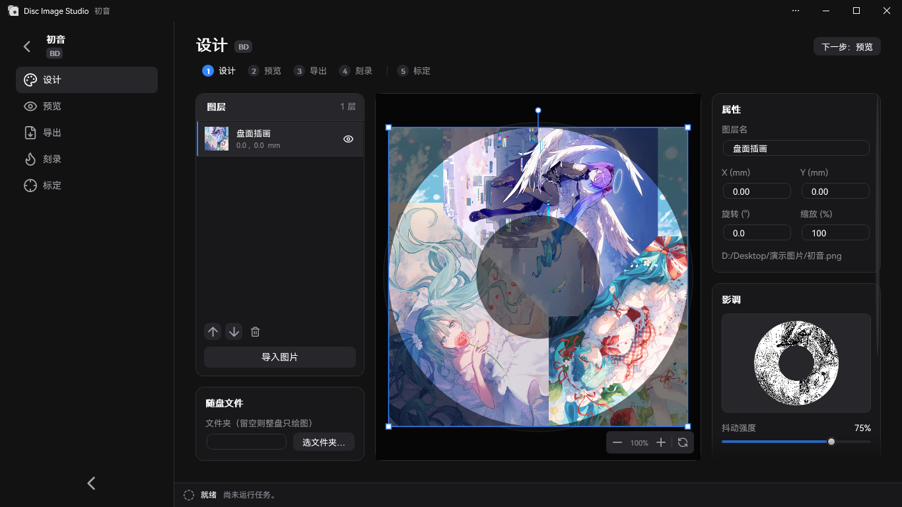
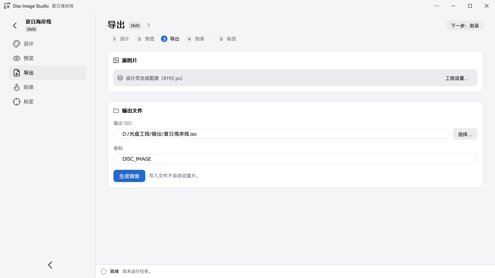

<div align="center">

[简体中文](README.md) | [繁體中文](README.zh-TW.md) | [English](README.en.md) | [日本語](README.ja.md) | **Türkçe** | [Español](README.es.md) | [Čeština](README.cs.md)


<h2>Optik disklere görünür görüntüler oluşturmak ve yazmak için hepsi bir arada araç</h2>

Disc Image Studio, herhangi bir kayıt sürücüsüyle herhangi bir DVD / CD / tek katmanlı Blu-ray disk üzerine çıplak gözle görülebilen görüntüler işlemenize yardımcı olan, çok platformlu bir disk yüzeyi görüntüsü oluşturma ve yazma aracıdır.


[](LICENSE)

</div>

---

## Sonuçlar


---

## Genel Bakış

Disc Image Studio, standart bir görseli CD, DVD ve tek katmanlı BD-R disklerin fiziksel katman kısıtlamalarına tam uyumlu verilere dönüştürür. Diske yazma işleminden sonra diskin veri yüzeyinde çıplak gözle net bir şekilde görülebilen desenler ve resimler oluşur.

## Arayüz Önizlemesi







---

## Hızlı Başlangıç

Windows x64 için adı `win-x64.exe` ile, Windows 11 ARM64 için ise `win-arm64.exe` ile biten yerel sürümü indirip çalıştırın. Linux veya macOS üzerinde, işlemcinize uygun **deneysel CLI** arşivini indirin, çıkartın ve `./disc-image-studio --help` komutunu çalıştırın. Her sürüm paketi .NET çalışma zamanını içerir: [GitHub Sürümleri (Releases)](https://github.com/JiaFeiMiao-K-Cat/DiscImageStudio/releases)

### 1. Proje Oluşturun

Ana sayfada CD, DVD veya Blu-ray seçin, bir çıktı konumu belirleyin ve projeyi oluşturun.

### 2. Disk Yüzeyini Tasarlayın

Tasarım sayfasında bir görsel içe aktarın, katmanları kullanarak düzenleyin ve sağdaki **Ton** panelinden sarsıntı (dithering), gama, parlaklık ve gri tonlama düzeylerini ayarlayın.

### 3. Önizleyin ve Dışa Aktarın

Önizleme sayfasında disk projeksiyonunu kontrol edin, ardından Dışa Aktarma sayfasında ISO / RAW / WAV+CUE oluşturun veya doğrudan boş bir diske yazmak için akışla yazma (live burn) özelliğini kullanın.

Akışla doğrudan diske yazma deneyseldir. Yalnızca gözden çıkarabileceğiniz boş test medyalarını kullanın.

## Özellikler

### Disk Verisi Oluşturma

- **CD Desteği**: Standart her türlü CD'yi destekler. cdrecord ve ImgBurn gibi yazma programlarıyla uyumlu biçim başlıklarına ve CUE dosyasına sahip WAV ses izleri dışa aktarılabilir; RAW ses izi dışa aktarımı da mevcuttur. Bkz. [CD Ses Uyumluluğu](docs/CD_AUDIO_COMPATIBILITY.md).
- **DVD Desteği**: Standart her türlü DVD'yi destekler. ISO imajları dışa aktarılır.
- **Blu-ray Desteği**: Yalnızca çizim modu ve UDF 2.01 dosya yerleşimi ile her türlü tek katmanlı 25 GB BD-R'yi destekler. Bkz. [Blu-ray Desteği Ekleme](docs/ADDING_BLURAY.md).
- **Disk Üzerinde Dosya Barındırma**: CD, DVD ve Blu-ray için doğrudan Tasarım sayfasından bir klasör seçip dosyalarını diskin iç veya dış halkasına yerleştirebilir ya da bu seçenekleri Dışa Aktarma sayfasından ayarlayabilirsiniz. Bu ayarlar projeyle birlikte kaydedilir.
- **Dosya Bölgesi Önizlemesi**: Hibrit disk tasarım projeksiyonları ve ürün geri okumaları, dosya sistemi dahil olmak üzere dosya alanını mavi renkle vurgular.
- **Medya Gri Tonlama Şemaları**: CD ve DVD'nin her ikisi de iki siyah-beyaz seviyesi kullanır: CD için `0D / AA` ve DVD karıştırılmış (scrambled) alanında `A5 / 92`. Bkz. [Fiziksel Model Denetimi](docs/PHYSICAL_MODEL_AUDIT.md).
- **Gri Tonlama Sarsıntı (Dithering) Aracı**: Bağımsız bir yardımcı program, bir kaynak görseli iki seviyeli `0/255` siyah-beyaz PNG'ye dönüştürebilir. Görselleri açmayı, sürükleyip bırakmayı, yan yana önizlemeyi ve kayıpsız PNG dışa aktarımını destekler. Bkz. [Kullanım ve Derleme Talimatları](tools/FourLevelDither/README.md).
- **Disk Önayarları**: Yerleşik disk parametreleri çeşitli CD, DVD ve BD markalarını kapsar. Ayrıca kendi kalibre edilmiş verilerinizle katkıda bulunabilirsiniz; bkz. [Disk Önayarı Yönetimi](docs/DISC_PRESETS.md).

### Destekli Kalibrasyon (Assisted Calibration)

Disc Image Studio, akıllı ve hassas bir destekli kalibrasyon iş akışı sunar. Manuel görsel kalibrasyonla karşılaştırıldığında, destekli kalibrasyon algoritması belirlenebilir disk yüzeyi fiziksel parametrelerinin hassasiyetini 10<sup>-6</sup> seviyesinden 10<sup>-14</sup> seviyesine çıkarır. Kalibrasyondan önce sabit iz aralığı belirgin şekilde kavisli radyal artı çizgileri oluşturur. Destekli kalibrasyonla elde edilen üçüncü dereceden (kübik) iz aralığı parametreleriyle yeniden oluşturulup yazıldığında, çizgiler düz radyal çizgilere çok daha yakın olur.

| Kalibrasyon Öncesi · Sabit İz Aralığı | Kalibrasyon Sonrası · Kübik İz Aralığı |
| --- | --- |
|  |  |
| `P20261004-133519.jpg` | `P20261004-135416.jpg` |

İş akışı ve parametreler için [Destekli Kalibrasyon Kılavuzu](docs/CALIBRATION.md) sayfasına bakın.

### Diske Yazma

- **Disk İmajı Çıktısı**: Eksiksiz ISO / RAW dosyalarını dışa aktarın ve uygun bir yazma yazılımıyla manuel olarak yazın.
- **Akışla Canlı Yazma (Deneysel)**: Tam bir disk imajı kaydetmeden CD, DVD ve BD-R verilerini aynı anda oluşturup diske yazın. BD-R için MMC sıralı yazma (sequential writing) kullanılır.
- **Dolu veya boş olmayan medyaları kesinlikle kullanmayın!**

## Sistem ve Donanım Gereksinimleri

- x64 masaüstü uygulaması Windows 10 2004 (2004/20H1, 19041) veya üstü ya da Windows 11 gerektirir. ARM64 sürümü Windows 11 gerektirir. Yerel ARM64 CI, yazılım öz testlerini ve GUI ekran görüntülerini kapsar; fiziksel diske yazma henüz doğrulanmamıştır.
- Derleme: .NET 10 SDK (`global.json` 10.0.x sürümünü sabitler). Kaynak koddan derlenen bağımsız olmayan bir GUI, .NET 10 Windows Masaüstü Çalışma Zamanı (Windows Desktop Runtime) gerektirir. Dağıtılan Release EXE dosyası çalışma zamanını kendi içinde barındırdığı için harici bir .NET kurulumu gerektirmez.
- Akışla yazma, Windows tarafından tanınan bir CD / DVD / BD yazıcı ve boş medya gerektirir. BD-R için sıralı yazmayı (sequential writing) destekleyen boş tek katmanlı bir disk gerekir.

## Derleme ve Çalıştırma

```powershell
dotnet build DiscImageStudio.slnx --configuration Release
dotnet run --project src/DiscImageStudio.App --configuration Release
```

Derleme regresyon testleri:

```powershell
dotnet run --project src/DvdImageSolver --configuration Release -- selftest
dotnet run --project tests/DiscImageStudio.ArchitectureTests --configuration Release
```

Sürüm kuralları, CI tarafından oluşturulan EXE'ler, sürüm taslağı denetimleri, MSIX paketleme ve imzalama adımları için [Sürüm Hazırlama Kılavuzu](docs/RELEASING.md) sayfasına bakın.

## Komut Satırı (CLI)

glibc kullanan Linux sistemleri için `linux-x64` veya `linux-arm64` seçin. macOS için Apple Silicon için `osx-arm64`, Intel için `osx-x64` seçin. CLI, uyumlu bir araçla yazabileceğiniz imaj dosyalarını ve ses izlerini oluşturur.

CLI'yi .NET 10 SDK ile kaynak koddan çalıştırmak için:

```sh
dotnet run --project src/DiscImageStudio.Cli -c Release -- --help
```

CLI; PNG, JPEG, BMP ve GIF formatlarını okur (hareketli görsellerin ilk karesi kullanılır). Kurulumunuzu test etmek için iki sektörlük bir ses izi ve eşleşen CUE dosyasını oluşturabilirsiniz:

```sh
./disc-image-studio cd-generate --input picture.png --output sample.wav --sectors 2
```

| Komut | Açıklama |
| --- | --- |
| `solve` | Siyah ve beyaz dokuları karıştırmak için isteğe bağlı sarsıntı (dithering) ile sabit hızlı doku eşleme (saat yönü / CW) kullanarak bir DVD görüntüsü oluşturur |
| `encode` | Tek bir DVD ECC bloğunu NRZI kanal seviyelerine kodlar |
| `calibrate` | Kalibrasyon projeksiyonu: DVD kaynak görüntüsünü oluşturma geometrisini kullanarak örnekler ve ölçülen geometriyi kullanarak diske yansıtır |
| `simulate` | Ölçülen yarıçapları kullanarak oluşturulmuş bir DVD ISO'sunun geri okumasını simüle eder |
| `selftest` | DVD motoru için belirleyici regresyon öz sınamalarını çalıştırır |
| `cd-generate` | Diske dosya dahil edilmediğinde WAV + CUE / RAW ses izleri oluşturur; `--data-dir` belirtildiğinde bir CD veri diski ISO'su oluşturur |
| `cd-preview-warp` | Kalibrasyon projeksiyonu: CD kaynak görüntüsünü ölçülen geometriyi kullanarak yansıtır |
| `cd-preview-track` | Mevcut bir WAV veya RAW CD-DA ses izini kalibre edilmiş geometri kullanarak işler (geri okuma simülasyonu) |
| `bd-generate` | Eksiksiz bir BD-R ISO'su oluşturur ve bir `<iso>.json` yan dosyası (sidecar) yazar |
| `bd-info` / `bd-probe` / `bd-encode` | Tek bir ECC kümesi için BD parametrelerini, ham veri yükü problarını veya tanılamaları dışa aktarır |

Her komutun eksiksiz parametreleri için ilgili dokümantasyona bakın.

## Kaynak Kod Düzeni

```text
src/DiscImageStudio.Cli/     Çevrimdışı Linux ve macOS komut satırı ana makinesi
src/DiscImageStudio.ImageIO/ WIC ve platformlar arası görsel çözücüler
src/DiscImageStudio.Core/    Medyadan bağımsız modül sözleşmeleri, proje/önayar modelleri, iş ve komut kataloğu
src/DiscImageStudio.Imaging/ CD/DVD/BD tarafından paylaşılan görsel ön işleme ve sarsıntı (dithering) yardımcıları
src/DiscImageStudio.Burning/ Windows IMAPI2 aygıt listeleme, akış arabelleğe alma ve güvenli yazma katmanı
src/DiscImageStudio.Cd/      CD-DA üretim çekirdeği ve CD modülü
src/DiscImageStudio.Dvd/     DVD motoru bağdaştırıcı modülü
src/DiscImageStudio.BluRay/  BD-R geometrisi, 17PP/ECC, 3T/6T eşleme, akışla üretim ve ISO
src/DiscImageStudio.Iso/     UDF 2.01 / ISO9660 yazıcıları
src/DiscImageStudio.App/     WPF GUI, birleşik komut satırı ve Mağaza varlıkları
src/DvdImageSolver/          Yalıtılmış DVD kodlama/çözme motoru
tests/                       Üçüncü taraf test çerçevesi içermeyen mimari regresyon testleri
packaging/                   MSIX bildirimi ve paketleme betikleri
tools/                       Bağımsız yardımcı programlar ve varlık oluşturma betikleri
docs/                        Mimari, motor, önayar, sürüm ve diğer dokümantasyonlar
```

## Dokümantasyon

| Belge | İçerik |
| --- | --- |
| [ARCHITECTURE.md](docs/ARCHITECTURE.md) | Modül soyutlamaları, katman sınırları ve genişletme kuralları |
| [LOCALIZATION.md](docs/LOCALIZATION.md) | Dil ayarları ve çeviri kaynaklarının bakımı |
| [DVD_ENGINE.md](docs/DVD_ENGINE.md) | DVD NRZI görsel kısıtlama çözücü kuralları, kodlama zinciri ve öz sınama kapsamı |
| [CD_AUDIO_COMPATIBILITY.md](docs/CD_AUDIO_COMPATIBILITY.md) | CD ses izi biçimleri, bayt sırası ve gölgelenme sorunlarını giderme |
| [ADDING_BLURAY.md](docs/ADDING_BLURAY.md) | Blu-ray modülü fiziksel modeli, üretim/yazma hattı ve genişletme noktaları |
| [DISC_PRESETS.md](docs/DISC_PRESETS.md) | Düzenlenebilir disk önayarları için katmanlı JSON biçimi ve birleştirme kuralları |
| [CALIBRATION.md](docs/CALIBRATION.md) | Fotoğraf düzeltme (diskin en dış fiziksel kenarını ve merkez delik kenarını işaretleme), eğri kalibrasyonu ve DVD kübik iz aralığı uydurma |
| [PHYSICAL_MODEL_AUDIT.md](docs/PHYSICAL_MODEL_AUDIT.md) | CD / DVD üretim fiziksel modellerinin incelenmesi |
| [VALIDATION.md](docs/VALIDATION.md) | Derlemeler, regresyonlar ve fiziksel disk testleri için yerel doğrulama kayıtları |
| [RELEASING.md](docs/RELEASING.md) | GitHub Sürümleri, MSIX paketleme, imzalama testleri ve Mağaza gönderim prosedürleri |
| [CHANGELOG.md](CHANGELOG.md) | Sürüm değişiklik geçmişi |

## Referans Standartlar

Disc Image Studio'nun uygulaması ve fiziksel modelleri öncelikli olarak şu teknik şartnameleri referans alır:

| Medya | Standart ve Sürüm | Bu Proje Tarafından Kullanılan Kapsam |
| --- | --- | --- |
| CD-R | [ECMA-394, 1. baskı, Aralık 2010](https://ecma-international.org/publications-and-standards/standards/ecma-394/) — *Recordable Compact Disc Systems CD-R Multi-Speed* ([resmi PDF](https://ecma-international.org/wp-content/uploads/ECMA-394_1st_edition_december_2010.pdf)) | CD-R medyası, çoklu hızda yazma ve CD-DA uyumluluğu; bu proje CD-DA ses izleri üretir. |
| DVD ortak biçimi / DVD-ROM | [ECMA-267, 3. baskı, Nisan 2001](https://ecma-international.org/publications-and-standards/standards/ecma-267/) — *120 mm DVD – Read-only disk* ([resmi PDF](https://ecma-international.org/wp-content/uploads/ECMA-267_3rd_edition_april_2001.pdf)) | DVD veri çerçeveleri, ECC, EFMPlus kodlama ve Ek G dönüşüm tabloları; kaydedilebilir medya kuralları için ECMA-359 da referans alınır. |
| DVD-R | [ECMA-359, 1. baskı, Aralık 2004](https://ecma-international.org/publications-and-standards/standards/ecma-359/) — *80 mm (taraf başına 1,46 Gbayt) ve 120 mm (taraf başına 4,70 Gbayt) DVD Kaydedilebilir Disk (DVD-R)* ([resmi PDF](https://ecma-international.org/wp-content/uploads/ECMA-359_1st_edition_december_2004.pdf)) | Tek katmanlı DVD-R geometrisi, sektörler, hata düzeltme ve kodlama; standart tek taraflı ve çift taraflı medyaları kapsar (çift taraflı çift katmanlı anlamına gelmez). |
| BD-R | [ISO/IEC 30190:2021, 3. baskı, Ocak 2021](https://www.iso.org/standard/80770.html) — 120 mm tek katmanlı (25,0 GB) ve çift katmanlı (50,0 GB) kaydedilebilir BD üzerinde bilgi değişimi ve depolama şartnamesi | Deneysel mod; tek katmanlı 25 GB diskler için iz ve sektör düzenini, hata düzeltmeyi ve kodlamayı kullanır. Çift katmanlı diskler şu anda desteklenmemektedir. |

Ortak CD kodlama bileşenleri ayrıca [ECMA-130, 2. baskı (CD-ROM, 1996)](https://ecma-international.org/publications-and-standards/standards/ecma-130/) standardını referans alır.

## Yazma ve Medya Güvenliği

- Disc Image Studio sürücü veya sistem hizmeti yüklemez. Akışla doğrudan yazma işlemi Windows'un yerleşik IMAPI2 altyapısını kullanır ve boş olmayan medyaları doğrudan reddeder.
- Akışla doğrudan yazma fiziksel disk testlerinden bazı geri bildirimler almıştır, ancak farklı cihazlar, medyalar ve yazma yolları arasındaki doğrulama kapsamı sınırlıdır. Bu özellik deneyseldir; yalnızca feda edilebilecek test medyaları kullanın. Kesintiye uğrayan yazma, güç kaybı veya yetersiz üretim hızı diski kullanılamaz hale getirebilir!
- Gözle görülebilen nihai sonuç diske, yazıcıya, bellenime (firmware) ve yazma stratejisine bağlıdır.
- Hibrit diskler için kaynak klasör taranır ve yazma başlamadan önce yerleşimi sabitlenir. İşlem sırasında bir kaynak dosyanın boyutu değişirse iş güvenli bir şekilde sonlandırılır; yazmaya başlamış bir disk yine de kullanılamaz hale gelebilir.
- BD-R sıralı yazma (sequential writing), yedek alan yeniden eşlemesi sağlamaz. Bir kesintiden sonra aynı diske yazmaya devam edilemez.

## Gizlilik ve Güvenlik

- Disc Image Studio ağa erişmez, dosya yüklemez veya telemetri verisi toplamaz. Bkz. [Gizlilik Politikası](PRIVACY.md).
- Güvenlik açıklarını herkese açık sorun (issue) kayıtlarında paylaşmayın. [Güvenlik Politikasını](SECURITY.md) izleyin ve GitHub'ın özel güvenlik bildirimi özelliğini kullanın.

## Katkıda Bulunma

Hata bildirimleri ve kod katkıları memnuniyetle karşılanır. Geliştirme ortamı kurulumu, modül sınırı kuralları, test gereksinimleri ve pull request süreci için [Katkıda Bulunma Kılavuzuna](CONTRIBUTING.md) bakın.

## Lisans

Bu proje [GNU GPL v3.0 veya üzeri](LICENSE) (`GPL-3.0-or-later`) lisansı ile lisanslanmıştır. CD serpiştirme uygulaması, CDImage projesinden uyarlanan ve değiştirilen kodları içerir ve projenin tamamı uyumlu bir GPL lisansı altında dağıtılır. İkili dosyaların veya değiştirilmiş sürümlerin dağıtılması, ilgili kaynak kodun sağlanmasını ve diğer geçerli şartlara uyulmasını gerektirir. Üçüncü taraf yazı tipleri ve bileşenleri kendi lisanslarını korur; bkz. [Lisans Bildirimi](LICENSE-NOTICE.md) ve [Üçüncü Taraf Bildirimleri](THIRD-PARTY-NOTICES.txt). Lisans metinlerinin tamamına uygulamanın Hakkında sayfasından çevrimdışı olarak da erişilebilir.

## Teşekkürler

CD ses izleri oluşturarak disk yüzeyinde görünür görüntüler oluşturulabileceğini gösteren [arduinocelentano'nun CDImage projesine](https://github.com/arduinocelentano/cdimage) teşekkür ederiz. Bu projenin CD serpiştirme (interleaving) uygulaması ilgili koddan uyarlanmış ve geliştirilmiştir; CD yüzeyine çizim yapma yaklaşımı da ondan ilham almıştır. CDImage'ın orijinal yazarının ve katkıda bulunanlarının çalışmaları bu proje için önemli bir temel oluşturmaktadır.

---

## Star History

<a href="https://www.star-history.com/?repos=jiafeimiao-k-cat%2Fdiscimagestudio&type=date&legend=top-left">
 <picture>
   <source media="(prefers-color-scheme: dark)" srcset="https://api.star-history.com/chart?repos=jiafeimiao-k-cat/discimagestudio&type=date&theme=dark&legend=top-left" />
   <source media="(prefers-color-scheme: light)" srcset="https://api.star-history.com/chart?repos=jiafeimiao-k-cat/discimagestudio&type=date&legend=top-left" />
   
 </picture>
</a>
