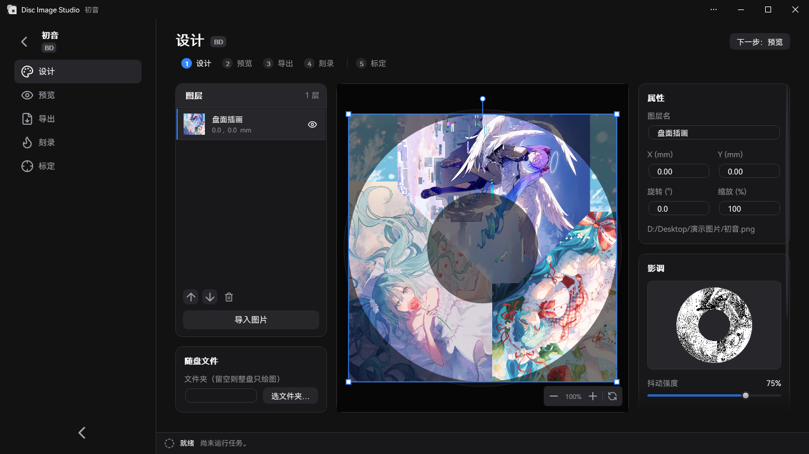
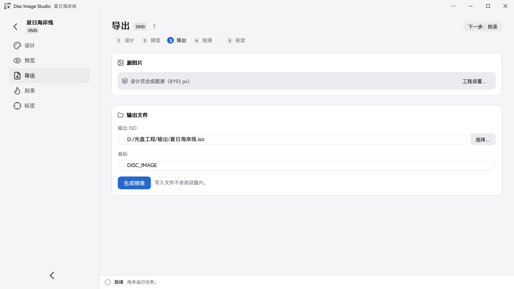

<div align="center">

[简体中文](README.md) | **繁體中文** | [English](README.en.md) | [日本語](README.ja.md) | [Türkçe](README.tr.md) | [Español](README.es.md) | [Čeština](README.cs.md)


<h2>全功能光碟表面可見圖像製作與燒錄工具</h2>

Disc Image Studio 是一個多平台的光碟表面圖像產生與燒錄工具，協助您使用任何燒錄光碟機，在任何 DVD / CD / 單層藍光 光碟上燒錄出肉眼可見的圖像。


[](LICENSE)

</div>

---

## 效果預覽


---

## 概述

Disc Image Studio 可將一張圖片轉換為符合 CD、DVD 與單層 BD-R 光碟實體層限制的資料，燒錄後讓光碟表面呈現肉眼可見的圖案。

## 介面預覽






---

## 快速開始

Windows x64 請下載以 `win-x64.exe` 結尾的檔案；Windows 11 ARM64 請下載以 `win-arm64.exe` 結尾的原生版本，均可直接執行。Linux 或 macOS 請下載與 CPU 相符的**實驗性 CLI** 壓縮檔，解壓縮後執行 `./disc-image-studio --help`。各發布套件均包含 .NET 執行階段。 [GitHub Releases](https://github.com/JiaFeiMiao-K-Cat/DiscImageStudio/releases)

### 1. 新增專案

在首頁選擇 CD、DVD 或藍光，指定輸出位置後建立專案。

### 2. 設計碟面

在設計頁匯入圖片，以圖層完成排版，並在右側「影調」模組調整抖動、Gamma、亮度與灰階級數。

### 3. 預覽與匯出

在預覽頁確認碟面投影，在匯出頁產生 ISO / RAW / WAV+CUE，或使用即時燒錄功能直接寫入空白光碟。

即時燒錄為實驗性功能，請僅使用可報廢的測試媒體。

## 功能

### 光碟資料產生

- **CD 支援**：支援任何 CD。您可匯出含格式標頭的 WAV 音軌與配套 CUE，相容於 cdrecord、ImgBurn 等燒錄軟體；也可匯出 RAW 音軌。詳見 [CD 燒錄相容性說明](docs/CD_AUDIO_COMPATIBILITY.md)。
- **DVD 支援**：支援任何 DVD。您可匯出 ISO 映像。
- **藍光支援**：支援任何單層 BD-R 25 GB，可純繪圖或附帶 UDF 2.01 檔案。詳見 [ADDING_BLURAY.md](docs/ADDING_BLURAY.md)。
- **隨碟檔案**：CD／DVD／藍光可在設計頁直接選擇要儲存的資料夾及內圈／外圈位置，也可在匯出頁調整；設定會隨專案儲存。
- **檔案區域預覽**：混合光碟的設計投影與成品讀回會以藍色標示檔案區（含檔案系統）。
- **媒體灰階方案**：CD 與 DVD 均使用黑白二階；CD 使用 `0D / AA`，DVD 擾碼域使用 `A5 / 92`。詳見 [PHYSICAL_MODEL_AUDIT.md](docs/PHYSICAL_MODEL_AUDIT.md)。
- **灰階抖動工具**：獨立程式也可將原圖處理為 `0/255` 黑白二階 PNG；支援開啟或拖入原圖、並排預覽及無損 PNG 匯出。詳見[使用與建置說明](tools/FourLevelDither/README.md)。
- **光碟預設**：內建數個品牌的光碟參數，涵蓋 CD／DVD／BD。您也可將自行校準的資料貢獻給我們，詳見[預設維護說明](docs/DISC_PRESETS.md)。

### 輔助校準

Disc Image Studio 提供一套智慧且精準的輔助校準流程。相較於人工目視校準，輔助校準演算法將可確定的碟面物理資料精確度從 10<sup>-6</sup> 提升至 10<sup>-14</sup>。校準前採用恆定軌距，十字線的徑向線條有明顯彎曲；使用輔助校準取得的三次軌距參數重新產生並燒錄後，線條更接近徑向直線。

| 校準前 · 恆定軌距 | 校準後 · 三次軌距 |
| --- | --- |
|  |  |
| `P20261004-133519.jpg` | `P20261004-135416.jpg` |


流程與參數說明請見[輔助校準說明](docs/CALIBRATION.md)。

### 燒錄

- **映像檔輸出**：您可以匯出完整 ISO / RAW 檔案，並使用合適的燒錄軟體手動燒錄。
- **即時串流燒錄（實驗性）**：CD、DVD 與 BD-R 一邊產生資料、一邊燒錄，不儲存完整映像；BD-R 使用 MMC 循序寫入。
- **請勿使用非空白媒體！**

## 系統與裝置需求

- x64 桌面版需要 Windows 10 2004（2004/20H1，19041）以上版本，或 Windows 11；ARM64 桌面版需要 Windows 11。ARM64 原生 CI 涵蓋軟體自我測試與 GUI 截圖，尚未驗證實體光碟燒錄。
- 建置：.NET 10 SDK（`global.json` 鎖定 10.0.x）；自行建置的非獨立部署 GUI 需要 .NET 10 Windows 桌面執行階段。Release EXE 已包含執行階段，無須另外安裝 .NET。
- 「即時燒錄」功能需要 Windows 可辨識的 CD / DVD / BD 燒錄機與空白光碟；BD-R 需要支援循序寫入的單層空白光碟。

## 建置與執行

```powershell
dotnet build DiscImageStudio.slnx --configuration Release
dotnet run --project src/DiscImageStudio.App --configuration Release
```

建置迴歸檢查：

```powershell
dotnet run --project src/DvdImageSolver --configuration Release -- selftest
dotnet run --project tests/DiscImageStudio.ArchitectureTests --configuration Release
```

版本規則、CI 產生 EXE、Release 草稿檢查、MSIX 封裝與簽署流程，請見[發布指南](docs/RELEASING.md)。

## 命令列

Linux（glibc）可選 `linux-x64` 或 `linux-arm64`。Apple Silicon Mac 選 `osx-arm64`，Intel Mac 選 `osx-x64`。CLI 在本機產生映像檔，如要寫入光碟，請使用支援相應映像或音軌的燒錄軟體。

使用 .NET 10 SDK 從原始碼執行 CLI

```sh
dotnet run --project src/DiscImageStudio.Cli -c Release -- --help
```

CLI 可讀取 PNG、JPEG、BMP 和 GIF，動畫圖片使用第一幀。以下範例產生兩個磁區的音軌及配套 CUE，可用來驗證安裝。

```sh
./disc-image-studio cd-generate --input picture.png --output sample.wav --sectors 2
```

| 命令 | 說明 |
| --- | --- |
| `solve` | 使用固定快速紋理映射（CW 方向）產生 DVD 映像，黑白紋理可選擇以抖動混合 |
| `encode` | 將單一 DVD ECC 區塊編碼為 NRZI 通道電位 |
| `calibrate` | 校準投影：依產生映像所用的幾何參數從 DVD 來源圖片取樣，再依實測幾何參數投影至碟面 |
| `simulate` | 依實測半徑對產生的 DVD ISO 進行讀回模擬 |
| `selftest` | 執行 DVD 引擎的確定性迴歸自我檢查 |
| `cd-generate` | 無隨碟檔案時產生 WAV + CUE / RAW 音軌；指定 `--data-dir` 時產生 CD 資料光碟 ISO |
| `cd-preview-warp` | 校準投影：依實測幾何參數投影 CD 來源圖片 |
| `cd-preview-track` | 依校準幾何參數算繪現有的 WAV 或 RAW CD-DA 音軌（讀回模擬） |
| `bd-generate` | 產生完整 BD-R ISO，並寫出 `<iso>.json` sidecar |
| `bd-info` / `bd-probe` / `bd-encode` | 匯出 BD 參數、原始負載探針或單一 ECC 叢集診斷 |

各命令的完整參數請見對應文件。

## 原始碼結構

```text
src/DiscImageStudio.Cli/     Linux 與 macOS 離線命令列入口
src/DiscImageStudio.ImageIO/ WIC 與跨平台影像編解碼
src/DiscImageStudio.Core/    與媒體無關的模組契約、專案／預設模型、任務與命令目錄
src/DiscImageStudio.Imaging/ CD/DVD/BD 共用的圖片前置處理與抖動輔助
src/DiscImageStudio.Burning/ Windows IMAPI2 裝置列舉、串流緩衝與安全燒錄層
src/DiscImageStudio.Cd/      CD-DA 產生核心與 CD 模組
src/DiscImageStudio.Dvd/     DVD 引擎介接模組
src/DiscImageStudio.BluRay/  BD-R 幾何、17PP/ECC、3T/6T 映射、串流產生與 ISO
src/DiscImageStudio.Iso/     UDF 2.01 / ISO9660 寫入器
src/DiscImageStudio.App/     WPF GUI、統一命令列與商店資源
src/DvdImageSolver/          維持獨立的 DVD 編碼／求解引擎
tests/                       不使用第三方測試框架的架構迴歸測試
packaging/                   MSIX 資訊清單與封裝指令碼
tools/                       獨立輔助工具與素材產生指令碼
docs/                        架構、引擎、預設、發布等文件
```

## 文件

| 文件 | 內容 |
| --- | --- |
| [ARCHITECTURE.md](docs/ARCHITECTURE.md) | 模組抽象、層間邊界與擴充規則 |
| [DVD_ENGINE.md](docs/DVD_ENGINE.md) | DVD NRZI 圖像限制求解器的慣例、編碼流程與自我檢查涵蓋範圍 |
| [CD_AUDIO_COMPATIBILITY.md](docs/CD_AUDIO_COMPATIBILITY.md) | CD 音軌格式、位元組順序與重影問題排查 |
| [ADDING_BLURAY.md](docs/ADDING_BLURAY.md) | 藍光模組的物理模型、產生／燒錄流程與擴充點 |
| [DISC_PRESETS.md](docs/DISC_PRESETS.md) | 可編輯光碟預設的分層 JSON 格式與合併規則 |
| [CALIBRATION.md](docs/CALIBRATION.md) | 相片校正（框選光碟實體最外緣與中心孔邊緣）、曲線校準與 DVD 三次軌距擬合 |
| [PHYSICAL_MODEL_AUDIT.md](docs/PHYSICAL_MODEL_AUDIT.md) | CD / DVD 資料產生物理模型複核 |
| [VALIDATION.md](docs/VALIDATION.md) | 各輪建置、迴歸與實際光碟測試的本機驗證記錄 |
| [RELEASING.md](docs/RELEASING.md) | GitHub Release、MSIX 封裝、簽署測試與商店提交流程 |
| [LOCALIZATION.md](docs/LOCALIZATION.md) | 語言設定、系統語言對應與翻譯資源維護 |
| [CHANGELOG.md](CHANGELOG.md) | 版本變更記錄 |

## 參考標準

Disc Image Studio 的實作與物理模型主要參考以下規範：

| 媒體 | 標準與版本 | 本專案採用的範圍 |
| --- | --- | --- |
| CD-R | [ECMA-394，第 1 版，2010 年 12 月](https://ecma-international.org/publications-and-standards/standards/ecma-394/) — *Recordable Compact Disc Systems CD-R Multi-Speed*（[官方 PDF](https://ecma-international.org/wp-content/uploads/ECMA-394_1st_edition_december_2010.pdf)） | CD-R 媒體、多速錄製及 CD-DA 相容關係；本專案產生 CD-DA 音軌。 |
| DVD 共通格式 / DVD-ROM | [ECMA-267，第 3 版，2001 年 4 月](https://ecma-international.org/publications-and-standards/standards/ecma-267/) — *120 mm DVD – Read-only disk*（[官方 PDF](https://ecma-international.org/wp-content/uploads/ECMA-267_3rd_edition_april_2001.pdf)） | DVD 資料框、ECC、EFMPlus 編碼及附錄 G 轉換表；可錄式光碟的媒體規則另參考 ECMA-359。 |
| DVD-R | [ECMA-359，第 1 版，2004 年 12 月](https://ecma-international.org/publications-and-standards/standards/ecma-359/) — *80 mm (1,46 Gbytes per side) and 120 mm (4,70 Gbytes per side) DVD Recordable Disk (DVD-R)*（[官方 PDF](https://ecma-international.org/wp-content/uploads/ECMA-359_1st_edition_december_2004.pdf)） | 單層 DVD-R 的幾何、磁區、錯誤更正與編碼；標準包含單面及雙面媒體，雙面不等於雙層。 |
| BD-R | [ISO/IEC 30190:2021，第 3 版，2021 年 1 月](https://www.iso.org/standard/80770.html) — 120 mm 單層（25.0 GB）及雙層（50.0 GB）可錄式 BD 的資訊交換與儲存規範 | 實驗模式採用單層 25 GB 的軌道、磁區配置、錯誤更正與編碼；目前不支援雙層光碟。 |

CD 共通編碼部分也參考了 [ECMA-130，第 2 版（CD-ROM，1996）](https://ecma-international.org/publications-and-standards/standards/ecma-130/)。

## 燒錄與媒體安全須知

- Disc Image Studio 不會安裝驅動程式或服務；「即時燒錄」功能使用 Windows 內建的 IMAPI2，並拒絕使用非空白媒體。
- 「即時燒錄」功能已收到部分實際光碟測試回饋，但對不同裝置、媒體與燒錄入口的驗證涵蓋範圍仍有限，屬於實驗性功能，請僅使用可報廢的測試媒體。燒錄中斷、斷電或資料產生速度不足，仍可能使光碟報廢！
- 實際可見效果取決於光碟、燒錄機、韌體與寫入策略。
- 混合資料夾會在開始燒錄前掃描目錄並固定配置；若期間來源檔案大小變更，任務會安全終止，但已開始寫入的光碟仍可能報廢。
- BD-R 循序寫入不提供備援區重新映射；中斷後，同一張光碟通常無法繼續寫入。

## 隱私與安全

- Disc Image Studio 不連網、不上傳檔案，也不收集遙測資料，詳見[隱私權政策](PRIVACY.md)。
- 發現安全問題時，請勿在公開 Issue 中揭露；請依[安全政策](SECURITY.md)使用 GitHub 私密回報。

## 貢獻

歡迎回報問題與提交程式碼。開發環境建置、模組邊界規則、測試需求與 Pull Request 流程，請見[貢獻指南](CONTRIBUTING.md)。

## 授權條款

本專案採用 [GNU GPL v3.0 or later](LICENSE)（`GPL-3.0-or-later`）。CD 交錯實作包含從 CDImage 移植並修改的程式碼，整體散佈沿用相容的 GPL 授權；散佈二進位檔或修改版本時，須遵守提供對應原始碼等要求。第三方字型與元件依循各自的授權條款，詳見[授權說明](LICENSE-NOTICE.md)與[第三方聲明](THIRD-PARTY-NOTICES.txt)；也可在應用程式的「關於」頁離線檢視完整文字。

## 致謝

感謝 [arduinocelentano 的 CDImage 專案](https://github.com/arduinocelentano/cdimage)，它展示了透過產生 CD 音軌，在碟面形成可見圖像的方法。本專案的 CD 交錯實作由其相關程式碼移植並持續修改，CD 碟面繪圖的構想也受到其啟發。CDImage 原作者及貢獻者的工作，為本專案提供了重要基礎。

---

## Star History

<a href="https://www.star-history.com/?repos=jiafeimiao-k-cat%2Fdiscimagestudio&type=date&legend=top-left">
 <picture>
   <source media="(prefers-color-scheme: dark)" srcset="https://api.star-history.com/chart?repos=jiafeimiao-k-cat/discimagestudio&type=date&theme=dark&legend=top-left" />
   <source media="(prefers-color-scheme: light)" srcset="https://api.star-history.com/chart?repos=jiafeimiao-k-cat/discimagestudio&type=date&legend=top-left" />
   
 </picture>
</a>
