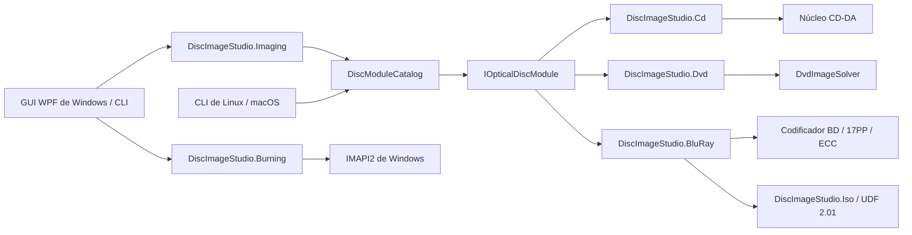

Traducción al español · [Original](ARCHITECTURE.md)

# Arquitectura

## Objetivo

El objetivo principal es que la interfaz de la aplicación no dependa de una codificación óptica concreta. CD, DVD y Blu-ray tienen distinta modulación física, corrección de errores, organización de sectores y sistemas de archivos. Por eso comparten el ciclo de vida de las tareas y las capacidades del producto, en lugar de una clase base de «codificador universal» que mezcle conceptos incompatibles.

`DiscImageStudio.Cli` y la aplicación de escritorio de Windows ejecutan los comandos sin conexión a partir del mismo catálogo de módulos. `DiscImageStudio.ImageIO` utiliza WIC en el destino de escritorio de Windows; en el destino genérico `net10.0` lee imágenes con StbImageSharp y escribe PNG con StbImageWriteSharp. Ambos proporcionan al generador píxeles BGRA en el mismo orden. Blu-ray comparte el código de composición de transparencia y conversión a escala de grises; CD y DVD también comparten, cada uno por separado, sus algoritmos de muestreo originales.

## Contratos de Core

`DiscImageStudio.Core` no referencia WPF, CD, DVD ni ningún codificador concreto, y tiene como destino `net10.0`.

- `IOpticalDiscModule`: límite de ejecución de un módulo.
- `DiscModuleDescriptor`: ID del módulo, familia de soporte, capacidad de cancelación y metadatos de comandos.
- `DiscCommandDescriptor`: definición de comandos, capacidades y opciones, disponible para una futura generación dinámica de la interfaz.
- `DiscJobRequest`: contenedor común de comandos y parámetros.
- `DiscJobProgress`: progreso independiente del soporte, etapa, cantidad completada y tiempo transcurrido.
- `DiscJobResult`: código de salida, resumen y rutas de salida.
- `DiscModuleCatalog`: enrutamiento de comandos, detección de duplicados y ejecución de módulos.
- `ToneProfile` / `ToneDither`: modelo tonal compartido por CD/DVD/BD —intensidad de tramado, niveles de gris, brillo y linealización sRGB— y fase determinista del tramado. CD y DVD aplican el tramado según el índice de byte lógico, de modo que la vista previa puede reproducirlo incluso después del entrelazado retardado de CD. BD cuantiza una sola vez a la resolución de la imagen de origen; la generación, la grabación y la vista previa utilizan la misma cuadrícula binaria.

Los tres valores de `OpticalDiscFamily` (`CompactDisc`/`Dvd`/`BluRay`) están implementados. Los proyectos, ajustes predefinidos, diseño, vista previa, exportación, grabación y calibración se organizan según esas tres familias.

Los ajustes de disco se almacenan en el archivo común `disc-presets.json` de Core, con esquema 4: contiene los grupos `cdPresets`, `dvdPresets` y `bluRayPresets`, cada uno con su lista independiente de elementos deshabilitados. Al leer archivos antiguos de esquema 2/3 se incorporan las plantillas BD integradas; la siguiente operación de guardado actualiza el esquema.

## Modelo de proyecto e interfaz

`DiscImageStudio.Core.ProjectJsonStore` gestiona `.discproj` (JSON UTF-8, `schemaVersion` 2): nombre del proyecto, familia de disco (CD/DVD/BD), geometría —r0/r1/sectores para CD; tres coeficientes de paso adicionales para DVD; alineación de 32 sectores, capacidad de una capa y radio ≤60 mm para BD—, lista de capas, configuración de salida, sección tonal opcional `tone`, sección opcional de polaridad `bluRay`, ruta del registro de calibración y miniatura renderizada al guardar. La ausencia de `tone` representa el umbral fijo de las versiones anteriores. Los archivos CD/DVD de `schemaVersion` 1 se escriben como versión 2 después de leerlos. `bluRay.invertMapping` sólo puede existir en proyectos BD; se rechazan los proyectos CD/DVD que incluyan esa sección. La lectura y la escritura se validan y utilizan un archivo temporal y una sustitución atómica, con las mismas reglas que el JSON de ajustes predefinidos. Las capas referencian las imágenes mediante rutas absolutas; no recopilan ni incorporan los recursos.

La interfaz utiliza un modelo de espacios de trabajo: una página de inicio sin barra lateral, con acciones para crear/abrir proyectos, tarjetas de plantillas y proyectos recientes, y cinco espacios del proyecto: Diseño / Vista previa / Exportar / Grabar / Calibrar. Se representan mediante el enum `Workspace`, y el orden de la barra lateral coincide con el flujo de trabajo. Cada espacio muestra una perspectiva del mismo proyecto, en lugar de constituir un proceso independiente. Todos comparten un `DiscParametersState`: al abrir un proyecto, `ProjectSession` vuelca el documento en ese estado; al guardar, captura el estado de vuelta al documento. De este modo, los enlaces de vista previa, exportación, grabación y calibración quedan desacoplados del ciclo de vida del proyecto. La marca de cambios pendientes sólo sigue las propiedades de State que se escriben en el archivo del proyecto.

`WindowWorkArea` limita el marco personalizado de la ventana principal: en `WM_GETMINMAXINFO` calcula la posición y el tamaño máximos a partir del área de trabajo física del monitor actual, incluidos la barra de tareas, los monitores con coordenadas negativas y los distintos DPI. Recalcula el tamaño mínimo al cambiar de monitor, resolución o DPI; ya no depende de los márgenes del monitor principal definidos por `SystemParameters.WindowResizeBorderThickness`.

Dos elementos hacen visible el flujo de trabajo: la **barra de etapas** (`StageBar`), situada debajo del título de `PageHeader`, y el botón «Siguiente» del espacio derecho del encabezado. La barra muestra Diseño → Vista previa → Exportar → Grabar │ Calibrar; resalta la etapa actual con el azul de la aplicación, atenúa las completadas y les añade una marca, y permite acceder directamente a cualquier etapa. La ventana conecta ambos elementos con `NavigateTo`: conserva las instancias de todas las páginas y, al cambiar de espacio, envía `CurrentWorkspace` a sus barras de etapas. Así, el flujo sigue visible y accesible en cada página sin depender de la barra lateral.

Las páginas comparten estructura y componentes de panel:

- `MonitorCard`: tarjeta de monitor con icono, título, subtítulo y espacio para acciones en el encabezado, contenido principal y barra de estado inferior opcional. Aloja los resultados de vista previa y la escena fotográfica de calibración.
- `StepCard`: tarjeta de paso numerado, con insignia de estado —pendiente/en curso/completado— y contenido plegable. Aloja el inspector de tres pasos de la página de calibración; el paso activo permanece abierto y los demás se pliegan.
- `VisibilityGate`: muestra u oculta contenido según un booleano y unifica las ramas de familia/modo de las páginas, sustituyendo sus estilos privados con DataTrigger.
- `PathField` y `SourceChip`: concentran en una implementación las filas de rutas y las bandas de origen repetidas.
- `EmptyStateCard`: unifica la orientación cuando una página está vacía, mediante un icono, una frase y una acción de navegación.

Hay dos estilos de encabezado de tarjeta: los contenedores de monitor/lista utilizan la banda de color `CardHeaderBandStyle` —por ejemplo, `MonitorCard` y la tarjeta de capas de Diseño—; las tarjetas de formulario mantienen un título plano. Ambos utilizan iconos de 15px. El espacio `Actions` de `SourceChip` aloja el botón para ir al componente responsable de los datos, por lo que la fila «resumen de sólo lectura + navegación» tiene el mismo aspecto en todas las páginas. Las reglas de densidad emplean la familia Compact de 36 px en barras laterales e inspectores, y la altura estándar de 44 px en el área principal y los botones de acción principales. Los paneles laterales comparten el token `SidePanelWidth` de 280.

Cada entrada de espacio de trabajo de la barra lateral tiene un icono. Al reducirse a 72 px, la barra pasa a mostrar sólo iconos: oculta los encabezados de grupo y lista directamente sus elementos. Ya no hay una lista plegada de iconos que exija otro clic para expandirse. A la derecha de la barra de título hay un botón permanente de engranaje y «Configuración» (`TitleBar.ShowSettingsButton` + `SettingsRequested`), accesible con un clic desde Inicio y todos los espacios. La barra reserva una columna independiente para ese botón y acorta automáticamente los nombres largos de proyecto con puntos suspensivos. El menú «…» situado a la izquierda de minimizar sólo ofrece «Acerca de…» (`TitleBar.ShowAppMenu` + `AppMenuRequested`); Ctrl+, también abre directamente Configuración. Los diálogos no muestran los accesos de la aplicación y «Acerca de» ya no aparece al pie de la barra lateral.

`DesignView` y `CalibrationView` adaptan su distribución al ancho de página. En ventanas anchas, el espacio se fija a la altura visible: el valor se recalcula al cambiar la ventana visible o el contenido del `ScrollViewer` exterior. Los estados transitorios —altura visible inicial cero o diferencias de un píxel por redondeo de DPI— no dejan la página en un estado de desplazamiento innecesario. En ventanas estrechas, los paneles se colocan debajo del área principal y se desplaza la página completa: Diseño cambia al bajar de 900 y Calibración al bajar de 990 de ancho. Diseño asigna una altura fija al lienzo en la distribución estrecha para evitar que quede inutilizable al comprimir las tres columnas. Su panel derecho contiene dos tarjetas de altura natural, propiedades y tono, con un `ScrollViewer` propio; por debajo de 900 se coloca debajo de la tarjeta de capas y se desplaza con la página. `TonePanel` es un UserControl independiente: en el panel derecho de 280 px presenta una miniatura del disco y una columna de controles; al ocupar todo el ancho en la disposición plegada, muestra un disco grande a la izquierda y los controles a la derecha. Tiene su propio ámbito de nombres, al que no puede acceder un `x:Name` de la página.

`PreviewInspectorViewModel` proporciona el panel de parámetros de Vista previa. Proyecta los conjuntos CD, DVD y BD sobre las mismas filas (`ArtifactPath`, `ArtifactLabel`, `MeasuredInnerRadius`, `PreviewSize`, `SamplesPerSector`…). No hay un selector local de familia: la proyección sigue estrictamente la del proyecto, indicada por `SetDiscType` al abrirlo. El inspector redirige las filas al conjunto actual en lugar de sustituirlas por otra copia del panel. El grupo de sólo lectura, geometría de generación, presenta el texto compuesto por `DiscParametersState` y enlaza con su editor responsable. La lectura de una imagen generada añade un interruptor de desentrelazado, enlazado directamente al `CdInterleave` compartido, para leer pistas externas sin archivo auxiliar según el entrelazado indicado por el usuario. BD no dispone de muestras por sector. Las escrituras de los parámetros propios de la vista previa —radios y paso medidos, y precisión— afectan a la familia visible y se agrupan en el desplegable de parámetros medidos y precisión de vista previa avanzada. Al leer una imagen BD, se carga automáticamente su archivo auxiliar del mismo nombre para recuperar los sectores totales, radios, inicio/final del dibujo, polaridad y tono. Un ISO externo sin ese archivo se sigue leyendo con la geometría del proyecto actual.

La proyección del diseño y la lectura de imágenes generadas comparten un máximo de 8192×8192: CD/DVD admiten 256–8192 px y BD 64–8192 px. Los valores fuera de rango se limitan a sus extremos al renderizar. Los tamaños predeterminados siguen siendo 1600 px para CD, 1200 para DVD y 2048 para BD. Se puede aumentar la precisión mediante el tamaño de exportación en píxeles de los parámetros avanzados. «Exportar vista previa» guarda el PNG actualmente renderizado, por lo que utiliza ese mismo tamaño.

Responsabilidad de los parámetros y presentación progresiva:

- **Geometría de generación:** r0, r1, sectores y los tres términos de paso de DVD sólo se editan en el diálogo de configuración del proyecto. Los demás espacios muestran `GeometrySummary`, de sólo lectura, y un botón «Editar…» que lleva a ese diálogo; ya no duplican el editor.
- **Ajustes predefinidos de disco:** son un acceso rápido a la geometría de generación y pertenecen al mismo lugar. Al crear un proyecto se eligen en la lista de plantillas de la izquierda, que muestra todos los ajustes no manuales del catálogo. El diálogo de configuración del proyecto ya no permite seleccionar familia ni ajuste: la familia queda fijada con el proyecto. Al pie de los parámetros, una acción para guardarlos como ajuste añade los campos actuales al JSON del usuario; un diálogo independiente confirma el nombre y el catálogo se actualiza al guardar.
- **Parámetros de entrega separados según el destino:** Exportar sólo escribe archivos —ruta, CUE, entrelazado, ISO/carpeta de datos/etiqueta de volumen—; Grabar sólo escribe el disco —contenido, grabadora y velocidad—. Ambos consumen la misma composición con calidad de exportación: el material comprobado en un archivo es el que se escribe en el disco. La familia CD/DVD de la grabación se deriva del origen, ya sea el proyecto o el patrón de calibración, y no hay un interruptor que permita elegir una familia incorrecta. El control segmentado de contenido de la página Grabar selecciona el origen para toda la página, igual que «proyección del diseño / lectura de imagen generada» en Vista previa. Al elegir la composición del proyecto muestra directamente su resumen; al elegir patrones auxiliares de calibración enlaza con Calibrar. La selección del origen ya no está anidada dentro del selector de destino.
- **Tono:** pertenece a la generación y se edita en el panel derecho de Diseño. La intensidad del tramado —0–100%, con 75% en proyectos nuevos—, la linealización sRGB (gamma), los niveles de gris de CD —2/4, frente a 2 fijos para DVD/BD— y el brillo (±64) se guardan en `tone`. La generación, la grabación por flujo, la lectura y la proyección de calibración comparten el mismo `ToneProfile`. BD añade un interruptor de polaridad 3T/6T, almacenado por separado en `bluRay.invertMapping`, no en `ToneProfile`. La miniatura del disco de este componente proyecta la composición actual con el mismo mapeo y se actualiza al mover los controles. Exportar conserva únicamente las opciones de salida e indica que el tono se modifica en Diseño; Vista previa no duplica ese editor.
- **Parámetros propios de la vista previa:** radios medidos, tamaño de exportación y muestras por sector permanecen en Vista previa porque corresponden a la inspección, no al proyecto. Al abrir un proyecto, la geometría medida coincide inicialmente con la del proyecto y la proyección es neutra por defecto. Las diferencias entre ambas geometrías aparecen al introducir mediciones; sólo la calibración modifica esos valores activamente.

El espacio Diseño (`DesignViewModel` + `DiscDesignCanvas` + `DesignComposer`) mantiene la pila de capas. Se almacenan en el orden del panel, con índice 0 arriba; el lienzo las dibuja de abajo arriba, en el mismo orden que la composición. Utiliza coordenadas en milímetros con origen en el centro del disco y admite arrastrar, escalar por las esquinas y girar mediante un tirador. Las filas de capas forman una lista seleccionable sincronizada en ambos sentidos con el lienzo y las propiedades. Tras un retardo de estabilización de 450 ms, `DesignComposer` produce una composición cuadrada de 2048 px para la vista previa y 8192 px para exportar. Su centro es el centro del disco y su lado equivale a 2 × el radio exterior del lienzo: 57.5 mm fijos en CD y el radio exterior de generación en DVD/BD. Su ruta se guarda en State como imagen de origen y se convierte en la entrada común de Exportar y Vista previa; la CLI de generación y la cadena de procesamiento no necesitan conocer este detalle. Exportar y Grabar utilizan la composición de 8192 px con calidad de exportación, de modo que el material verificado en la vista previa es el que se escribe en el disco. «Siguiente» recorre Diseño → Vista previa → Exportar → Grabar; a Calibrar se accede desde la barra lateral o el enlace de Grabar.

El lenguaje visual se concentra en `Themes/Tokens.xaml` —colores, colores semánticos, radios incluidos `RadiusChip`/`RadiusPanel` y curvas simétricas de encabezado/pie de tarjetas, alturas de controles, `SidePanelWidth`, márgenes de página, sombras y paleta del lienzo— y `Themes/Controls.xaml` —jerarquía de texto, familias de botones, entradas, filas de lista, paneles desplegables, tarjeta de advertencia `DangerCard` y plantillas de tarjetas de monitor y paso—. Las animaciones del código usan las tres duraciones de `Controls/Motion.cs`; los lienzos personalizados utilizan `Controls/DiscTheme.cs` y `Controls/DiscRenderCore.cs` para obtener los colores y dibujar el disco, sin paletas privadas independientes. Los estilos derivados de estilos implícitos en `Controls.xaml` (`BasedOn="{StaticResource {x:Type X}}"`) deben aparecer después del estilo implícito: una referencia adelantada no produce un error, sino que vuelve silenciosamente al estilo de Windows y muestra el control con el aspecto claro del sistema. Los paneles que alojan contenido con nombres definidos por la página, como `MonitorCard`, deben ser controles personalizados con plantilla, no UserControl. Un UserControl aísla el contenido en su propio ámbito de nombres, impide compilar los elementos `x:Name` de la página y deja sus elementos fuera del alcance de los puntos de captura y de las conexiones del lienzo.

El cambio de tema es inmediato: `Themes/Palette.Light.xaml` reemplaza todas las claves de colores y pinceles de `Tokens.xaml`; `Services/ThemeResolver` inserta o retira esa capa clara en la posición 1 de los diccionarios combinados, sin reconstruir las ventanas. Las vistas deben utilizar `DynamicResource` para las claves de la paleta: `StaticResource` fijaría el valor oscuro al cargar, y `ThemePaletteTests` detecta ese caso. Los controles que obtienen colores desde código (`SideNavItem`, `SegmentedControl`, `DiscDesignCanvas`, `CalibrationPhotoCanvas`, `JobDock` y `HelpHint`) se suscriben a `ThemeResolver.Changed` y vuelven a leer los tokens. El tema del sistema se obtiene de `HKCU\...\Themes\Personalize\AppsUseLightTheme`.

`Services/AppSettingsStore` guarda la configuración de la aplicación en `%LOCALAPPDATA%\DiscImageStudio\settings.json`, utilizando camelCase, enums de texto, un archivo temporal y sustitución atómica: tema, ubicación predeterminada de proyectos y caché. Si falta el archivo, está dañado o su `schemaVersion` supera la admitida, se utilizan valores predeterminados; `AppSettings.Normalize` descarta rutas inválidas introducidas manualmente. La configuración nunca se escribe en `.discproj`. La ubicación predeterminada sólo afecta al directorio inicial del diálogo de nuevo proyecto; si no existe, se utiliza Documentos del sistema. `Services/TempFiles` gestiona el directorio de caché configurable (`LivePreviewDirectory`) para composiciones de diseño, miniaturas y vistas previas. Cambiarlo sólo afecta a tareas nuevas. El vaciado de caché elimina únicamente los nombres de una lista permitida (`design-composite-*`, `design-tone-*`, `design-thumbnail.png`, `cd/dvd/bd-live-*` y sus archivos auxiliares `.png.json`); nunca elimina directorios, proyectos ni archivos exportados. La ventana de configuración edita una copia hasta guardar; Cancelar o Esc descarta todos los cambios.

## Capa de preprocesamiento de imágenes

`DiscImageStudio.Imaging` se sitúa entre la interfaz y los módulos de codificación de soportes. Actualmente sólo contiene `RingImageQuality`, la constante de tamaño de generación definitivo de la composición de Diseño (8192 px), compartida por composición, exportación, grabación y lectura. `DesignComposer` realiza sobre el lienzo en milímetros la disposición de la imagen en el disco: escala, centrado y recorte al anillo de contenido. Exportar, Grabar y Vista previa consumen directamente esa composición; ya no hay otro paso independiente de preprocesamiento.

## Capa de grabación por flujo

Para CD, `OpticalBurnRequest.ProduceContent` exige expresamente PCM sin cabecera, de 44.1 kHz, 16 bits, estéreo y little-endian. `ContentLength` cuenta únicamente los datos de audio. El flujo sin cabecera predeterminado del generador CD mantiene la salida big-endian anterior; al llamar a IMAPI, la interfaz elige explícitamente `CdAudioByteOrder.LittleEndian`. La conversión se realiza en la salida de sectores completos, después del entrelazado retardado. La generación de archivos elige el formato según la extensión `.wav` / `.raw`: WAV utiliza los mismos datos little-endian, añade una cabecera RIFF de 44 bytes y un CUE WAVE del mismo nombre; el RAW anterior conserva big-endian. Las mediciones del constructor de imágenes RAW de Windows confirmaron que conserva los bytes recibidos sin corregir su orden. Véase [Compatibilidad de grabación de CD](CD_AUDIO_COMPATIBILITY.es.md).

`DiscImageStudio.Burning` sólo se ocupa de enumerar dispositivos IMAPI2 de Windows, comprobar el soporte, adaptar COM `IStream`, proporcionar un búfer de memoria limitado a 64 MiB —precargado con 32 MiB antes de comenzar— y gestionar el ciclo de grabación. Al iniciar realmente una grabación CD/DVD, la velocidad automática vuelve a consultar la configuración de escritura del disco actual y selecciona la mínima. Una velocidad manual se conserva; si el dispositivo no comunica velocidades, se utiliza la alternativa conservadora de la interfaz de grabación. Los generadores CD/DVD siguen siendo responsables del formato: CD produce secuencialmente sectores de audio de 2352 bytes y el algoritmo rápido de DVD sectores de datos de 2048 bytes. La grabadora consume esos bloques bajo demanda, sin crear una imagen completa en disco. La salida original a archivos no utiliza esta capa; un fallo no altera ese flujo de trabajo.

El modo DVD mixto con carpeta genera secuencialmente en dos fases: primero examina el directorio y determina los metadatos ISO9660/Joliet, los extents de los archivos y los LBA inicial/final del dibujo; después emite el contenido según la distribución prevista. En modo de anillo interior, el orden es «metadatos → archivos → patrón»; en modo exterior, «metadatos → patrón → archivos». El patrón se alinea con bloques ECC de 16 sectores. El plan sólo conserva metadatos, no el contenido de los archivos, y admite flujos sin Seek.

BD-R reutiliza el mismo contrato de grabación. `BluRayIsoGenerator` escribe UDF 2.01, el área del patrón y los metadatos de respaldo del final del disco en un único flujo hacia delante. El modo de anillo exterior mueve toda la partición de archivos hasta antes del área de respaldo final; el patrón mantiene la alineación de 32 sectores y permanece fuera de la partición. La página Grabar entrega el flujo directamente a una sesión de escritura secuencial MMC, sin guardar una imagen completa de 25 GB. BD no implementa remapeo a un área de reserva; normalmente no es posible continuar escribiendo el disco después de una interrupción.

`ProjectOutputs.FilesAtOuterRing` es opcional y vale `false` por defecto. DVD y BD sincronizan, cada uno por separado, exportación, vista previa y grabación mediante el estado de parámetros compartido. La vista previa de la GUI marca en amarillo el área de archivos según los límites inicial/final del dibujo, incluidas las reservas necesarias del sistema de archivos; ese color no entra en el generador. Las imágenes ya generadas utilizan los intervalos fijos de su archivo auxiliar, sin intentar reconstruir la distribución a partir del directorio actual.

## Límites entre módulos

### CD

`DiscImageStudio.Cd` es responsable de la geometría CD, el muestreo de imágenes, la salida RAW y el entrelazado retardado. Implementa cancelación y convierte el progreso en bytes a `DiscJobProgress`.

### DVD

`DiscImageStudio.Dvd` es un adaptador ligero: gestiona metadatos, enrutamiento y normalización de resultados antes de llamar al motor aislado `DvdImageSolver`. Los parámetros originales y la autocomprobación del motor DVD permanecen sin cambios.

### Blu-ray

`DiscImageStudio.BluRay` es responsable de la geometría BD, 17PP, EDC/Reed-Solomon/LDC-BIS, el mapeo de recuentos de secuencias 3T/6T, la generación por flujo y la planificación ISO. Referencia `DiscImageStudio.Iso` para escribir UDF 2.01. Sólo expone tareas a la GUI mediante los contratos de Core; no referencia ni modifica tipos internos de CD/DVD. Su `ToneProfile` cuantiza a la resolución de origen y `BluRayRunLengthMapping` sólo aplica el umbral 128 y el intercambio de polaridad. Durante la generación escribe junto al ISO un archivo auxiliar `bd-r-image-v1`, con sectores, radios, inicio/final del dibujo, polaridad, tono y marcas temporales UDF.

## Reglas de extensión

1. Los ID de módulo y nombres de comando deben ser globalmente únicos; el catálogo rechaza los conflictos al arrancar.
2. Los módulos no deben leer estado de controles GUI: todas las entradas proceden de `DiscJobRequest`.
3. Los módulos no deben mostrar ventanas directamente: devuelven registros, progreso y resultados a través de los contratos.
4. Si el algoritmo subyacente no puede cancelarse con seguridad, `SupportsCancellation` debe ser `false`.
5. Los formatos específicos de un soporte permanecen en su módulo; sólo los conceptos estables y realmente compartidos pertenecen a Core.
6. Un módulo nuevo debe añadir pruebas de enrutamiento del catálogo y una prueba mínima de generación de salida.
