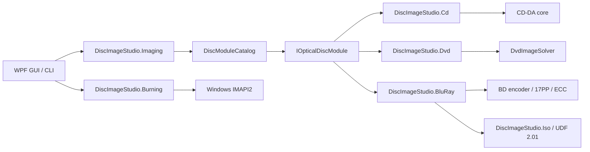

# 架构说明

## 目标

核心目标是让应用外壳不依赖某一种光盘编码。CD、DVD、蓝光的物理调制、纠错、扇区组织和文件系统不同，因此共享的是任务生命周期和产品能力，不共享错误的“万能编码器”基类。

## Core 契约

`DiscImageStudio.Core` 不引用 WPF、CD、DVD 或任何具体编码器，并以 `net10.0` 为目标。

- `IOpticalDiscModule`：模块执行边界。
- `DiscModuleDescriptor`：模块 ID、介质家族、取消能力和命令元数据。
- `DiscCommandDescriptor`：命令、能力和选项定义，可供未来动态生成界面。
- `DiscJobRequest`：统一命令与参数载体。
- `DiscJobProgress`：介质无关的进度、阶段、完成量和耗时。
- `DiscJobResult`：退出码、摘要和输出路径。
- `DiscModuleCatalog`：命令路由、重复命令检查和模块执行。
- `ToneProfile` / `ToneDither`：CD/DVD/BD 共用的影调模型（抖动强度、灰阶档位、亮度、sRGB 线性化）与确定性抖动相位。CD/DVD 在逻辑字节索引上抖动，因此 CD 延迟交织后仍可在预览中复现；BD 在源图分辨率一次性量化，生成、刻录与预览共用同一张二值栅格。

`OpticalDiscFamily` 的三种取值（`CompactDisc`/`Dvd`/`BluRay`）都已实现；工程、预设、设计、预览、导出、刻录与标定都按这三种盘型分支。

盘片预设由 Core 的统一 `disc-presets.json`（schema 4）承载：`cdPresets`、`dvdPresets`、`bluRayPresets` 三组，各有独立的禁用列表。读取 schema 2/3 的旧文件时补入内置 BD 模板并在下一次保存时升级。

## 工程模型与外壳

`DiscImageStudio.Core.ProjectJsonStore` 持有 `.discproj`（UTF-8 JSON，schemaVersion 2）：工程名、盘型（CD/DVD/BD）、几何（CD r0/r1/扇区；DVD 加三次轨距系数；BD 要求 32 扇区对齐、单层容量与 ≤60 mm）、图层列表、输出配置、可选的 `tone` 影调节、可选的 `bluRay` 极性节、标定记录路径和保存时渲染的缩略图。`tone` 缺省表示旧版硬阈值；schemaVersion 1 的 CD/DVD 文件读取后自动按 2 写回。BD 的 `bluRay.invertMapping` 只存在于 BD 工程，CD/DVD 携带该节会被拒绝。读写都经过校验并使用临时文件原子替换，规则与预设 JSON 一致。图层按绝对路径引用图片，不收集资源。

外壳是工作区模型：起始页（无侧边栏，提供新建/打开、模板卡片与最近工程）加上五个工程工作区——设计 / 预览 / 导出 / 刻录 / 标定（`Workspace` 枚举，侧边栏顺序即工作流顺序）。每个工作区都是同一个工程的一个视角，不是各自独立的一套流程：共享一个 `DiscParametersState`，打开工程时 `ProjectSession` 把文档内容填进它，保存时再捕获回文档；预览、导出、刻录、标定对 State 的绑定因此与工程生命周期完全解耦。脏标记只跟踪会写进工程文件的 State 属性。

主窗口的自定义 chrome 由 `WindowWorkArea` 约束：它在 `WM_GETMINMAXINFO` 中按当前显示器的物理工作区（含任务栏、负坐标显示器与不同 DPI）设置最大位置/尺寸，并在窗口跨屏、分辨率或 DPI 变化时重算最小尺寸；不再依赖 `SystemParameters.WindowResizeBorderThickness` 的系统主屏边距。

工作流的可见性由两件外壳设施承载：页眉（`PageHeader`）标题行下方的**阶段条**（`StageBar`，设计 → 预览 → 导出 → 刻录 │ 标定，当前阶段品牌蓝高亮、已过阶段打勾弱化、任意阶段可点击直达）与页眉右槽的「下一步」按钮。二者都由窗口接线到 `NavigateTo`：窗口持有全部页面实例，在工作区变化时把 `CurrentWorkspace` 推给各页的阶段条，因此工作流在每一页都可见、可达，而不依赖侧边栏。

工作区页面的骨架与面板语言是共享的：`MonitorCard`（监视器卡：头部图标 + 标题 + 副标题 + 动作槽，主体内容，可选状态底栏）承载预览结果与标定照片舞台；`StepCard`（编号步骤卡：状态徽章 待开始/进行中/已完成 + 可折叠主体）承载标定页的三步检查器，活动步骤展开、其余收起；`VisibilityGate`（按一个布尔显隐内容）统一各页的盘型/模式分支，替代了各视图私有的 DataTrigger 样式；`PathField`、`SourceChip` 把反复出现的路径行、来源条收敛成单一实现；`EmptyStateCard`（图标 + 一句话 + 跳转动作）统一各页的空态引导。卡片头分两档：监视/列表容器用 `CardHeaderBandStyle` 色带头（MonitorCard、设计页图层卡），表单卡保持平铺标题；两者图标同为 15px。`SourceChip` 的 `Actions` 槽承载「转到拥有者」的按钮，因此「只读摘要 + 跳转」这一行在所有页面是同一份外观。密度规则：侧栏/检查器面板一律用 Compact 家族（36 px），主舞台与主操作按钮用标准高度（44 px），两侧面板宽度统一 `SidePanelWidth`（280）令牌。

侧边栏在每个工作区条目上都带图标，收起成 72 px 时即成为图标栏（组头在收窄态隐藏、子项直接列出）；不再有需要二次点击才展开的折叠图标列表。「设置…」与「关于…」统一收进标题栏最小化按钮左侧的「…」应用菜单（`TitleBar.ShowAppMenu` + `AppMenuRequested`，Ctrl+, 直达设置），主页与工程态都能打开，侧边栏底部不再保留「关于」入口。

`DesignView` 与 `CalibrationView` 都按页宽切换布局：宽窗口下工作区钉住为视口高度（钉住值随外层 `ScrollViewer` 的视口/内容尺寸变化重算，首次布局视口为零、DPI 取整差一像素等瞬态不会把页面留在无意义的滚动状态）；窄窗口下侧栏折到舞台下方、整页滚动（设计页在页宽 < 900 时改变，标定页 < 990）。设计页在窄布局下给画布固定高度，避免三栏挤在一起时画布被压到不可用。设计页右栏是“属性 + 影调”两张自然高度的卡片，由右栏自己的 `ScrollViewer` 滚动；页宽 < 900 时右栏折到图层卡下方并随整页滚动。影调模块（`TonePanel`）是独立 UserControl，在 280 px 右栏里用缩略盘面 + 单列控件，在折页后的整宽右栏里切换为左侧大盘面、右侧控件（它有自己的名称范围，页面级 `x:Name` 不能穿透）。

预览页的参数面板由 `PreviewInspectorViewModel` 提供：它把 CD、DVD、BD 三套参数集投影成同一组行（`ArtifactPath`、`ArtifactLabel`、`MeasuredInnerRadius`、`PreviewSize`、`SamplesPerSector` …）。盘型没有页内开关——投影预览严格跟随工程盘型，打开工程时由 `SetDiscType` 指定，检查器只是把这组行重新指向当前盘型，而不是换上第二份面板副本。只读组（生成几何）以 `DiscParametersState` 组合好的文案呈现并跳转到拥有者；成品读回模式额外提供「逆交织」开关，直接绑定共享的 `CdInterleave`，让外部音轨（没有 sidecar）按用户声明的交织方式读回；BD 没有每扇区采样项。预览自有组（实测半径与轨距、预览精度）的写入会落到当前显示的盘型，并折叠进「实测参数与预览精度（高级）」展开器。BD 的成品读回会自动读取同名 sidecar，恢复总扇区、半径、绘图起止、极性与影调；没有 sidecar 的外部 ISO 仍按当前工程几何读回。

参数归属与渐进披露：

- **生成几何**（r0、r1、扇区、DVD 三项轨距）只在工程设置对话框里编辑。其他工作区显示只读摘要（`GeometrySummary`）和「编辑…」直达按钮，不再各自提供一份编辑器。
- **盘片预设**是生成几何的快捷入口，归属同一处：新建工程经左侧模板列表选择（列出目录中全部非手动预设）。工程设置对话框不再展示盘型与预设选择——盘型随工程固定，参数区底部提供「将此套参数保存为预设」，把当前字段追加进用户预设 JSON（弹出独立窗口确认名称，保存后目录即时刷新）。
- **交付参数按目的地分家**：导出工作区只管写文件（输出路径、CUE、交织、ISO/数据文件夹/卷标），刻录工作区只管写盘（写入内容、刻录机与速度）。两者消费同一张导出质量合成图，文件验证过的素材就是写入盘片的素材；刻录的 CD/DVD 由来源推导（工程盘型或标定图案盘型），没有可以拨到错误一侧的开关。刻录页的「写入内容」分段控件是页面级来源选择（与预览页「设计投影 / 成品读回」同一模式）：选工程合成图时直接给出来源摘要，选辅助标定图案时链接到标定工作区；来源选择不再嵌套在目的地开关内部。
- **影调**是生成参数，归设计工作区右栏：抖动强度（0–100%，新工程 75%）、sRGB 线性化（伽马）、CD 的灰阶档位（2/4 级；DVD/BD 固定 2 级）与亮度（±64）写进工程 `tone` 节，生成、流式刻录、读回与标定投影共用同一个 `ToneProfile`。BD 另有 3T/6T 极性开关，数据上是独立的 `bluRay.invertMapping`，不塞进 `ToneProfile`。模块内的盘面预览用同一映射投影当前合成图，拖动滑块即时更新；导出页只保留输出选项并提示影调在设计页，预览页不重复编辑。
- **预览专属参数**（实测半径、导出尺寸、每扇区采样）留在预览页，因为它们是检视行为而非工程参数。打开工程时实测几何先跟随工程几何，设计投影因此默认中性；用户填入实测值后才显示两套几何的偏差，只有标定流程会主动改写它们。

设计工作区（`DesignViewModel` + `DiscDesignCanvas` + `DesignComposer`）维护图层栈：图层按面板顺序存储（顶部索引 0，画布自下而上绘制，与合成顺序一致），画布以盘心为原点的毫米坐标系渲染并支持拖动/角点缩放/旋转柄；图层行是可选中列表，与画布及属性面板双向同步。图层编辑经 450 ms 防抖后由 `DesignComposer` 渲染出方形合成图（预览 2048 px，导出 8192 px）：方形中心即盘心，边长对应 2 × 画布外半径（CD 固定 57.5 mm，DVD/BD 为生成外半径）。合成图写入 State 的源图片路径，成为导出与预览的共同输入；生成 CLI 与管线对此无感知。导出与刻录两条交付路径都使用导出质量的 8192 px 合成图，因此预览验证的素材就是写入盘片的素材。页眉的「下一步」贯穿 设计 → 预览 → 导出 → 刻录，标定经侧边栏或刻录页的链接进入。

设计语言集中在 `Themes/Tokens.xaml`（颜色、语义色、圆角含 `RadiusChip`/`RadiusPanel`/卡片头尾镜像弧、控件高度、`SidePanelWidth`、页面留白、浮层阴影、画布调色板）与 `Themes/Controls.xaml`（文字层级、按钮族、输入控件、列表行、披露面板、`DangerCard` 警示卡、监视器与步骤卡模板）。代码侧动画统一走 `Controls/Motion.cs` 的三档时长，自定义画布统一通过 `Controls/DiscTheme.cs` 与 `Controls/DiscRenderCore.cs` 取色与绘制盘体，不再各自内置一套调色板。`Controls.xaml` 内基于隐式样式的派生样式（`BasedOn="{StaticResource {x:Type X}}"`）必须写在隐式样式之后：前向引用不会报错，而是静默回退到 Windows 自带样式，控件会以浅色系统外观出现。需要承载页面命名内容的面板（如 `MonitorCard`）做成模板化自定义控件而不是 UserControl：UserControl 会把内容隔离进自己的名称范围，页面里 `x:Name` 的元素无法编译，快照钩子与画布接线也因此够不到它们。

主题切换是即时的：`Themes/Palette.Light.xaml` 覆盖 `Tokens.xaml` 的全部颜色与画刷键，`Services/ThemeResolver` 在合并字典的第 1 位插入或移除浅色层，窗口无需重建。因此视图对调色板键必须使用 `DynamicResource`（`StaticResource` 会把深色值固化在加载时刻，`ThemePaletteTests` 会拦截）；代码侧取色的控件（`SideNavItem`、`SegmentedControl`、`DiscDesignCanvas`、`CalibrationPhotoCanvas`、`JobDock`、`HelpHint`）订阅 `ThemeResolver.Changed` 并重新读取令牌。系统主题取 `HKCU\...\Themes\Personalize\AppsUseLightTheme`。

应用设置由 `Services/AppSettingsStore` 持久化到 `%LOCALAPPDATA%\DiscImageStudio\settings.json`（camelCase、字符串枚举、临时文件原子替换）：主题、默认工程位置和缓存位置。缺失、损坏或 schemaVersion 高于当前版本的文件回落到默认值，手工改坏的路径在 `AppSettings.Normalize` 中被丢弃；设置从不写入 `.discproj`。默认工程位置只影响新建工程对话框的初始目录，不存在时回落到系统文档目录。`Services/TempFiles` 持有可配置的缓存目录（`LivePreviewDirectory`），设计合成图、缩略图与预览图都写到这里；切换只影响新任务，清空缓存按文件名白名单（`design-composite-*`、`design-tone-*`、`design-thumbnail.png`、`cd/dvd/bd-live-*` 及其 `.png.json` sidecar）删除，绝不删除目录、工程或导出文件。设置窗口在保存前只改副本，取消或 Esc 丢弃全部编辑。

## 图片预处理层

`DiscImageStudio.Imaging` 位于界面与介质编码模块之间，当前只承载 `RingImageQuality`：设计页合成图的正式生成尺寸（8192 px）常量，供设计合成、导出与刻读共用。图片到盘面的布局（缩放、居中、裁剪到内容环）由设计页的 `DesignComposer` 在 mm 画布上完成，导出/刻录/预览直接消费合成结果，不再有独立的预处理步骤。

## 流式刻录层

CD 的 `OpticalBurnRequest.ProduceContent` 明确要求无头的 44.1 kHz、16 位、双声道小端 PCM，`ContentLength` 只计音频数据。CD 生成器的默认无头流保留旧大端输出，调用 IMAPI 时由外壳显式选择 `CdAudioByteOrder.LittleEndian`；转换在延迟交织完成后的整扇区输出处进行。文件生成根据 `.wav` / `.raw` 后缀选择格式：WAV 使用同样的小端音频数据，额外写入 44 字节 RIFF 头和同名 WAVE CUE；旧 RAW 保持大端。Windows RAW 镜像构造器实测原样保留传入字节，不负责修正字节序。详见 [CD 刻录兼容说明](CD_AUDIO_COMPATIBILITY.md)。

`DiscImageStudio.Burning` 只负责 Windows IMAPI2 设备枚举、介质检查、COM `IStream` 适配、64 MiB 有界内存缓冲（开刻前预填充 32 MiB）和刻录生命周期。自动速度会在真正开始 CD/DVD 刻录时重新读取当前盘片的写入配置并选择最低值，手动选择仍保持原值；设备不报告速度时使用刻录接口的保守回退。CD/DVD 生成器仍拥有介质格式：CD 顺序产生 2352 字节音频扇区，DVD 快速算法顺序产生 2048 字节数据扇区。刻录器按需读取这些块，因此磁盘上不出现完整镜像。原文件输出入口不经过该层，失败时不会破坏原工作流。

DVD 混合文件夹模式采用两阶段顺序生成：第一阶段扫描目录，确定 ISO9660/Joliet 元数据、文件 extent 及绘图起止 LBA；第二阶段按规划的盘面顺序输出，内圈模式为“元数据 → 文件 → 图案”，外圈模式为“元数据 → 图案 → 文件”。图案按 16 扇区 ECC Block 对齐。布局计划只保存元数据，不缓存文件内容，支持不可 Seek 的流。

BD-R 复用同一刻录契约：`BluRayIsoGenerator` 在一个前向流里写入 UDF 2.01、图案区与盘尾备份元数据；外圈模式将完整文件分区移至尾部备份区前，图案始终保持 32 扇区对齐且位于分区之外。刻录页把该流直接喂给 MMC 顺序写入会话，不落盘完整 25 GB 镜像。BD 不提供备用区重映射；中断后盘片通常不可继续写入。

`ProjectOutputs.FilesAtOuterRing` 为可选字段，默认 `false`，DVD/BD 各自通过共享参数状态同步导出、预览与刻录。文件区在 GUI 预览中按绘图起止边界标黄，包含必要的文件系统保留区；该配色不进入生成器。已有成品依赖其 sidecar 的固定范围，不使用当前目录重新猜测布局。

## 模块边界

### CD

`DiscImageStudio.Cd` 拥有 CD 几何、图片采样、RAW 输出和延迟交织。它实现取消，并把字节进度转换成统一的 `DiscJobProgress`。

### DVD

`DiscImageStudio.Dvd` 是薄适配器。它只负责元数据、路由与结果归一化，然后调用隔离的 `DvdImageSolver`。DVD 引擎原参数和自检保持不变。

### Blu-ray

`DiscImageStudio.BluRay` 拥有 BD 几何、17PP、EDC/Reed-Solomon/LDC-BIS、3T/6T run-count 映射、流式生成和 ISO 计划，并引用 `DiscImageStudio.Iso` 写 UDF 2.01。它只通过 Core 契约向 GUI 暴露任务，不引用或修改 CD/DVD 内部类型。BD 的 `ToneProfile` 在源图分辨率量化，`BluRayRunLengthMapping` 只做 128 阈值和极性交换；生成时在 ISO 旁写出 `bd-r-image-v1` sidecar，记录扇区、半径、绘图起止、极性、影调与 UDF 时间戳。

## 扩展规则

1. 模块 ID 和命令名必须全局唯一，目录会在启动时拒绝冲突。
2. 模块不得从 GUI 控件读取状态；输入全部来自 `DiscJobRequest`。
3. 模块不得直接显示窗口；日志、进度和结果通过契约返回。
4. 如果底层算法不能安全取消，`SupportsCancellation` 必须为 `false`。
5. 介质专用格式留在专用模块；只有稳定且真正共享的概念进入 Core。
6. 新模块必须增加目录路由测试和一个最小输出冒烟测试。
