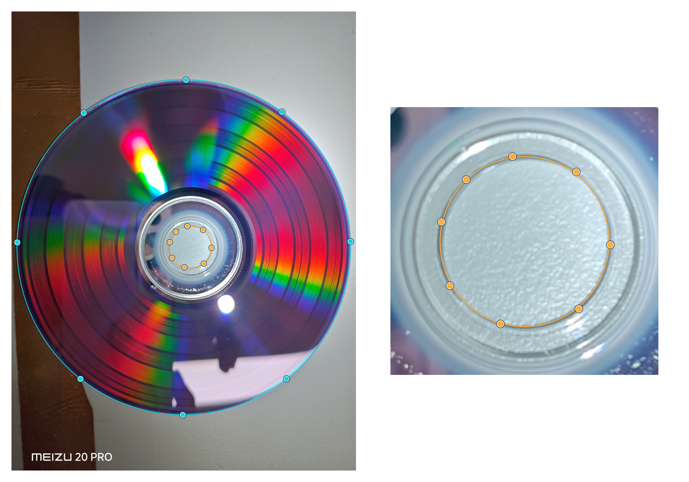
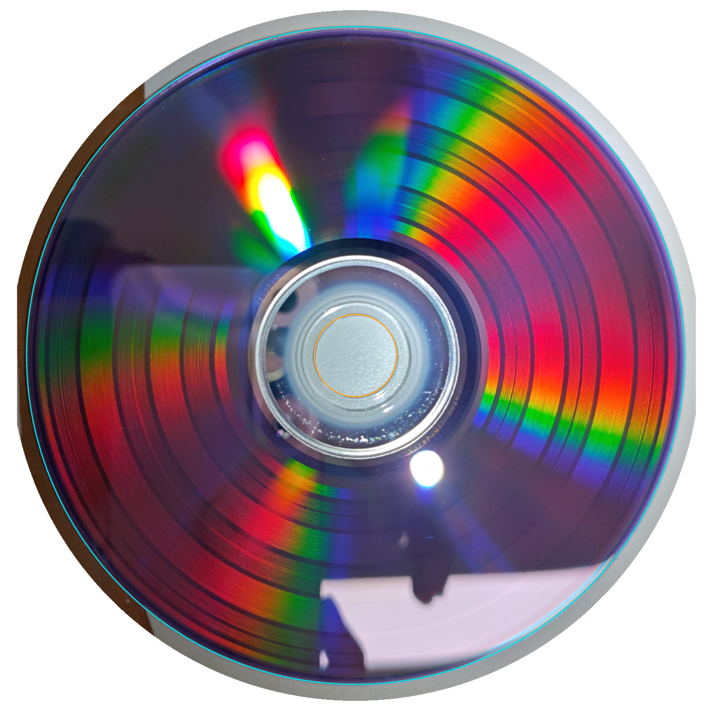
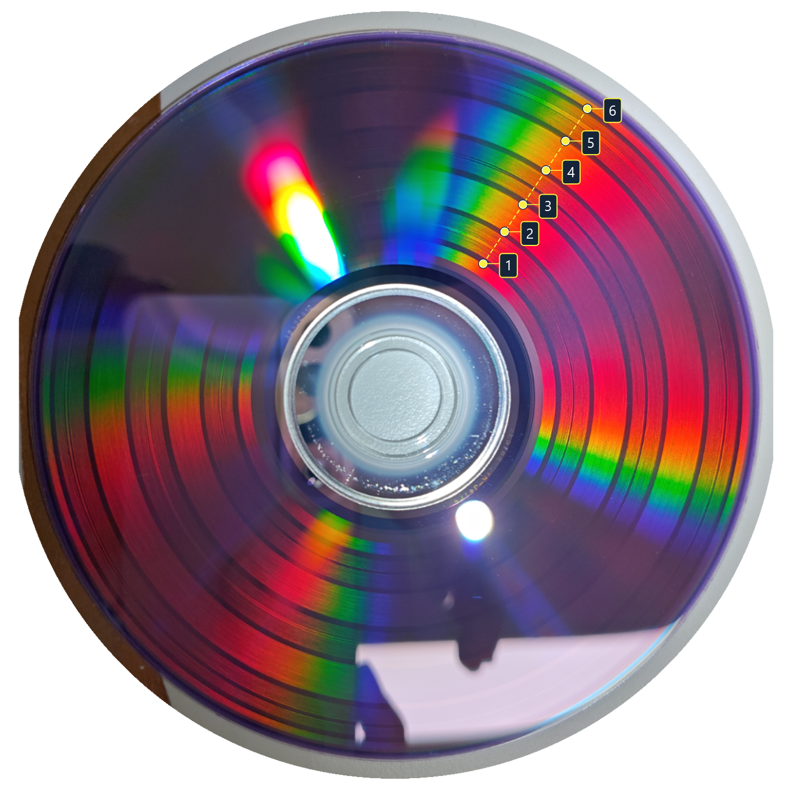
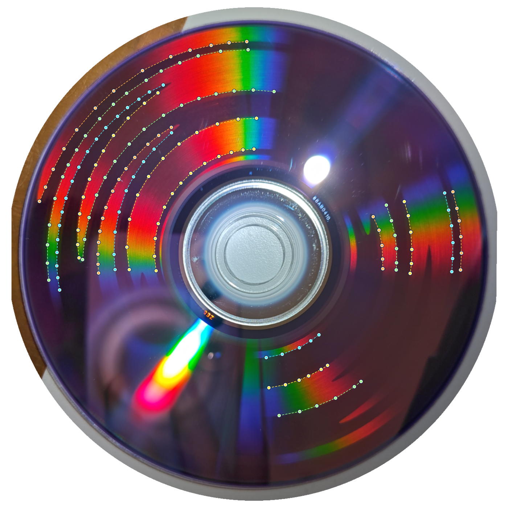
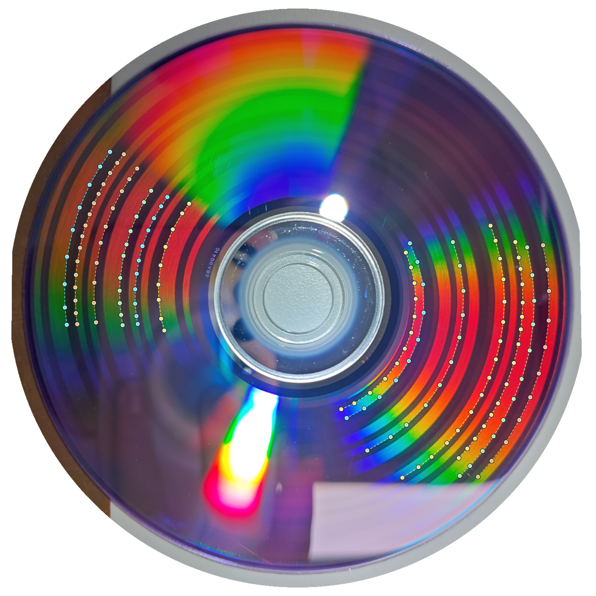
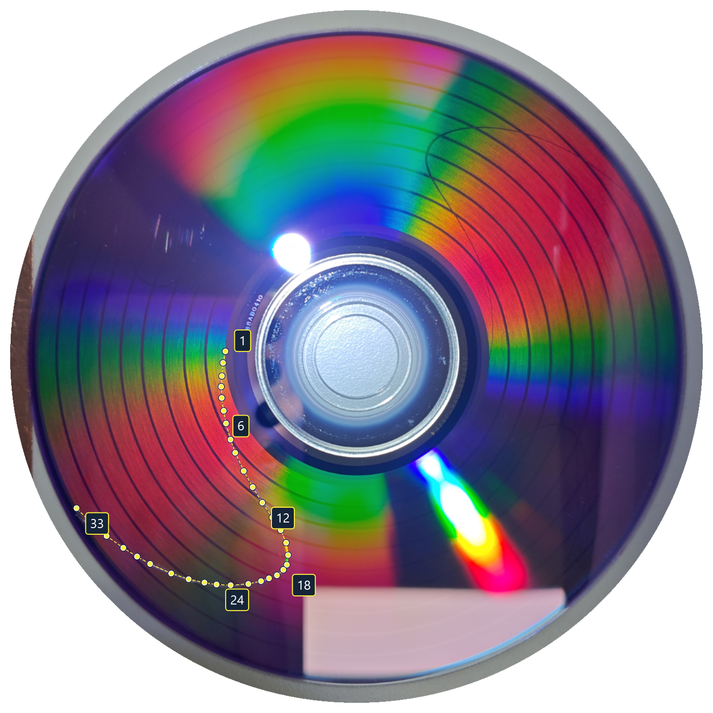

# Assisted Calibration

[简体中文](CALIBRATION.md) | **English**

For a first use, you can follow [DVD Calibration Walkthrough: Verbatim AZO DVD-R](CALIBRATION_TUTORIAL.en.md) to see the actual records for all three stages, the points taken in practice, and the disc surface after fine calibration. This document first explains the shared photo rectification used by every stage, then explains how to generate, measure, apply, and fine-calibrate again.

Open **Assisted Calibration** from the home page or the project sidebar, then choose **Coarse Calibration**, **Boundary Calibration**, or **Fine Calibration** as needed. When reliable initial values are already available, you can start directly with boundary or fine calibration. Every disc should use the `.calibration.json` saved when its target was generated, together with photos of that disc.

When a project exists, the calibration page keeps the two navigation groups, **Design, Export, Burn** and **Preview, Calibrate**; calibration burns are also under **Calibrate**. Calibration uses independent disc parameters, so changing its settings does not modify the drawing project. When there is no project, calibration can also be completed independently from the home page. Click **Back** to return to the page from which calibration was opened.

## Complete Photo Rectification First

Rectify each calibration disc's photos using the steps below before measuring wide bands or tracing lines. If the disc has not been burned yet, first review the photography requirements, then generate the target in the next section.

1. Take a photo or scan that shows the **entire physical outer edge and center hole** of the disc, keeping the complete rim. If reflections obscure the area to be measured, adjust the lighting and retake the same disc.
2. Open the **calibration record from when this disc was generated** and import the corresponding photo. Select the physical **12 cm or 8 cm** size; this determines a physical outer radius of 60 mm or 40 mm. It is not the radius of the burned area.
3. Drag each outer control point to the **physical outer edge** of the disc, and each inner control point to the **edge of the center hole**. The burned-area boundary, transparent plastic ring, bright reflective ring, and shadows are not suitable as physical boundaries. Use the wheel to zoom and the right mouse button to pan; zoom in especially to inspect the hole edge.
4. Click **Calculate Rectification** and inspect the disc rim and center hole in the front-view preview. If necessary, return to adjust the control points and calculate again. Confirm the rectification after checking it.
5. Perform all subsequent measurements on the **rectified photo**. After changing the physical size or boundary control points, rectify and measure again; do not continue using points from the old coordinates.

**Photo resolution.** When importing, keep the original pixel dimensions whenever possible: the long edge is limited to **8192 px**, and the total pixel count is limited to **33,554,432 (32 × 1024 × 1024)**. If either limit is exceeded, the image is reduced proportionally. Typical 12-megapixel and 24-megapixel phone photos remain at their original size within both limits.

The rectified image automatically selects a size according to the local pixel density of the disc projection and includes a **3 mm** canvas margin outside the physical rim; it is no longer fixed at 1400 × 1400. The output is also subject to the pixel budget, with a square maximum of **5792 × 5792**. Window fitting and wheel zoom only change the display size; they do not reduce the working image again. Keeping more pixels helps inspect details but does not provide an equivalent increase in measurement accuracy. The physical edge, reflective obstruction, and reproduced result still need to be checked.

This image was reconstructed from the Verbatim AZO DVD-R example record: **cyan** marks the 8 points on the physical outer edge, and **orange** marks the 8 points on the center-hole edge. The magnified hole view helps identify the correct boundary. It illustrates the points taken in the actual record; it is not a screenshot of the application interface.

The physical size is used to restore the millimeter scale, while the burned-area size is determined by the target-generation parameters. The preview above was reconstructed from the same record: the **cyan reference circle** corresponds to the physical outer edge, and the **orange reference circle** corresponds to the center hole. Rectification preserves the actual burned curvature on the disc and does not separately correct lens radial distortion. Do not move the rim control points just to make the crosshair straight.

## Choose a Stage and Generate a Calibration Disc

| When to use | New burn pattern | What to measure in the photo |
| --- | --- | --- |
| The inner and outer radii are still uncertain | **Coarse Calibration**: three wide bands, each with angle markers | Along one radius, measure the inner and outer edges of all three bands, six points in total |
| Initial values are available and the radii need further correction | **Boundary Calibration**: wide light and dark regions, with two opposing boundaries oscillating along the radius | Trace the clearly visible **light/dark boundary**; trace one segment when continuous, and split it when obstructed |
| Thin arms can be distinguished and the final geometry needs checking | **Fine Calibration**: concentric circles with a crosshair | Select one clear thin arm and trace points along its **centerline** from inside to outside |

1. Select the stage, disc type, and preset corresponding to the physical disc, then verify the inner and outer radii and sector count. **Read from Disc** can fill the sector count reported by the disc. If there is only one burner, read it directly; with multiple burners, select the device first. Discs with the same capacity may still have different inner and outer radii.
2. Click **New Target**. The disc type, geometry, capacity, and relevant encoding settings at generation time are fixed in the record. Save the previous disc's record first if you need to keep its photos and inputs.
3. Generate the file on the calibration page, or choose streaming burn. CD output is `.wav` (with an accompanying `.cue`) or `.raw`; DVD and BD output a plain drawing `.iso`. A same-named `.calibration.json` is saved beside the file. Streaming burn also saves the record first, then opens the dedicated burn page for device selection and confirmation.
4. After completing this stage's measurements and applying the radii, select the next stage as needed and **create that stage's target**, then burn and photograph the new pattern. Switching stages only changes the settings for the next generation; it does not rewrite records for existing discs.

Independent assisted calibration and the project page share the bottom task bar. Preparation, writing, and finalization for streaming burns, the amount to be written during device confirmation, live speed, and progress are shown in the bottom bar. Expand **Task Details** to view or copy the log, or cancel the burn from the bar. Progress remains visible when switching pages or returning home while a task is running; the log expands automatically on failure. Calibration solving and file generation are shown there as well. Calibration records and project output remain separate, and completing a burn does not display the last exported file as the result of the current task.

CD-R/RW sector counts come from the pregroove lead-in address; single-layer recordable DVDs use the total sector count reported by the device. Automatic BD-R reading is limited to supported 25 GB single-layer sequential layouts without spare areas. If reading fails, check the media or enter the value manually.

**Pattern preview and burning.** The page provides an 8192 × 8192 preview of the burn pattern. Wide-boundary and crosshair patterns can be exported as PNGs at the same size; the PNGs exported for wide bands and angle markers are disc-surface diagrams. For an actual burn, generate the audio track or image from the calibration page, or use streaming burn, so the disc pattern corresponds to the saved record.

## Coarse Calibration: Estimate the Radii with Wide Bands and Angle Markers

The three wide bands occupy 3.5%–17%, 30.5%–51%, and 70.5%–95.5% of the drawing-area addresses, respectively, and each band contains angle markers. First measure the band edges; the program then reads the stripes inside the bands to further correct the radius estimate.

The six points reconstructed from the example record are labeled **1, 2, 3, 4, 5, 6** from inside to outside, corresponding to **1 inner, 1 outer, 2 inner, 2 outer, 3 inner, 3 outer** in the interface. Measure the boundary between the entire wide band and the blank area; the fine stripes inside the band are used to read the angle. See the [walkthrough](CALIBRATION_TUTORIAL.en.md) for the example parameters and the results before and after angle correction.

1. Find a direction in which all three bands are visible from inside to outside on the same side. A clear area around 45° is a good place to try; the program also checks other clear areas. Reflections and the light/dark mapping of Blu-ray discs may make the three bands appear bright; identify the boundary between each band and the blank interval.
2. Starting with the band nearest the disc center, click **1 inner, 1 outer, 2 inner, 2 outer, 3 inner, 3 outer** in order. The first click establishes the direction; then click the edge of each entire band along the guide line. The program reads the stripes inside the bands. If a point is wrong, select that boundary and click **Re-mark Current Boundary**. To use another side, click **Clear All Boundaries and Re-mark**.
3. Click **Estimate Radii and Read Angle Markers**. When all three markers pass verification, the page displays the wide-band estimate, the inner and outer radii after angle correction, and the angular deviation per revolution at the inner, middle, and outer positions relative to the generated initial values. A positive value means the real disc turns through a larger angle after the same number of sectors. The angle-corrected values are used when generating a new target.
4. If all three stripe groups are too weak or inconsistent, the page only reports the wide-band estimate. You can adjust the lighting and retake the same disc. If there is a reflection in the middle, measuring both sides of bands 1 and 3 is still enough to estimate the radii; angle correction requires six points in the same direction. Coarse calibration uses a fixed track-pitch model, and the configured track-pitch coefficient can be left for later stages.

If one coarse calibration does not produce a suitable initial value, repeat the process: **apply the coarse correction → save the current record → keep Coarse Calibration selected and create a new target → burn it to a new blank disc → photograph, rectify, and measure the six points again → estimate again**. Each new disc must use its own generation record and photos; recalculating the same photo is not iterative burning with new parameters. Once a suitable initial value is obtained, apply it and create a boundary-calibration disc. The walkthrough also includes a [supplementary record of entering boundary calibration after three coarse-calibration rounds from the same initial value](CALIBRATION_TUTORIAL.en.md); three rounds was the number attempted in that case, not a program requirement.

The image above shows the boundary-calibration example after three coarse rounds, reconstructed from the record with **17 segments and 169 points**. Colors only distinguish segments; dashed lines indicate the point order within a segment and are not fitted prediction lines. Generation parameters and detailed steps are described in the [supplementary walkthrough case](CALIBRATION_TUTORIAL.en.md).

The drawing area must be wide enough to separate the three angle markers. The supported range for a standard 12 cm CD is 70–85 minutes (315000–382500 sectors), with a linear velocity of 1200 mm/s. Single-layer DVDs and BDs must also satisfy their respective capacity, sector-alignment, and band-width requirements. If an 8 cm CD or a small DVD with a narrow drawing area cannot create this pattern, check the preset or use an existing initial value to enter boundary calibration.

## Boundary Calibration: Trace the Light/Dark Boundary Continuously or in Segments

At each radius, the wide-boundary pattern has one light half and one dark half. Its two boundaries are 180° apart and slowly oscillate back and forth along the drawing radius three times. Locally clear areas can usually be found with boundaries at different radii.

The pattern itself is curved, so judge the result by checking whether the predicted boundary fits the photograph, not by whether the pattern becomes straight. Measure the light/dark boundary in the photo, not the centerline of a band. Whether the visible boundary is straight, curved, folded back, or winding around, place points along its actual path.

This image was reconstructed from the example with **13 segments and 154 points**. **Colors only distinguish segments, and dashed lines connect points in the order taken within each segment**; they are not fitted prediction boundaries. These counts describe this record and are not fixed requirements for every disc. See the [walkthrough](CALIBRATION_TUTORIAL.en.md) for more point-taking examples and reference parameters.

1. Use the parameters obtained from coarse calibration to create a boundary-calibration disc, then burn and photograph it. Open the corresponding record and confirm photo rectification.
2. When a boundary is clear and continuous, trace it by placing points along the same boundary. You can also start at a turn and extend toward both ends. A line preview appears before placing the point. Near an existing line, the new point is inserted into that line segment; when both ends are close, click the endpoint you want to continue from to fix the direction, or press **Esc** to restore automatic selection. Dragging a point only corrects its position; after saving the record, the point order remains when it is reopened. A segment must have at least 6 distinct points and cover 55% of the drawing-radius width; add points more densely where it turns. Straight lines, gentle curves, and folded-back sections are all acceptable. Do not split segments artificially or deliberately search for tips.
3. Skip areas that are unclear and click **Trace Another Segment** to select another visible boundary segment. If only short segments are available, use at least 4 different radii and at least 3 points per segment; 5–8 segments are recommended. If two longer boundaries are available, use at least 6 points per segment, with each spanning 10% of the drawing-radius width. In all cases together, the points must span at least 55% from the inner to outer radius. There is no need to count turns or connect parts hidden by reflections. A region around 45° on the same side can be used, and other clear areas can also be used. Points must extend along the boundary, not just mark intersections on one radius.
4. Click **Infer Parameters**. A new boundary calibration searches within ±0.01 mm of the initial value by default, which suits a coarse calibration accurate to about ±0.005 mm; a manually saved range is restored with the record. If the best value reaches a limit, check the initial value or widen the range manually. If there are too few points, insufficient coverage, or multiple candidates cannot be distinguished, add a segment in another visible area and calculate again.
5. Check that the two overlaid predicted boundaries fit every traced and untraced visible boundary. After the prediction display is complete and you confirm the fit, you can apply the current candidate and use the corrected parameters to generate a fine-calibration disc. A large deviation, a search reaching a limit, or multiple solutions leaves a warning for manual judgment; it does not prevent applying a candidate whose fit has been confirmed. Switching candidates or editing points cancels the confirmation, and edited points require recalculation. This stage preserves the track-pitch coefficient used when generating this disc; the three-coefficient track-pitch fit is reserved for fine calibration.

Segmented measurement still requires enough radial distribution and local path-direction information. A single clear continuous arc can exceed 90°; there is no need to split it artificially for an angle limit. Distribute additional points along the boundary and avoid gaps of nearly half a turn between adjacent observations. Repeating the same location does not add independent evidence. When coverage is insufficient or ambiguous, first add points to the same disc or adjust the lighting and retake the photo.

## Fine Calibration: Trace One Thin Crosshair Arm

Fine calibration uses a concentric-circle and crosshair pattern. The concentric circles scale with the generated disc radius, and the final visible number of circles depends on the burned-area range.

This image was reconstructed from the example's **33 actual points**. The connecting line only helps display point order; it is not a fitted prediction line. The labels **1, 6, 12, 18, 24, 33** are point numbers. Follow the centerline of the real thin arm; do not turn along a concentric circle or cross to another arm. The distorted crosshair in the lower-left of the original example photo was enhanced with a craft knife to make it easier to photograph; its line width and clarity must not be treated as the original burn result. The original image and annotations are in the [walkthrough](CALIBRATION_TUTORIAL.en.md).

1. Starting at the disc center, place points evenly along the centerline of one clear crosshair arm toward the outside. At least 6 points are required when correcting only the radii, with a radial span of at least 18% of the generated band width; more points are recommended in clear areas. Points do not need to be placed at intersections with concentric circles; always follow the same arm. Drag existing points to correct their positions, click empty space to add points, and press Delete to remove the selected point.
2. For CDs, DVDs, and BDs, you can select **Fit Three-Coefficient Track-Pitch Distribution** during fine calibration. This requires at least 12 points at different radii and coverage of 60% of the band's radial width. If the point count or coverage is insufficient, the existing track-pitch shape is retained and only the radii are fitted.
3. Click **Infer Parameters**. The default search starts at ±0.02 mm and automatically expands when the best solution is near a boundary. If the angle between adjacent points is close to half a turn, add points along the actual path so the curve can be followed correctly.
4. Check whether the predicted line follows the photographed thin arm from inside to outside. Points with large deviations are marked red. A mean deviation above 0.35 mm or a maximum deviation above 0.8 mm produces a large-deviation warning; these thresholds are references for checking, and the parameters can still be applied after you manually confirm the fit. If only a few points fit, add points in the middle section and calculate again.
5. After the prediction display is complete, confirm the outline fit and apply the parameters. To reuse the result in a drawing project, **apply it first, then save it as a preset**, and return to the project to select that preset. Switching candidates or editing points requires the fit to be checked again; edited points also require solving again.

CD nonzero coefficients use the same arc-length model as DVD and BD: total track length is `sector count / 75 × linear velocity`, and byte position `q` corresponds to `q × linear velocity / (75 × 2352)` mm. When all three coefficients are zero, the original area formula and generated output are retained. This convention matches the parameter conversion in [CD non-constant track-pitch feedback #78](https://github.com/JiaFeiMiao-K-Cat/DiscImageStudio/issues/78); repeated calibration checks covered the coefficient-based calibration-disc scenario described in [#92](https://github.com/JiaFeiMiao-K-Cat/DiscImageStudio/issues/92).

## Review and Fine-Calibrate Again

After applying the fine-calibration result, remain in **Fine Calibration**, **create a new target**, burn a new disc, and save its corresponding generation record. Photograph the new disc and check whether the thin arm from inside to outside is closer to a radial straight line and whether local curved or hard-to-distinguish areas remain. The post-fine-calibration disc in the walkthrough still has some local deficiencies, but the thin arm is easier to use for further point-taking.

When fine calibration is needed again, open the **record saved when the new disc was generated**, import the new disc's photo, complete rectification again, and trace points along the same clear thin arm before inferring and checking the predicted line. Do not analyze a new photo with the previous disc's generation record, and do not only change the radius while reusing mismatched coefficients.

The fit uses the inner and outer radii and all three track-pitch coefficients from the disc's generation record, and outputs a new complete parameter set; **there is no need to manually add the result to the old coefficients**. Applying a candidate only updates the settings for the next target; the generation parameters of the current photo remain unchanged. The inner radius, outer radius, capacity, and three coefficients must be used as one set.

## Saving, Returning, and Older Records

Click **Back** to leave an unfinished calibration; the application keeps the current draft. When a project exists, Back returns to the page from which calibration was opened; when calibration was opened from the home page, it returns home. Use **Save Calibration Record** to restore the original pattern, photo, rim and hole control points, markers, and curve points the next time it is opened. After changing the physical size or boundary control points, rectify and measure again; after changing measured points, solve again. Save the previous record that you need to keep before creating each new target.

**Save Calibration Record** preserves this disc's generation parameters and measurement inputs. If the predicted line has been checked and the outline fit confirmed, it also saves that fit result, its error, and the selected candidate; there is no need to click Apply first. When reopened, the predicted line is rebuilt, the confirmation state is restored after a successful rebuild, and the selected fitted parameters are restored as the settings for the next target. The original burn target's parameters remain unchanged, so the photo continues to correspond to the correct generation geometry.

Fits that have not been confirmed, have been unconfirmed, or have been invalidated by measurement edits are not written to the record. Old records and records without a confirmed fit restore the disc's original generation parameters and require solving and confirmation again. **Save as Preset** saves the current settings; to use a fitted result in a drawing project, still apply the result first, save it as another preset, and then return to the project to select that preset.

Photos are embedded losslessly in the record as PNGs, preserving the working resolution after import. When reopened after saving, the photo keeps the pixel dimensions saved at that time, and the rectified image is rebuilt using the same rules with the same dimensions, without needing the original photo file. Image sampling consistently uses an 8-bit-per-channel BGRA working image; high-bit-depth photos are converted to this format first. Therefore, preserving pixel dimensions does not preserve the original bit depth. High-resolution photos make record files larger and require more memory and time to read, rectify, and save.

New versions can still open existing calibration records, but photo details already reduced in old records cannot be recovered. The original photo must be imported again and rectified and measured again. Older program versions cannot read new high-resolution records that exceed their photo-dimension or file-size limits.

For an existing disc, open the record saved when it was generated. The program restores the corresponding reference image, combined pattern, timing marks, short arcs or wide bands from the record; old three-point or dragged-arc data is also retained. For an old single-line disc, continue tracing points along the **centerline** of the 6 mm coarse line. For a half-black, half-white disc, trace the diameter boundary. For an existing wide-band disc, measure the band edges again along a radius. A disc with angle markers inside the bands needs six individual points in the same direction to use all three markers for correction. An old disc with only wide bands can continue measuring the band edges, but angle markers that were never burned cannot be read later.

## References

The light/dark boundary measurement approach is based on [community discussion #49](https://github.com/JiaFeiMiao-K-Cat/DiscImageStudio/issues/49). The crosshair uses the project's original reference pattern; see [Reference Image Notes](../src/DiscImageStudio.Core/Calibration/Patterns/README.md) for the original image and file information.
