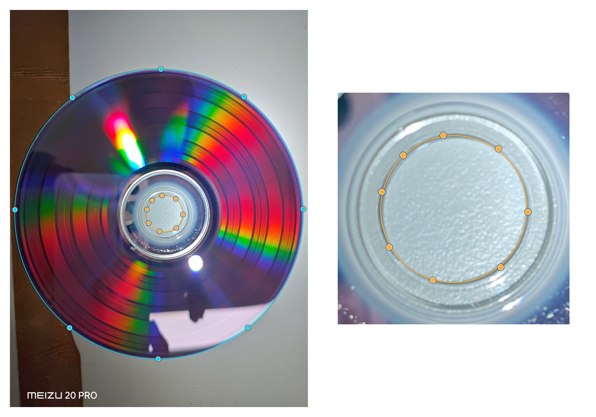
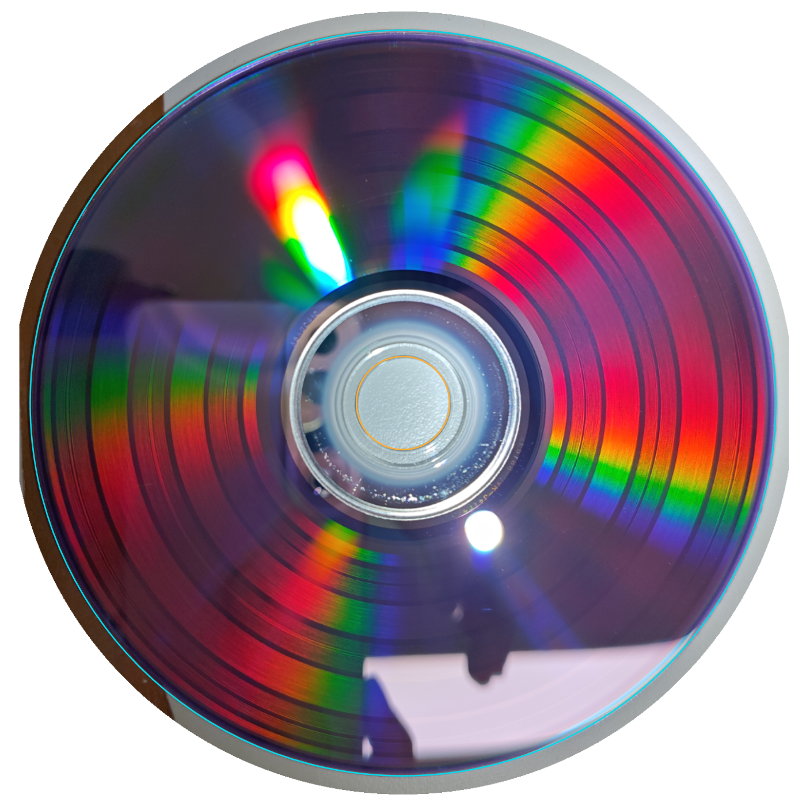
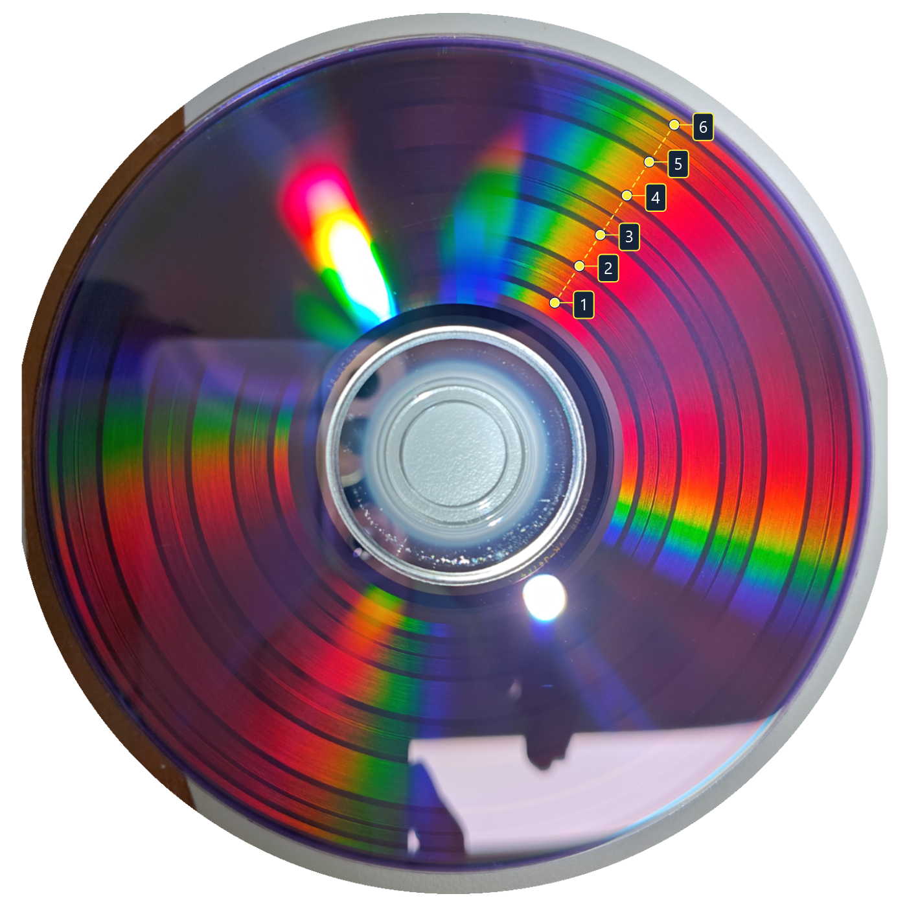
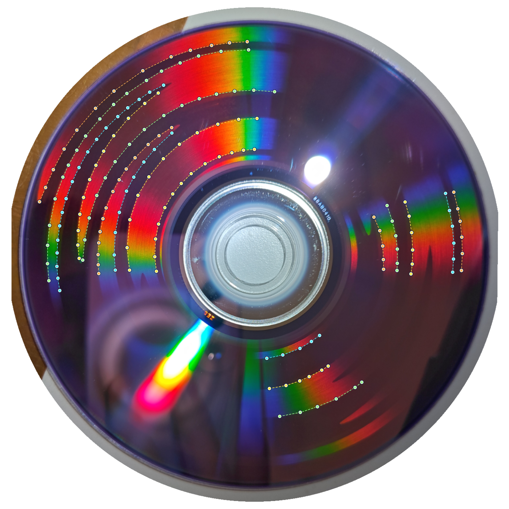
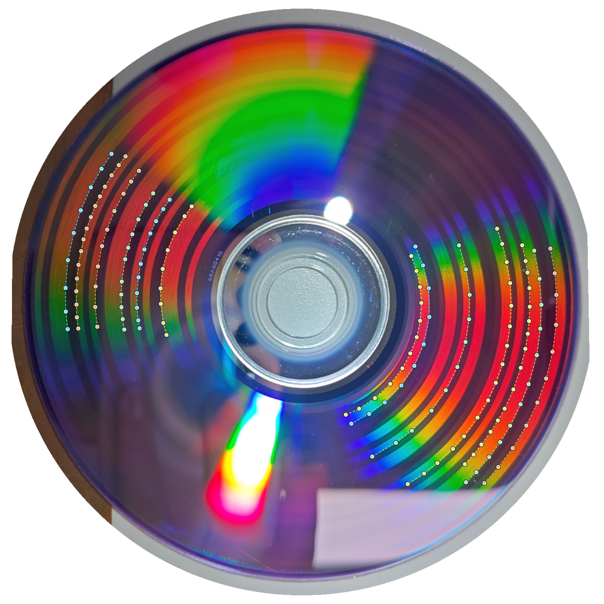
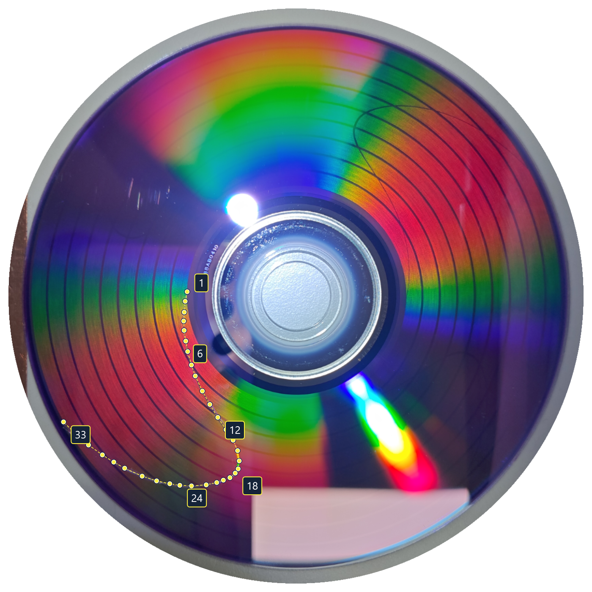

# 辅助标定

第一次使用可结合 [DVD 标定实操教程：Verbatim AZO DVD-R](CALIBRATION_TUTORIAL.md)，查看三个阶段的真实记录、实际取点和精标后的盘面效果。本文先说明各阶段共用的照片矫正，再说明生成、测量、应用与再次精标。

从首页或工程侧栏打开**辅助标定**，按需要选择**粗标定、边界标定、精细标定**。已有可靠初值时，可以直接从边界标定或精细标定开始。每张盘都应使用生成时保存的 `.calibration.json` 和这张盘的实拍照片。

已有工程时，标定页保留「设计、导出、刻录」和「预览、标定」两组导航；标定刻录也归在「标定」下。标定使用独立的盘片参数，调整设置不会改动绘图工程。没有工程时，也可以从首页独立完成标定。点**返回**可回到进入标定前的页面。

## 先完成照片矫正

每张标定盘都先按下面步骤矫正照片，再量宽带或描线。尚未刻盘时，可以先了解拍照要求，再按下一节生成标靶。

1. 拍下能看见**整个盘片实体最外缘和中心孔**的照片或扫描图，保留完整盘缘。待测区域被反光遮住时，可以调整光照重拍同一张盘。
2. 打开**这张盘生成时的标定记录**，导入对应照片。选择实物的 **12 cm 或 8 cm** 规格；它决定实体外半径为 60 mm 或 40 mm，不是让你填写刻录区半径。
3. 将外圈控制点逐个拖到**盘片实体最外缘**，将内圈控制点逐个拖到**中心孔边缘**。刻录区边界、透明塑料圈、反射亮圈和阴影都不适合作为实体边界。滚轮缩放、右键平移，尤其要放大检查孔缘。
4. 点**计算矫正**，检查正视预览中的盘缘与中心孔。必要时返回调整控制点并重新计算，核对后确认矫正。
5. 在**矫正照片**上进行后续测量。修改实体规格或边界控制点后，需要重新矫正并测量；不要继续使用旧坐标下的点位。

**照片分辨率。** 导入时尽量保留原始像素尺寸：长边上限为 **8192 px**，总像素上限为 **33,554,432（32 × 1024 × 1024）**，超过任一限制时按比例缩小。常见的 1200 万、2400 万像素手机照片在两项限制内会保留原尺寸。

矫正图按盘面投影的局部像素密度自动选择尺寸，并计入实体外缘之外的 **3 mm** 画布边距；不再固定为 1400 × 1400。输出同样受像素预算限制，正方形最大为 **5792 × 5792**。窗口适配和滚轮缩放只改变显示大小，不会再次缩小工作图像。保留更多像素便于检查细节，但不代表同等提高测量精度，仍需核对实体边缘、反光遮挡与复刻效果。

本图按 Verbatim AZO DVD-R 示例记录重建：**青色**是实体外缘的 8 个点，**橙色**是中心孔边缘的 8 个点；孔缘放大图用于辨认正确边界。这是实际记录的取点说明图，不是应用界面截图。

照片规格用于还原毫米尺度，刻录区大小由标靶生成参数决定。上图按相同记录重建矫正预览，**青色参考圆**对应实体外缘，**橙色参考圆**对应中心孔。矫正保留盘上真实的刻录弯曲，未单独校正镜头径向畸变。不要为了让十字线变直而移动盘缘控制点。

## 选择阶段与生成标定盘

| 何时使用 | 新建的刻录图案 | 照片上量什么 |
| --- | --- | --- |
| 内外半径还不确定 | **粗标定**：三条宽带，每条带内有角度标记 | 沿同一条半径点三条带的内缘和外缘，共六点 |
| 已有初值，需要继续修正半径 | **边界标定**：宽明暗区域，两条对置分界沿半径摆动 | 描清楚的**明暗交界**；连续时描一段，被遮住时再分段 |
| 已能分辨细臂，需要检查最终几何 | **精细标定**：同心圆加十字线 | 选一条清楚的细臂，沿其**中线**从内向外描点 |

1. 选阶段、盘型和与实物对应的预设，核对内外半径和扇区数。用**从光盘读取**可以把盘片报告的扇区数填入当前设置。只有一个刻录机时直接读取，有多个时先选择设备。相同容量的盘片仍可能有不同的内外半径。
2. 点**新建标靶**。生成当时的盘型、几何、容量和有关编码设置会固定在记录中。要保留上一张盘的照片和输入，先保存其记录。
3. 在标定页生成文件，或选择流式刻录。CD 输出 `.wav`（附 `.cue`）或 `.raw`，DVD、BD 输出纯绘图 `.iso`。文件旁会保存同名 `.calibration.json`。流式刻录也会先保存记录，再进入专用刻录页选择设备和确认。
4. 完成本阶段的测量并应用半径后，选择需要的下一阶段，**新建该阶段标靶**，用新图案刻盘、拍照。切换阶段只改变下一次生成的设置，不会改写已有盘片的记录。

独立辅助标定与工程页面共用底部任务栏。流式刻录的准备、写入与封盘阶段、设备确认的写入量、实时速度和进度都在底栏显示；展开「任务详情」可查看或复制日志，也可在底栏取消刻录。切换页面或在任务运行中返回首页仍可查看进度，失败时自动展开日志。标定求解和文件生成同样在此显示状态；标定记录与工程输出仍独立保存，刻录完成不会把上次导出的文件显示为本次结果。

CD-R/RW 的扇区数来自预刻槽引出区地址；单层可写 DVD 使用设备报告的总扇区数。BD-R 自动读取限于支持的 25 GB 单层顺序、无备用区布局。读取失败时可核对介质或手动输入。

**图案预览与刻录。** 页面提供 8192 × 8192 的刻录图案预览。宽边界和十字图案可导出同尺寸 PNG，宽带与角度标记导出的 PNG 是盘面示意图。正式刻录请从标定页生成音轨、镜像或使用流式刻录，使盘面图案与保存的记录对应。

## 粗标定：用宽带和角度标记估算半径

三条宽带分别占绘图区地址的 3.5%–17%、30.5%–51%、70.5%–95.5%，每条带内都有角度标记。先量宽带边缘，再由程序读取带内条纹，进一步修正半径估计。

图中按示例记录重建的六点，从内向外标为 **1、2、3、4、5、6**，依次对应界面的 **1 内、1 外、2 内、2 外、3 内、3 外**。量的是整条宽带与空白的交界，带内细条纹用于角度读取。示例参数及角度修正前后结果见[实操教程](CALIBRATION_TUTORIAL.md)。

1. 找同一侧从内到外都看得见条带的方向。约 45° 的清楚区域即可尝试读取，有其他清楚区域时程序会一起检查。反光和蓝光盘的明暗映射可能让三条带显亮，按条带和空白间隔的交界识别即可。
2. 从靠近盘心的一条开始，依次点击 **1 内、1 外、2 内、2 外、3 内、3 外**。第一下确定取点方向，随后沿辅助线依次点整条带的边界。带内的条纹交给程序读取。点错时选中该交界，点**重标当前交界**；要换一侧则点**清除全部交界并重标**。
3. 点**估算半径并读取角度标记**。三处标记核对通过时，页面同时显示宽带估值、角度修正后的内外半径，以及内、中、外三处相对生成初值的每圈转角偏差。正值表示经过相同扇区数时实盘转过的角度更大。把结果用于新标靶时会采用角度修正值。
4. 三处条纹过弱或相互不一致时，页面只给出宽带估值。可在同一张盘上调整光照后重拍。如果中间反光，量齐第 1、3 带的两侧仍可先估半径，角度修正需要同一方向的六个点。粗标定采用固定轨距，已设置的轨距系数可留给后续阶段。

一次粗标后仍未取得合适初值时，可以再做几轮：**应用粗标修正值 → 保存当前记录 → 仍选粗标定并新建标靶 → 用新空白盘刻录 → 拍照、矫正、重新量六点 → 再估算**。每张新盘都要使用它自己的生成记录和照片；重复计算同一张照片不等于使用新参数迭代刻盘。取得合适初值后，再应用并新建边界标定盘。实操教程另提供了[从相同初值经过三轮粗标后进入边界标定的补充记录](CALIBRATION_TUTORIAL.md)，三轮是该次尝试的次数，不是程序要求。

上图是三轮粗标之后的边界标定示例，按记录重建了 **17 段、169 点**。颜色只区分片段，虚线表示同段内的取点顺序，不是拟合预测线。生成参数和详细步骤见[实操教程的补充案例](CALIBRATION_TUTORIAL.md)。

绘图区需要足够宽，才能分开三处角度标记。标准 12 cm CD 的支持范围为 70–85 分钟（315000–382500 扇区），线速度为 1200 mm/s。单层 DVD、BD 还需满足各自的容量、扇区对齐和环带宽度要求。8 cm CD 或绘图区很窄的小 DVD 无法新建此图案时，可核对预设，也可用已有初值进入边界标定。

## 边界标定：连续或分段描明暗交界

宽边界图案在每个半径处各有一半明区和暗区，两条分界相隔 180°，沿绘图区半径缓慢来回摆动三次。局部清楚的区域通常可以找到分布在不同半径的边界。

图案本身就有弯曲，判断结果时应检查预测边界是否贴合实拍，不能以图案是否变直判断。照片上量的是明暗交界，不是条带中线。可见边界平直、弯曲、折返或绕转时，都可以按其实际走向描点。

本图按示例的 **13 段、154 点**重建，**颜色只区分片段，虚线连接同段内的取点顺序**，不是拟合预测边界。数量是本次记录的实际情况，不是每张盘的固定要求。更多取点示例和参考参数见[实操教程](CALIBRATION_TUTORIAL.md)。

1. 用粗标定得到的参数新建边界标定盘，刻盘并拍照。打开对应记录，确认照片矫正。
2. 交界清楚且连续时，沿同一条交界顺着描点，也可以先点转折处，再向两端延伸。落点前会显示连线预览。靠近已有连线时，新点会插入该线段；两端靠得近时，单击要继续的端点固定续点方向，按 **Esc** 恢复自动选择。拖动点只修正位置，保存记录后再打开仍保留描点顺序。一段至少 6 个不同点，并覆盖绘图半径宽度的 55%；转弯较多时加密取点。直线、缓弯、折返均可以，不必人为拆段，也不需要刻意寻找尖端。
3. 看不清的地方跳过，点**另描一段**，选另一段可见交界。若只有短段，至少选 4 处不同半径、每段至少 3 点，建议 5–8 段。若有两段较长的交界，可每段点至少 6 点、各跨绘图半径宽度的 10%。所有情况合计都需跨内外至少 55%。无需数圈或连接反光遮住的部分。同侧约 45° 可用于取点，有更多清楚区域也可以利用；点应沿交界延伸，不能只点同一根半径上的交点。
4. 点**反推参数**。新建边界标定默认在初值 ±0.01 mm 内搜索，适合粗标定已达到约 ±0.005 mm 的情况；保存的手动范围会随记录恢复。若最佳值落在边界，核对初值或手动扩大范围。点数、覆盖不足，或者多个候选无法区分时，需在其他可见位置补段，再计算。
5. 核对叠加的两条预测边界是否贴合所有已描和未描的可见交界。预测显示完成并勾选吻合后，可以应用当前候选，再用修正参数生成精细标定盘。偏差过大、搜索贴边或多解会保留警告，供人工判断，不会阻止已经确认吻合的候选应用。切换候选或修改点位会取消确认，修改点位后还需重新计算。本阶段保留这张盘生成时的轨距系数，三次轨距拟合留在精细标定阶段。

分段测量仍需要足够的径向分布和局部走向信息。单段清楚的连续弧线可以超过 90°，无需为角度上限人为拆段；沿交界分散补点，避免相邻观测之间留下接近半圈的空隙。重复描同一个位置不会增加独立证据。覆盖不足或有歧义时，优先在同一张盘上补点或调整光照重拍。

## 精细标定：沿一条十字线细臂描点

精细标定使用同心圆和十字线图案。同心圆随盘片生成半径缩放，最终可见的圈数取决于刻录区范围。

本图按示例的 **33 个实际点位**重建，连线只辅助显示点序，不是拟合预测线；标出的 **1、6、12、18、24、33** 是取点序号。跟随真实细臂的中线，不要沿同心圆转向或跨到另一条臂。示例原照片左下方的扭曲十字线经过美工刀刻画增强以方便拍照；该处线宽、清晰度不能视为原始刻录效果，原图与注记见[实操教程](CALIBRATION_TUTORIAL.md)。

1. 从盘心向外沿一条清楚的十字臂中线均匀取点。只修正半径时至少 6 点，径向跨度至少达到生成环带宽度的 18%，建议在清晰处多取点。无需把点放在同心圆交点；应始终跟随同一条臂。拖动已有点可修正位置，点击空白处可补点，按 Delete 删除选中点。
2. CD、DVD 和 BD 均可在精细标定中勾选**拟合三次轨距分布**，需要至少 12 个不同半径的点，并覆盖环带径向宽度的 60%。点数或覆盖不足时保留既有轨距形状，只拟合半径。
3. 点**反推参数**。默认搜索从 ±0.02 mm 开始，最优解接近边界时自动扩大范围。相邻两点转角接近半圈时应沿真实走向补点，以便正确跟踪曲线。
4. 检查照片上的预测线是否跟随从内到外的实拍细臂。偏离较大的点会标红。平均偏差超过 0.35 mm 或最大偏差超过 0.8 mm 时会提示偏差较大；阈值作为核对参考，人工勾选吻合后仍可应用。若只有少数点吻合，可在中段补点再算。
5. 预测显示完成后，勾选轮廓吻合并应用参数。要在绘图工程中复用结果，**先应用，再保存为预设**，然后回到工程选择该预设。切换候选或修改点位后需重新核对；修改点位还需重新求解。

CD 非零系数采用与 DVD、BD 相同的弧长模型：总轨长为 `扇区数 / 75 × 线速度`，字节位置 `q` 对应 `q × 线速度 / (75 × 2352)` mm。三个系数均为零时保留原面积公式和生成输出。此约定与 [CD 非恒定轨距反馈 #78](https://github.com/JiaFeiMiao-K-Cat/DiscImageStudio/issues/78) 中的参数换算一致；重复校准检查覆盖了 [#92](https://github.com/JiaFeiMiao-K-Cat/DiscImageStudio/issues/92) 所述的带系数标定盘场景。

## 精标后复查与再次精标

应用精标结果后，留在**精细标定**阶段，**新建标靶**并刻一张新盘，保存对应生成记录。拍照检查新盘上从内到外的细臂是否更接近径向直线，以及是否仍有局部弯曲或难以辨认的区域。实操教程中的精标后结果盘仍有局部不足，但细臂已经更便于继续取点。

需要再次精标时，打开**新盘生成时保存的记录**，导入新盘照片，重新完成矫正，再沿同一条清楚细臂描点、反推并检查预测线。不要用上一张盘的生成记录分析新照片，也不要只改半径后沿用不配套的系数。

拟合会同时使用该盘生成时的内外半径及三个轨距系数，输出新的完整参数；**无需手动把结果加到旧系数上**。应用候选只更新下一张标靶的设置，当前照片的生成参数保持不变。内外半径、容量和三个系数必须成套使用。

## 保存、返回和旧记录

点**返回**可以离开未完成的标定，应用内保留当前草稿。已有工程时返回进入标定前的页面；从首页进入时返回首页。使用**保存标定记录**可在下次打开时恢复原图案、照片、盘缘和孔缘控制点、标记及曲线点。修改实体规格或边界控制点后需重新矫正并测量；修改已量的点后需重新求解。每次创建新靶前应保存需要留存的上一张记录。

**保存标定记录**保留这张盘的生成参数与测量输入。如果已经核对预测线并勾选轮廓吻合，还会保存该次拟合结果、误差及所选候选；无需先点应用。重新打开时会重建预测线，成功后恢复确认状态，并把所选拟合参数恢复到下一张标靶的设置。原刻录目标的参数保持不变，因此照片仍对应正确的生成几何。

尚未确认、取消确认或修改测量后已失效的拟合不会写入记录。旧记录和不含已确认拟合的记录仍恢复该盘的原生成参数，需要重新求解和确认。**保存为预设**保存当前设置；要把拟合结果用于绘图工程，仍需先应用结果、另存预设，再回到工程选择该预设。

照片以 PNG 无损嵌入记录，保留导入后的工作分辨率；保存后重新打开，照片保持保存时的像素尺寸，矫正图按相同规则重建，尺寸与保存前一致，无需原照片文件。图像采样统一使用每通道 8 位的 BGRA 工作图，高位深照片会先转换为该格式，因此保留像素尺寸不等于保留原始位深。高分辨率照片会使记录文件更大，读取、矫正和保存也需要更多内存与时间。

新版本仍可打开原有标定记录，但旧记录中已经缩掉的照片细节无法恢复，需要重新导入原照片并重新矫正、测量。旧版程序不能读取超出其照片尺寸或文件大小限制的新高分辨率记录。

已有盘片请打开当时生成的记录。程序按记录恢复对应的参考图、组合图案、时标、短弧或宽带，旧三点或拖弧数据也会保留。旧单线盘仍沿 6 mm 粗线的**中线**连续描点，半黑半白盘按其直径分界描点。已有宽带盘可沿半径重新量边；带内刻有角度标记的盘片，需要在同一方向取得六个单点，才能用三处标记修正。仅有宽带的旧盘可继续测量宽带边缘，无法补读未刻入的角度标记。

## 参考说明

明暗边界测量思路参考 [社区讨论 #49](https://github.com/JiaFeiMiao-K-Cat/DiscImageStudio/issues/49)。十字线沿用项目原有参考图，原图及文件信息见[参考图说明](../src/DiscImageStudio.Core/Calibration/Patterns/README.md)。
