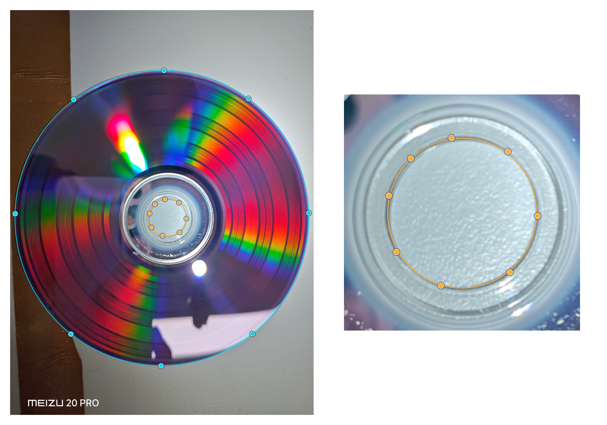
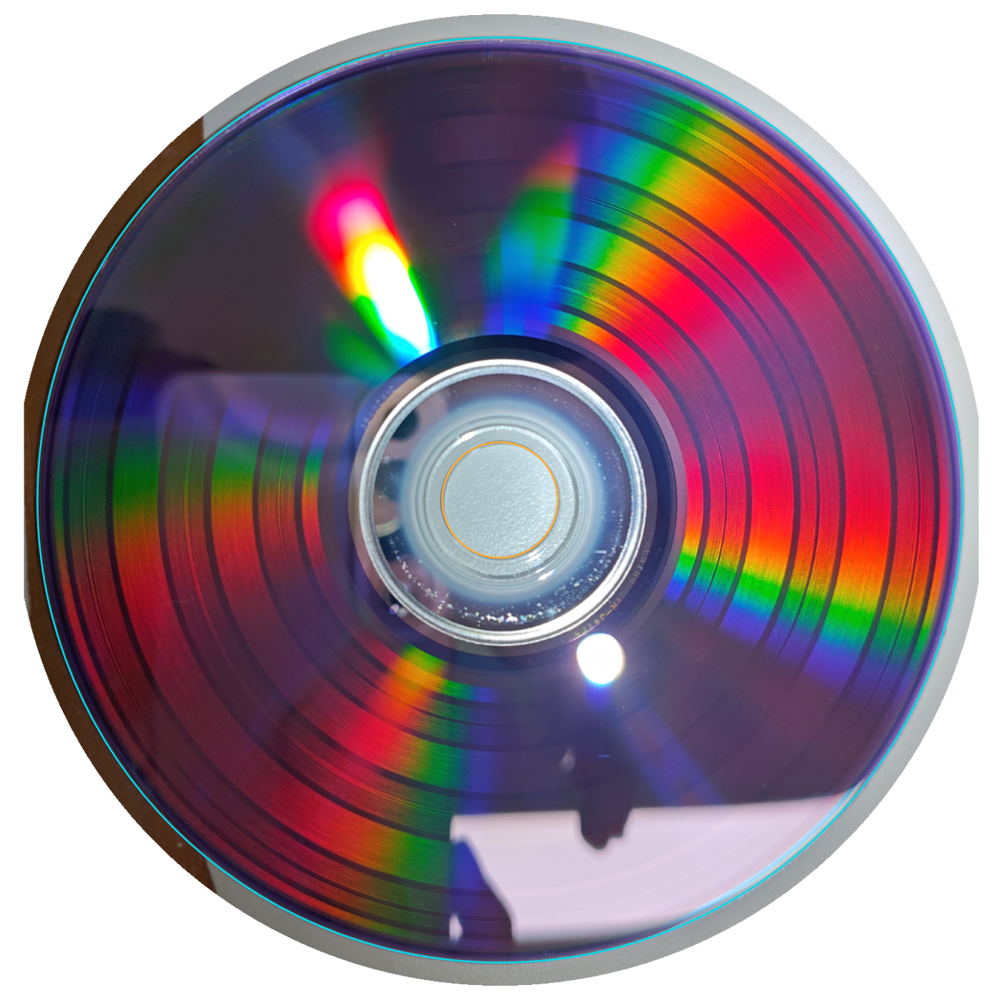
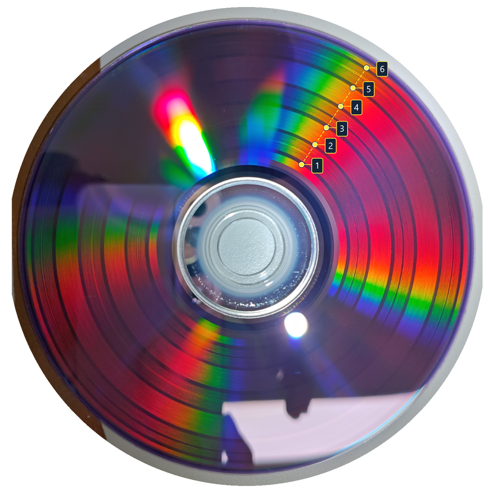
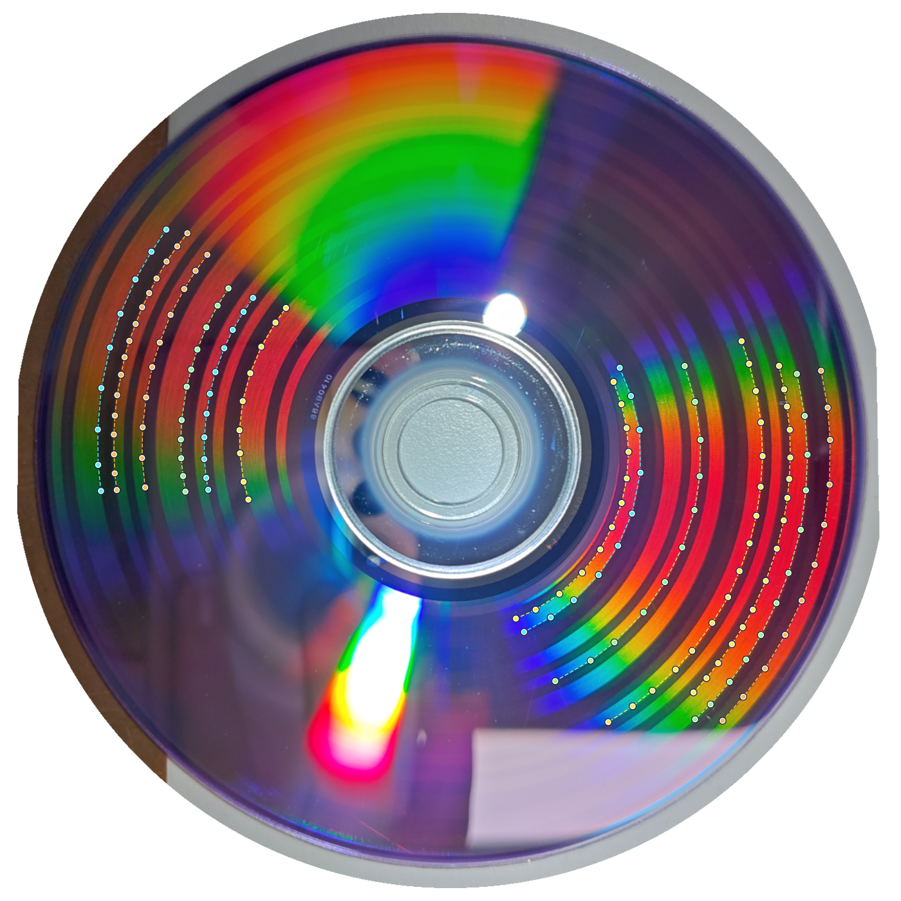
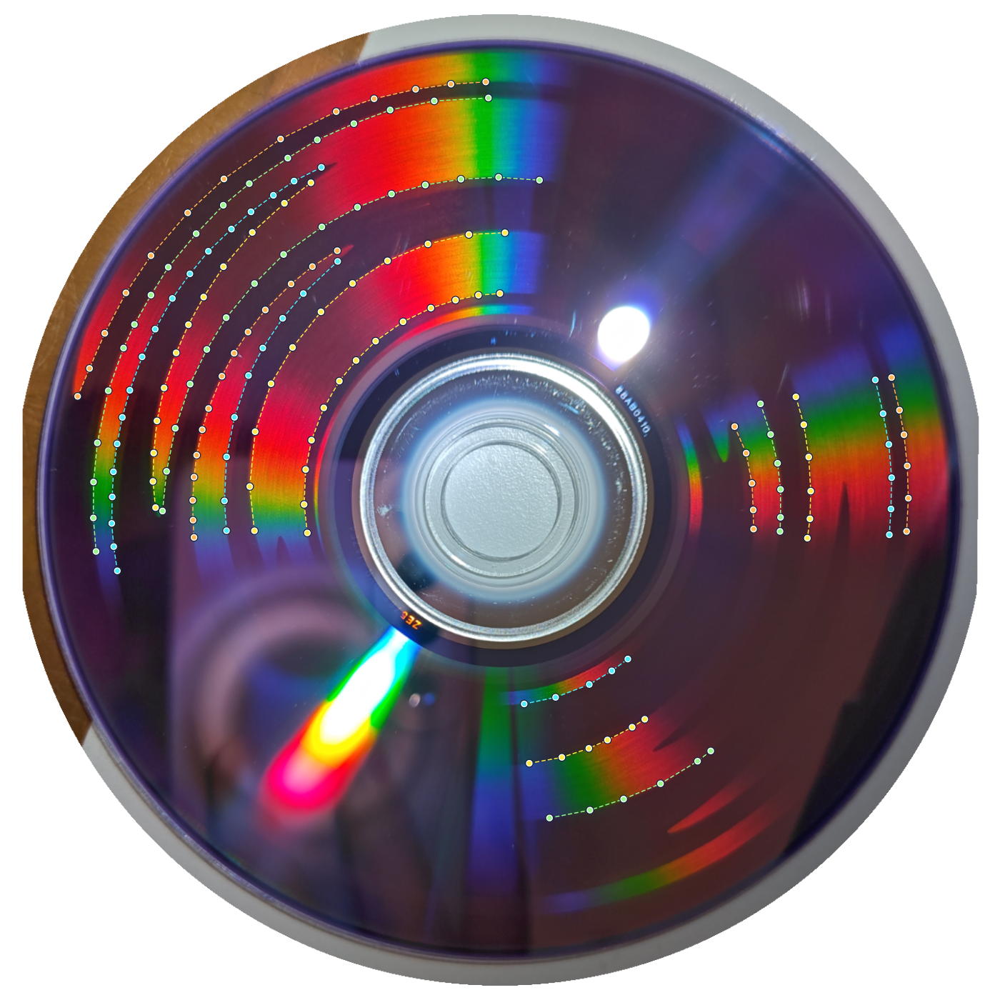
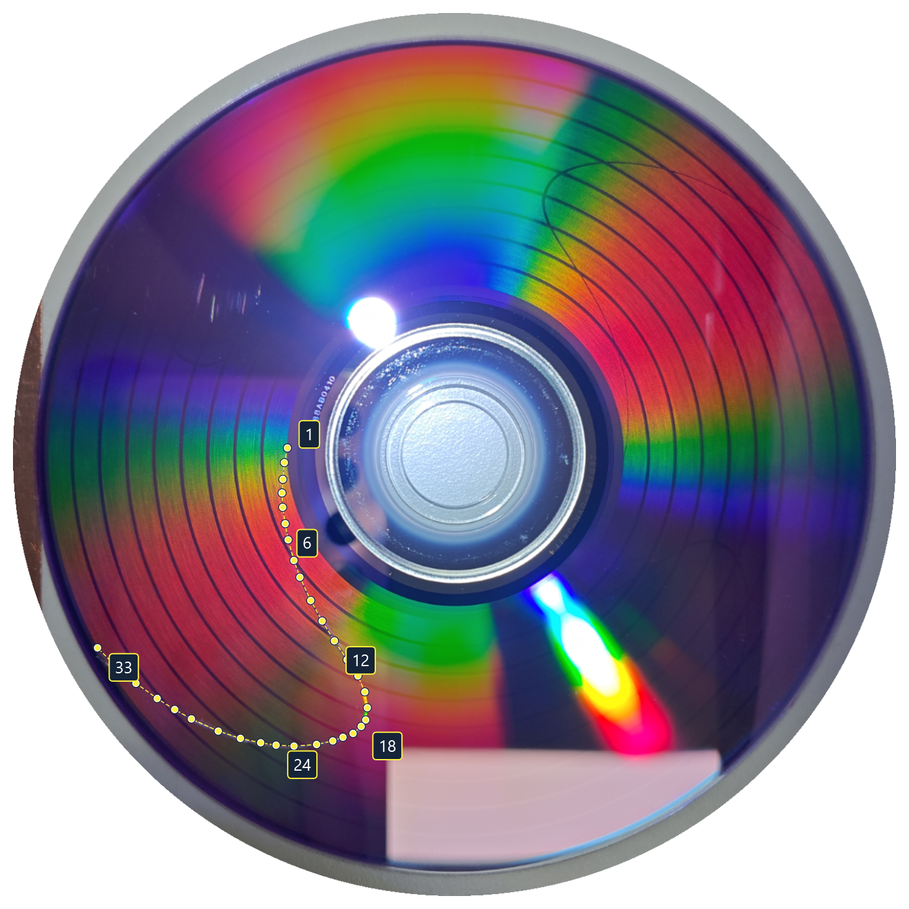
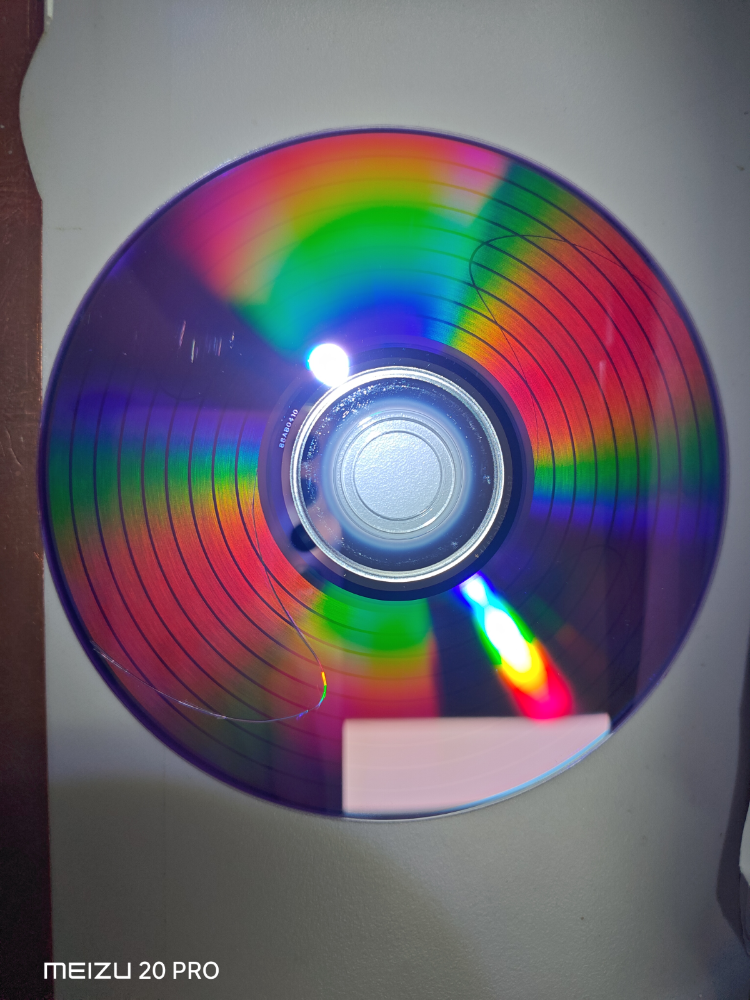
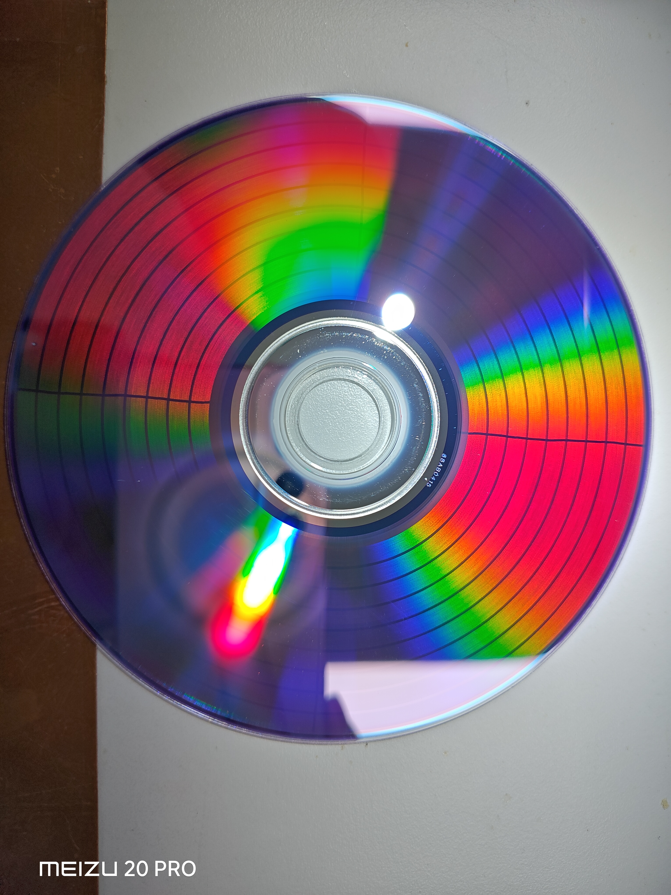

# DVD Calibration Walkthrough: Verbatim AZO DVD-R

Using a real-disc test with the **Verbatim AZO DVD-R preset** as an example, this walkthrough demonstrates the actual point-taking methods for **coarse calibration → boundary calibration → fine calibration**, as well as the disc-surface result after burning again with the fine-calibration parameters. All three calibration stages provide photos, measurement points, and records that can be opened; the photo of the post-fine-calibration result is `P20261104-203512.jpg`.

Use a new blank disc for every round, and keep the **generation record, the disc actually burned, and that disc's photo** associated with one another. After applying measurement results, only the next disc uses the new parameters; an old disc must still be analyzed with the record used to generate it. See [Assisted Calibration](CALIBRATION.md) for the complete feature description.

## Learn Photo Rectification First: Align with the Physical Rim and Center Hole

Rectify the photo before measuring wide bands or tracing lines in all three stages. If you already have a calibration disc, follow the steps below. If you have not burned a disc yet, first learn the framing and point locations, then generate the first target later in this document.

1. Photograph the **complete physical outer edge and center hole of the disc**, keeping the target pattern as clear as possible. If local reflections obscure the pattern, change the lighting and retake the photo without cropping the rim.
2. On the Assisted Calibration page, open the **record used when this disc was generated**, then import its photo. This example selects the **12 cm** physical size, which means a physical outer radius of **60 mm**; do not enter the approximately **58 mm** outer radius of the burned area.
3. Drag each outer control point to the **physical outer edge** of the disc and the inner control points to the **edge of the center hole**. Zoom in to inspect the hole edge; the transparent plastic ring, burned-area edge, bright reflective ring, and shadows cannot replace these two physical boundaries. Use the wheel to zoom and drag with the right mouse button to pan.
4. Click **Calculate Rectification** and inspect the rim and center hole in the front-view preview. If the positions are wrong, return and adjust the control points, then calculate again. Confirm the rectification after checking it.
5. Mark all subsequent wide-band and curve points on the **rectified photo**. After changing the physical size or boundary control points, rectify and measure again.

The image above was reconstructed from the record saved for this example: **cyan** represents the 8 control points on the physical outer edge, and **orange** represents the 8 control points on the center-hole edge. The magnified hole view shows which ring the points should follow. It illustrates the points taken; it is not an application-interface screenshot.

The image above is the rectified preview reconstructed from the record. The **cyan reference circle** corresponds to the physical outer edge, and the **orange reference circle** corresponds to the center hole. The physical size restores the millimeter scale. Rectification does not remove the curvature of the actual burn and does not separately correct lens radial distortion. Do not move the rim control points just to make the crosshair look straight.

## Example Files

Download the following mainline JSON files, then load them on the Assisted Calibration page with **Open Calibration Record**. All three records contain embedded photos, outline control points, and measurement points, so they can be inspected or solved again directly. An empty top-level `observations` field does not mean there are no measurements; photo measurements are stored in `photo`. A supplementary case that repeats coarse calibration before entering boundary calibration is shown later.

| Order | Record (click to download) | Target | Saved measurements |
| --- | --- | --- | --- |
| 1 | [4f0228e6](examples/verbatim-azo-20261104/calibration-4f0228e6.calibration.json) | Coarse calibration `AngleSweepBands` | Confirmed photo rectification; six edge points for the three wide bands |
| 2 | [3f2ce8c2](examples/verbatim-azo-20261104/calibration-3f2ce8c2.calibration.json) | Boundary calibration `WavyBoundary` | Confirmed photo rectification; 13 boundary segments, 154 points total |
| 3 | [14580aac](examples/verbatim-azo-20261104/calibration-14580aac.calibration.json) | Fine calibration `ReferenceCross` | Confirmed photo rectification; 33 points on one thin arm |

The point-taking images for each stage were reconstructed from the record's photo, rectification parameters, and actual measurement points; they are not application-interface screenshots. Connecting lines only help display point order and are not solver prediction lines. The original photos are kept separately: [coarse-calibration photo](images/verbatim-azo-20261104/01-coarse.png), [boundary-calibration photo](images/verbatim-azo-20261104/02-boundary.png), and [fine-calibration photo](images/verbatim-azo-20261104/03-fine.png). The fine-calibration disc was locally enhanced with a craft knife; the exact location is described in the comparison caption later.

## Before Starting: Select the Preset and Verify the Initial Values

1. Open **Assisted Calibration** from the home page or project sidebar, select **DVD**, and choose the **Verbatim AZO DVD-R** preset corresponding to the physical disc. When a project exists, calibration settings are independent of the drawing project.
2. Insert a blank disc and use **Read from Disc** to verify the sector count. In this example, every stage and the post-fine-calibration result disc used **2,297,888 sectors**, and DVD `linearDensity` was **133.3 nm**. Use the actual values read from your own disc.
3. The generation radii for the first round in this example were **24.1 / 57.8 mm**. These differ from the approximately **23.991461 / 57.964894 mm** in the current built-in AZO DVD-R preset; change to the first pair only when reproducing this starting point.
4. Keep the same batch of discs, burner, and writing settings, and save each round's record separately. The example does not record the burner model, speed, or exact disc SKU, so those details cannot be inferred from the JSON.

The generation parameters in all three mainline records retain the built-in AZO DVD-R preset's three nonzero track-pitch coefficients. The coarse-calibration wide-band pattern was generated and estimated with constant track pitch; applying the coarse result updates only the radii and retains the original coefficients. Boundary calibration continues to retain the original coefficients, and fine calibration is the stage that refits them. Do not treat the presence of coefficients in the coarse record as though they were newly measured in that round.

## Before Each Stage: Generate the Corresponding Calibration Disc

Repeat the following process every time you switch to a new calibration disc.

1. Select the stage and click **New Target**. The new target fixes that disc's generation parameters; switching stages alone does not change an already generated target.
2. Generate a DVD `.iso` on the calibration page and burn it, or use the calibration page's streaming burn. Save the corresponding `.calibration.json`; do not use a normal drawing project to re-import a preview PNG as a substitute for calibration burning.
3. Photograph, import, and confirm rectification using the photo-rectification steps at the beginning, then proceed to that stage's measurements.
4. At the end of each round, click **Save Calibration Record** before creating the next target, so the previous photo and points are not replaced by the new draft.

## Stage 1: Coarse Calibration, Obtaining Radii Close to the Real Disc

Record for this round: [4f0228e6](examples/verbatim-azo-20261104/calibration-4f0228e6.calibration.json). The pattern consists of three wide bands with angle markers inside them.

The six points in the image come from this example record and lie along one radius. Numbers **1, 2, 3, 4, 5, 6** correspond to **1 inner, 1 outer, 2 inner, 2 outer, 3 inner, 3 outer** in the interface. Look for the boundary between the entire wide band and the blank area; do not mistake the angle stripes inside the band for its edge.

1. On the rectified photo, choose a direction on one side where all three bands are clear from inside to outside.
2. Following the interface prompts, click **1 inner, 1 outer, 2 inner, 2 outer, 3 inner, 3 outer**, for six boundaries total. Measure the edges of the entire wide bands; the program identifies the fine stripes inside them.
3. Click **Estimate Radii and Read Angle Markers** and inspect the wide-band estimate and angle-corrected result. When all three angle markers pass inspection, the next target uses the angle-corrected values. If recognition fails, first check the points or retake the photo; the interface may report only the wide-band estimate.
4. Apply the initial values for the next target, save this round's record, switch to **Boundary Calibration**, and **create a new target**.

The pure wide-band radius estimate in this round was **24.016692871476085 / 57.70924224450089 mm**. After reading the three angle markers, it was corrected to **23.99575834805153 / 57.97592653885557 mm**. The boundary-calibration disc used these angle-corrected values, so distinguish the interface's “wide-band estimate” from its “angle-corrected values” when using the result.

When the first record is reopened, it still shows its original **24.1 / 57.8 mm**. This is expected.

### If One Coarse Round Is Still Not Ideal, Continue Coarse Calibration

If one coarse round does not yet produce an initial value suitable for entering boundary calibration, first check the points and photo. If further correction is needed, use the result to generate another coarse-calibration disc:

1. Apply this round's coarse-calibration correction and save the current record.
2. Keep **Coarse Calibration** selected, click **New Target**, and let the new pattern use the parameters just applied.
3. Burn the new target to a new blank disc, photograph and rectify it, then measure the six wide-band edges again on the new disc and estimate again.
4. Continue the loop as needed. Once a suitable initial value is obtained, apply the result and create a **Boundary Calibration** target.

Clicking “Estimate” repeatedly on the same photo only recalculates the existing measurements; it is not the disc-by-disc iteration described above. The supplementary case later attempted three coarse rounds. This is not a fixed requirement and does not mean every disc needs, or needs only, three rounds.

## Stage 2: Boundary Calibration, Continuing to Correct the Inner and Outer Radii

Record for this round: [3f2ce8c2](examples/verbatim-azo-20261104/calibration-3f2ce8c2.calibration.json). This disc uses the new radii from the previous step and still retains the original track-pitch coefficients.

The image preserves the **13 segments and 154 points** from this example, including their point order. **Colors only distinguish segments, and dashed lines connect points in the order taken within each segment**; they are not fitted prediction boundaries. Skip portions hidden by reflections and move to another clear light/dark boundary.

1. Trace the clearly visible **light/dark boundary**, not the centerline of a light or dark band. When it is continuously visible, trace one segment. When a reflection obstructs it, finish the current segment and start again at another clear boundary.
2. Distribute points across different radii and capture the local direction of the boundary. The **13 segments and 154 points** saved in this example describe this point-taking method; they are not numbers that everyone must copy.
3. Click **Infer Parameters**. The range saved in this example was **±0.02 mm**, with automatic expansion disabled. The current program's default for a new boundary calibration is **±0.01 mm**; opening the example restores its saved settings.
4. Check whether the predicted boundary fits the visible boundaries that were and were not traced. If the best value is near the search edge, the candidate is ambiguous, or coverage is insufficient, check the initial value, add a segment, or adjust the range and solve again.
5. After the prediction display is complete, confirm the outline fit and apply the current candidate. Save the record, switch to **Fine Calibration**, and **create a new target**.

The generation radii in the third record were **23.990847220268247 / 57.96535646048506 mm**, respectively about **4.911 / 10.570 μm** smaller than those for this disc. The three track-pitch coefficients remained unchanged.

### Supplementary Case: Boundary Calibration After Three Coarse Rounds

Record: [calibration-2ba20083_2.calibration.json](examples/verbatim-azo-20261104/calibration-2ba20083_2.calibration.json). This was another test starting from the same initial parameters. Three coarse rounds were performed consecutively before generating a boundary-calibration disc. The boundary points from this test are shown below as a reference when multiple coarse rounds are needed.

This boundary disc was generated with radii **23.9966141727963 / 57.96012005643783 mm**, a capacity of **2,297,888 sectors**, and a bit length of **133.3 nm**, still using the Group A track-pitch coefficients described later. The saved search range was **±0.02 mm**, with automatic expansion disabled.

The supplementary record reconstructs **17 segments and 169 points**. Colors only distinguish segments, and dashed lines show the point order within a segment; they are not fitted prediction lines. Open the record to inspect the boundaries and segmentation in clear areas, then solve it again using the steps in this section.

Multiple coarse rounds can gradually correct the initial value. After entering boundary calibration, still check the prediction lines, points, and reflection effects, and decide from the actual result whether to add points or continue adjusting. Three rounds was only the number attempted in this test; it does not mean every disc needs, or needs only, three rounds.

## Stage 3: Fine Calibration, Fitting the Radii and Track-Pitch Shape Together

Record for this round: [14580aac](examples/verbatim-azo-20261104/calibration-14580aac.calibration.json). The crosshair pattern is still visibly curved on this disc, as shown by the left image in the next section. This stage traces points along the actual curved thin arm.

The image shows the **33 points** actually saved in this example; connecting lines only display point order. The labels **1, 6, 12, 18, 24, 33** are point numbers. Follow the centerline of the same thin arm outward; continue following the arm when crossing concentric circles. The manually enhanced location in the original photo and its limitations are described in the caption in the next section.

1. On the rectified photo, select one clear thin crosshair arm and place points continuously and evenly from inside to outside along its **centerline**, always following the same arm. The concentric circles help identify position; points do not need to be placed specifically at intersections.
2. Select **Fit Three-Coefficient Track-Pitch Distribution**. At least **12 points at different radii** are required, covering **60%** of the generated band's radial width. If the point count or coverage is insufficient, only the radii are fitted and the old coefficients are retained. This example has **33 points**, covering nearly the entire drawing area.
3. Click **Infer Parameters**. The initial search range in this example was **±0.02 mm**, with automatic range expansion enabled. Add points along the actual curve to avoid an angle near half a turn between adjacent points, which can create direction ambiguity.
4. Check whether the prediction line follows the entire visible thin arm. Return to the photo and inspect points marked red as deviating; solve again after changing points.
5. Confirm the outline fit and apply the candidate. The resulting inner and outer radii and three track-pitch coefficients are **one complete new parameter set**; do not manually add the new coefficients to the old ones.
6. **Apply first, then save as a preset**, giving this result an identifiable name. When returning to the drawing project, select this new preset so the project uses these parameters.

**Save Calibration Record** saves the original generation settings, photo, points, and search settings; it does not save the solver candidate, error, or applied state. **Save as Preset** saves the current settings; the two functions have different purposes. After reopening an old record, solve and apply again before saving that round's fitted result.

## The Post-Fine-Calibration Result and How to Fine-Calibrate Again

After applying the fine-calibration result, **create a new target** again in **Fine Calibration** and burn a new disc. The right image below shows the result after burning with this new parameter set. The original photo is [P20261104-203512.jpg](images/verbatim-azo-20261104/04-verification.jpg).

| Before fine calibration: crosshair used for point-taking and solving | After fine calibration: result disc burned with the new parameters |
| --- | --- |
|  |  |
| `14580aac` embedded photo | `P20261104-203512.jpg` |

**Photography note: the distorted crosshair in the lower-left of the left image was enhanced with a craft knife to make photography easier. This area contains manual scoring marks, so the enhanced line width and clarity must not be treated as the original burn result.**

In these photos, the left and right thin arms on the post-fine-calibration result disc are closer to radial straight lines. Some local deficiencies remain, but the arm is easier to trace for further point-taking and another fine-calibration round. The two photos were taken with different orientations and lighting. This is an appearance comparison and cannot establish a millimeter error or physical measurement accuracy.

To continue fine calibration, open the **record corresponding to when the result disc was generated**, import that disc's photo, rectify it again, and trace and infer points along the same clear thin arm. Use the inner and outer radii and three coefficients from that disc's generation as one complete input. Burn another disc after applying the new result; do not manually accumulate the new coefficients onto the old ones.

## Parameter Changes and Reference Values by Stage

The table below lists the generation parameters used by the three mainline stages to show the change from the initial radii to the fine-calibration result. When the corresponding record is opened, the interface restores the parameters in that row; the correction obtained from the current measurement is used for the next target.

| Stage (record) | Inner radius / mm | Outer radius / mm | Track-pitch coefficient group |
| --- | --- | --- | --- |
| Coarse calibration (`4f0228e6`) | 24.1 | 57.8 | A |
| Boundary calibration (`3f2ce8c2`) | 23.99575834805153 | 57.97592653885557 | A |
| Fine calibration (`14580aac`) | 23.990847220268247 | 57.96535646048506 | A |

The result disc after fine calibration was generated with an inner radius of **23.99144094121467 mm**, an outer radius of **57.964899248503315 mm**, and the **Group B** track-pitch coefficients below. They document the parameters used for the final appearance shown above.

| Field | A: generation values for the three mainline stages | B: generation values for the post-fine-calibration result disc |
| --- | --- | --- |
| `pitchLinear` | -3.9256854319227684E-05 | -7.937249285949148E-05 |
| `pitchQuadratic` | 6.964795915429256E-05 | 0.00014593344294674726 |
| `pitchCubic` | -4.670918950137523E-05 | -8.817669151956023E-05 |

These are dimensionless relative-shape coefficients, not track-pitch values in μm. The model is `p(x) = p0 × (1 + c1*x + c2*x² + c3*x³)`, where `x = (r - inner radius) / (outer radius - inner radius)` and `p0` is determined by the total track length. The inner radius, outer radius, capacity, and coefficients should be saved together; see the [preset documentation](DISC_PRESETS.md) for the format.

| Parameter transition | Inner-radius change / μm | Outer-radius change / μm | Coefficient change |
| --- | --- | --- | --- |
| Coarse disc → boundary disc | -104.241652 | +175.926539 | Group A retained |
| Boundary disc → fine-calibration disc | -4.911128 | -10.570078 | Group A retained |
| Fine-calibration input → post-fine-calibration result disc | +0.593721 | -0.457212 | A updated to B |

In this example, coarse and boundary calibration first corrected the inner and outer radii while retaining Group A coefficients. Fine calibration then adjusted both the radii and track-pitch shape, and the result disc used Group B. Capacity and bit length remained unchanged at every stage.

The values above are provided for reproducing this example and understanding parameter changes. For your own discs, adjust them using actual photographic measurements and save the complete parameters as a user preset.

## Troubleshooting

| Symptom | Check first |
| --- | --- |
| Coarse calibration reports only a wide-band estimate and cannot read the angle markers | Are the six points along one direction and on the edges of the entire wide bands? Change the lighting and retake the photo |
| Boundary result is against a search-range endpoint | Are the initial value and range appropriate? Add a clear boundary at another radius and solve again |
| Fine calibration fits only the radii and produces no new track-pitch coefficients | Is the cubic fit enabled? Are the requirements for points at different radii and coverage met? |
| Many points are present but the prediction does not fit | Were different thin arms or light/dark boundaries mixed? Was a reflection mistaken for the pattern? Is rim rectification accurate? |
| Reopening after saving shows the old parameters again | The record restores the generation parameters of this disc; solve and apply again, then save as a preset |
| The new disc is still curved | Confirm that the result was applied and a new target created, with all five geometric parameters passed together; continue measuring with the new disc's own record |

Return to [README](../README.md) · [complete Assisted Calibration guide](CALIBRATION.md) · [disc preset format](DISC_PRESETS.md)
