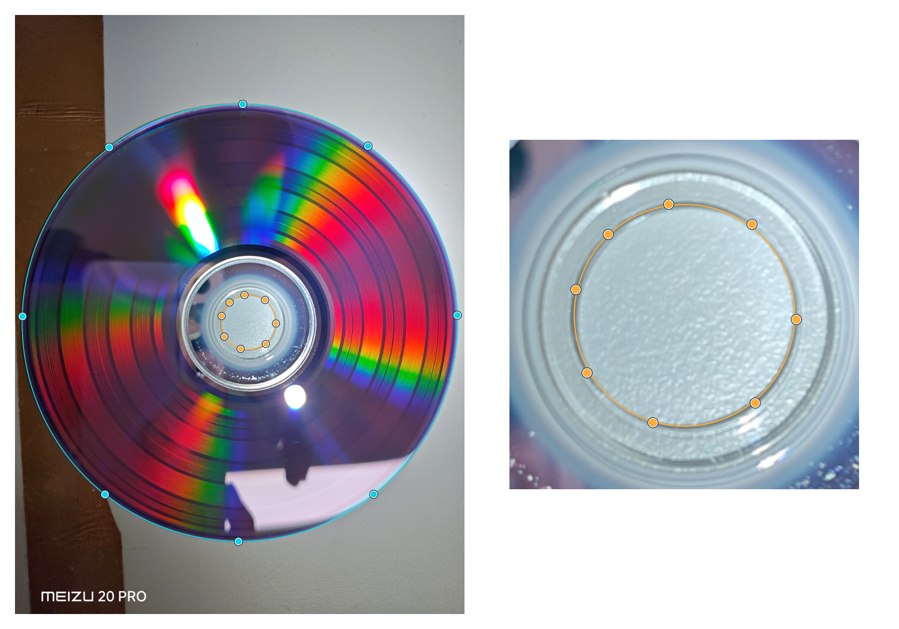
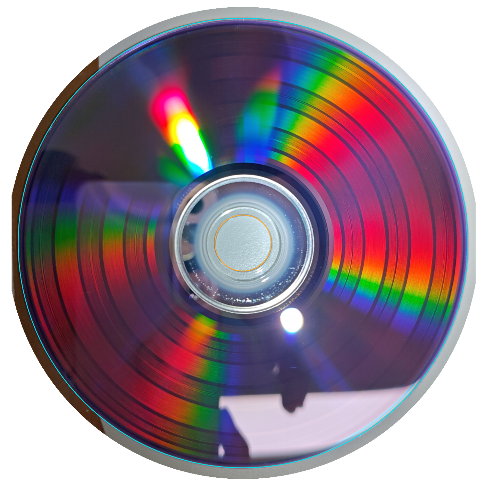
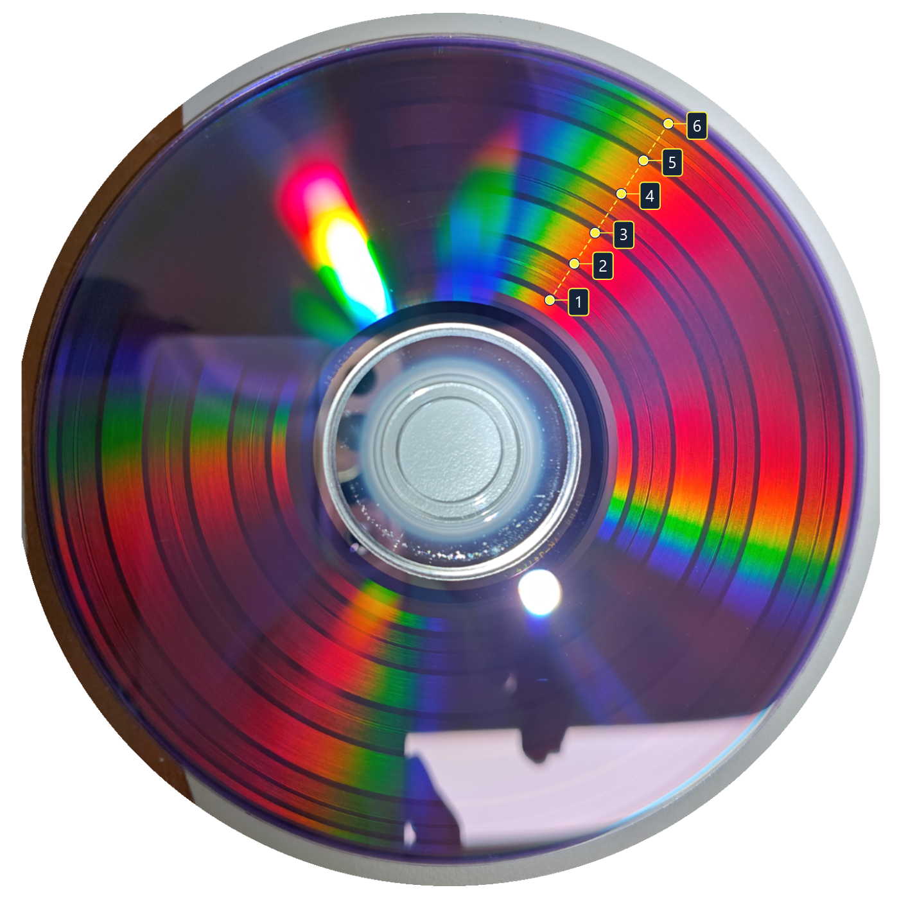
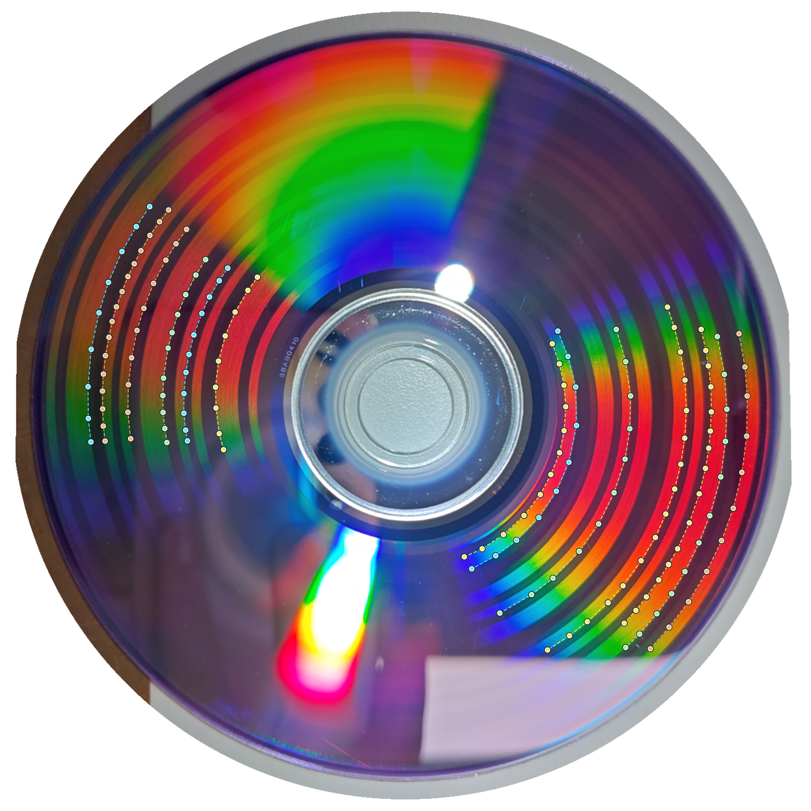
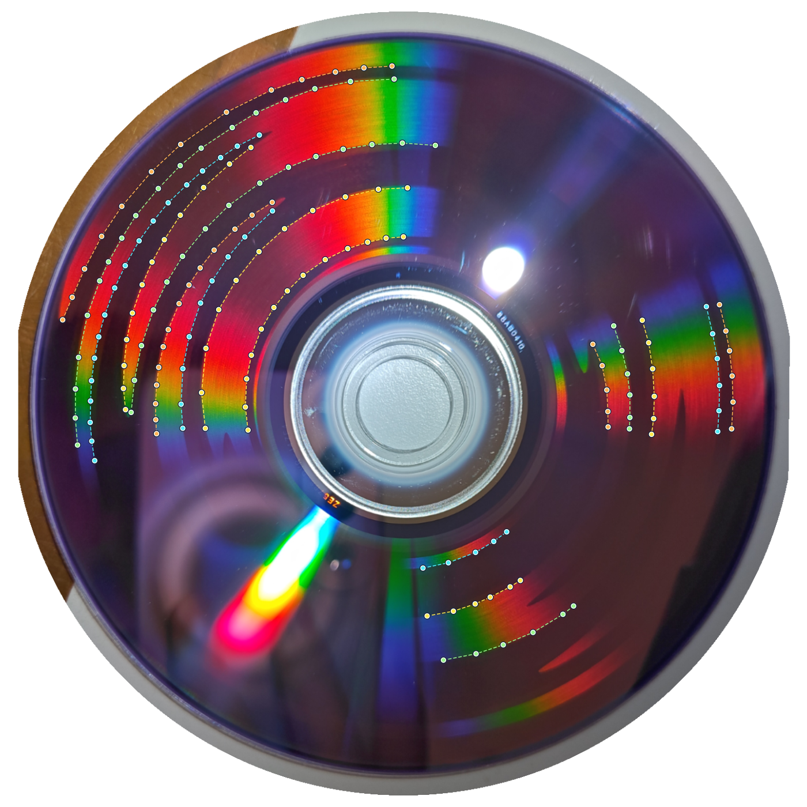
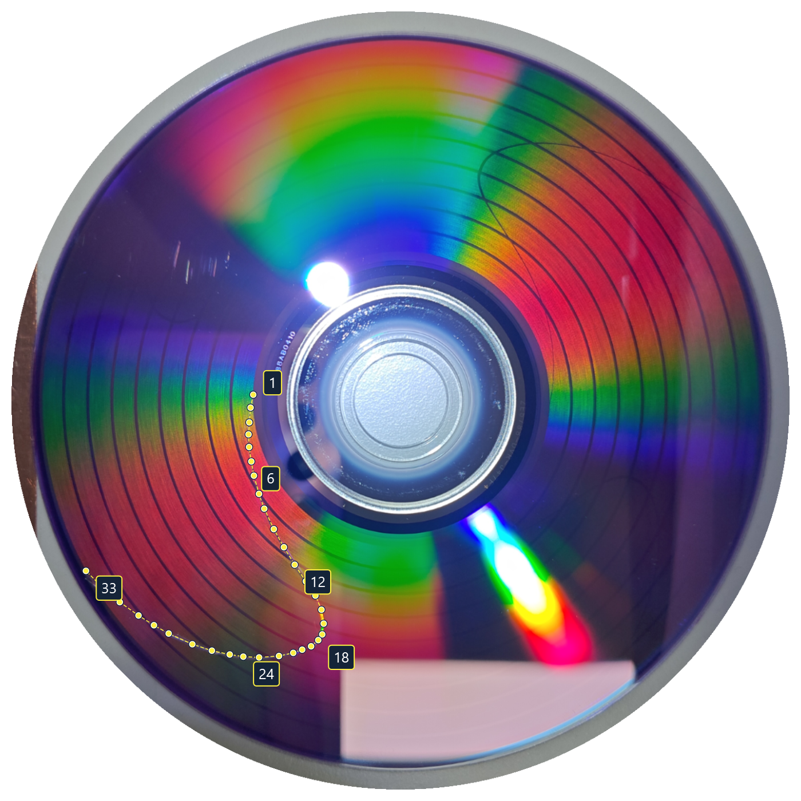
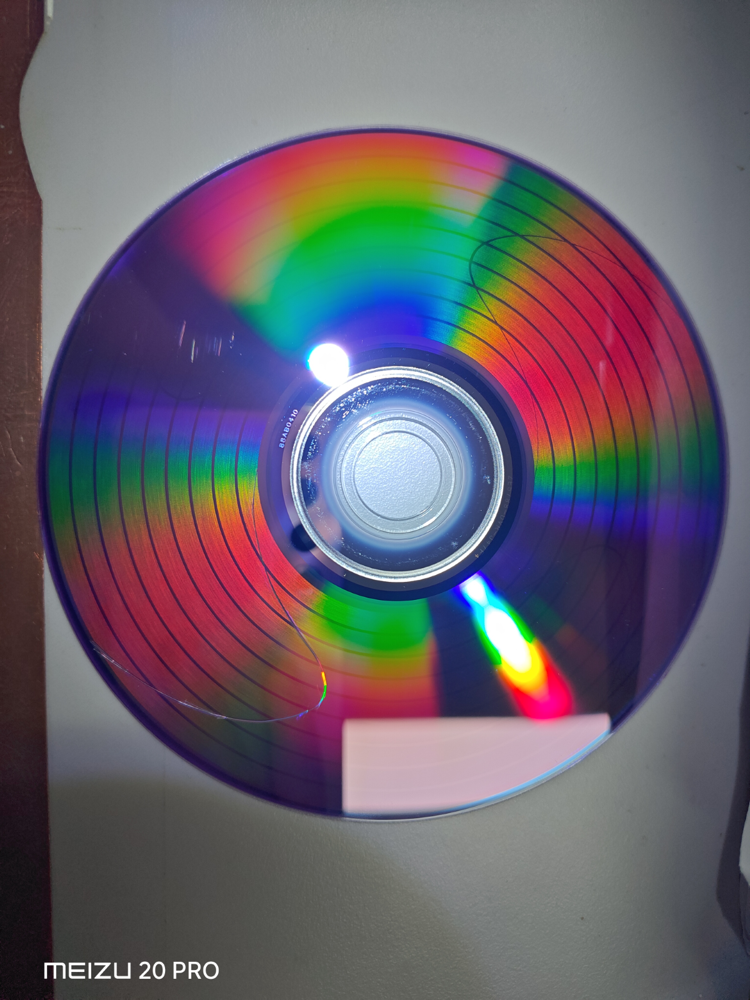
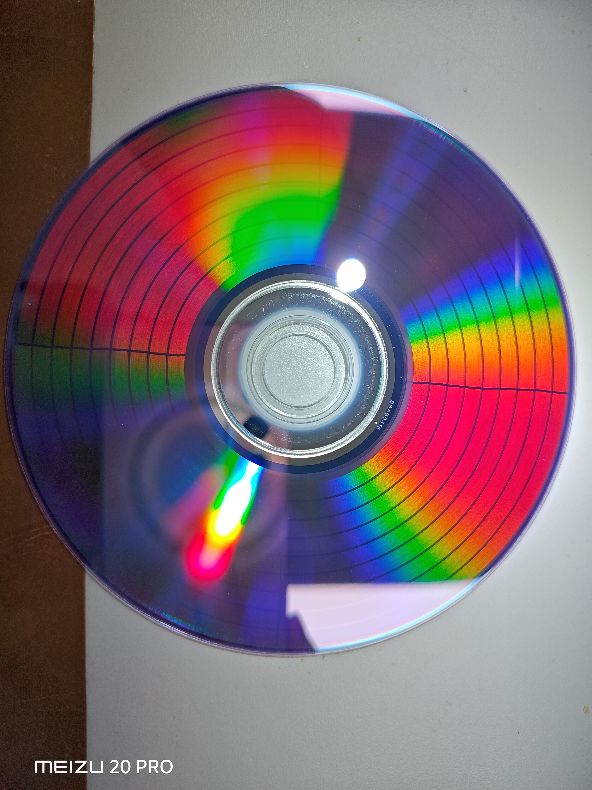

# DVD 标定实操教程：Verbatim AZO DVD-R

本教程以一次使用 **Verbatim AZO DVD-R 预设**的实盘测试为例，展示“粗标定 → 边界标定 → 精细标定”的实际取点方法，以及应用精标参数后重新刻录的盘面效果。三个标定阶段均提供照片、测量点和可打开的记录；精标后的效果照片为 `P20261104-203512.jpg`。

每轮都使用一张新的空白盘，并把**生成记录、实际刻出的盘、该盘照片**对应起来。应用测量结果以后，下一张盘才使用新参数；旧盘仍须用生成时的记录分析。完整功能说明见[辅助标定说明](CALIBRATION.md)。

## 先学会照片矫正：对准实体外缘和中心孔

三个阶段都先矫正照片，再量宽带或描线。已有标定盘时按下面操作；尚未刻盘时，先了解取景和取点位置，再按后文生成第一张标靶。

1. 拍下**完整的盘片实体外缘和中心孔**，让待测图案尽量清晰。局部反光遮住图案时换光照重拍，避免裁掉盘缘。
2. 在辅助标定页打开**这张盘生成时的记录**，再导入它的照片。本例选择 **12 cm** 实体规格，即实体外半径 **60 mm**；不要填约 **58 mm** 的刻录区外半径。
3. 将外圈控制点逐个拖到**盘片实体最外缘**，将内圈控制点拖到**中心孔边缘**。放大检查孔缘；透明塑料圈、刻录区边缘、反射亮圈和阴影都不能代替这两条实体边界。滚轮缩放，右键拖动平移。
4. 点**计算矫正**，检查正视预览中的盘缘和中心孔。位置不对时返回修正控制点，再计算；核对后确认矫正。
5. 后续所有宽带和曲线点都标在**矫正照片**上。修改实体规格或边界控制点后，应重新矫正并测量。

上图按本例保存的记录重建：**青色**表示实体外缘的 8 个控制点，**橙色**表示中心孔边缘的 8 个控制点；孔缘放大图用于看清应贴住哪一圈。它是取点说明图，不是应用界面截图。

上图是按记录重建的矫正预览，**青色参考圆**对应实体外缘，**橙色参考圆**对应中心孔。照片规格用于还原毫米尺度，矫正不会消除真实的刻录曲线弯曲，也不单独校正镜头径向畸变。不要为了让十字线看起来直而移动盘缘控制点。

## 示例文件

下载下列主线 JSON 后，在辅助标定页用**打开标定记录**载入。三份记录均已内嵌照片、轮廓控制点和测量点，可以直接检查或重新求解；顶层 `observations` 为空不代表没有测量，照片测量保存在 `photo` 中。后文另外展示先重复粗标、再进入边界标定的补充案例。

| 次序 | 记录（点击下载） | 标靶 | 已保存的测量 |
| --- | --- | --- | --- |
| 1 | [4f0228e6](examples/verbatim-azo-20261104/calibration-4f0228e6.calibration.json) | 粗标定 `AngleSweepBands` | 已确认的照片矫正；三条宽带的六个边缘点 |
| 2 | [3f2ce8c2](examples/verbatim-azo-20261104/calibration-3f2ce8c2.calibration.json) | 边界标定 `WavyBoundary` | 已确认的照片矫正；13 段交界，共 154 点 |
| 3 | [14580aac](examples/verbatim-azo-20261104/calibration-14580aac.calibration.json) | 精细标定 `ReferenceCross` | 已确认的照片矫正；同一条细臂上的 33 点 |

各阶段的取点图按记录中的照片、矫正参数和实际测量点重建，不是应用界面截图。图中的连线只辅助显示取点顺序，不是求解器的预测线。原始照片另行保留：[粗标照片](images/verbatim-azo-20261104/01-coarse.png)、[边界照片](images/verbatim-azo-20261104/02-boundary.png)、[精标照片](images/verbatim-azo-20261104/03-fine.png)。精标盘局部经过美工刀刻画增强，具体位置见后文对比图注。

## 开始前：选预设，核对这次的初值

1. 从首页或工程侧栏打开**辅助标定**，选择 **DVD** 和与实物对应的 **Verbatim AZO DVD-R** 预设。已有工程时，标定设置独立于绘图工程。
2. 放入空白盘，用**从光盘读取**核对扇区数。本例各阶段及精标后结果盘均为 **2,297,888 扇区**，DVD 的 `linearDensity` 均为 **133.3 nm**。自己的盘片应以实际读取结果为准。
3. 本例第一轮的生成半径为 **24.1 / 57.8 mm**。这与当前内置 AZO DVD-R 预设的约 **23.991461 / 57.964894 mm** 不同；只有复现这次起点时才需要改成前一组数字。
4. 保持同批盘片、同一刻录设备和相同写入设置，分别保存每轮记录。示例没有记录刻录机型号、速度或具体盘片 SKU，不能从 JSON 推断这些信息。

主线三份记录的生成参数均保留了内置 AZO DVD-R 的三个非零轨距系数。粗标定的宽带图案实际按恒定轨距生成和估算，应用粗标结果只更新半径并保留原系数；边界标定继续保留原系数，精细标定才重新拟合它们。不要因为粗标记录里带有系数，就把它们当作这一轮新测得的结果。

## 每个阶段开始前：生成对应标定盘

以下过程每换一张标定盘都要重复。

1. 选择阶段，点**新建标靶**。新建时固定本张盘的生成参数；切换阶段本身不会改变已生成的标靶。
2. 从标定页生成 DVD `.iso` 并刻录，或使用标定页的流式刻录。保存对应的 `.calibration.json`；不要用普通绘图工程重新导入预览 PNG 来代替标定刻录。
3. 按开头的照片矫正步骤拍照、导入并确认矫正，再进入本阶段的测量。
4. 每轮完成后点**保存标定记录**，再创建下一张标靶，避免上一张的照片和点位被新草稿替换。

## 第一阶段：粗标定，取得接近实盘的半径

本轮记录：[4f0228e6](examples/verbatim-azo-20261104/calibration-4f0228e6.calibration.json)。图案是三条宽带及带内角度标记。

图中六点来自本例记录，沿同一条半径排列；数字 **1、2、3、4、5、6** 依次对应界面中的 **1 内、1 外、2 内、2 外、3 内、3 外**。看整条宽带与空白的交界，勿把带内角度条纹当成宽带边缘。

1. 在矫正照片上选同一侧、从内到外都清楚的方向。
2. 按界面提示依次点 **1 内、1 外、2 内、2 外、3 内、3 外**，共六个交界。量整条宽带的边缘，带内细条纹交给程序识别。
3. 点**估算半径并读取角度标记**，查看宽带估值及角度修正结果。三处角度标记通过检查时，下一张标靶采用角度修正值；识别失败时先检查取点或重拍，界面可能只给出宽带估值。
4. 应用用于下一张标靶的初值，保存本轮记录，切到**边界标定**并**新建标靶**。

本轮纯宽带的半径估值为 **24.016692871476085 / 57.70924224450089 mm**；读取三处角度标记后，修正为 **23.99575834805153 / 57.97592653885557 mm**。后续边界标定盘采用这组角度修正值，因此使用结果时要分清界面中的“宽带估值”和“角度修正值”。

重新打开第一份记录时，仍显示它原来的 **24.1 / 57.8 mm**，这是正常的。

### 一次粗标后仍不理想，可以继续粗标

若一次粗标还没有给出适合进入边界标定的初值，可以先核对取点和照片；需要继续修正时，再用结果生成新的粗标盘：

1. 应用本轮粗标修正值，保存当前记录。
2. 仍选择**粗标定**，点**新建标靶**，让新图案使用刚应用的参数。
3. 用新的空白盘刻录，拍照、矫正，在新盘照片上重新量六个宽带边缘并估算。
4. 需要时继续以上循环；取得合适初值后，再应用结果并新建**边界标定**标靶。

反复对同一张照片点“估算”只是重算现有测量，不是上述逐盘迭代。后文补充案例尝试了三轮粗标；这不是固定要求，也不表示每种盘片都需要或只需要三轮。

## 第二阶段：边界标定，继续修正内外半径

本轮记录：[3f2ce8c2](examples/verbatim-azo-20261104/calibration-3f2ce8c2.calibration.json)。本张盘使用上一步的新半径，仍保留原轨距系数。

图中保留了本例 **13 段、154 点**的分段和点序；**颜色只区分不同片段，虚线连接同段内的取点顺序**，不是拟合预测边界。反光遮住的部分可以跳过，转到另一段清楚的明暗交界。

1. 沿清楚的**明暗交界**描点，不要描亮带或暗带的中线。连续可见时描一段，遇反光遮挡时结束当前段，到另一处清楚的交界重新起段。
2. 点位应分布在不同半径，并反映局部交界走向。本例保存了 **13 段、154 点**，是本次取点方式，不是要求每个人照抄的数量。
3. 点**反推参数**。本例记录保存的范围是初值 **±0.02 mm**，自动扩大范围关闭；当前程序新建边界标定的默认值是 **±0.01 mm**，打开示例会恢复其已保存设置。
4. 核对预测边界是否贴合已描和未描的可见交界。最佳值贴近搜索边缘、候选有歧义或覆盖不足时，应核对初值、补段或调整范围后重算。
5. 预测显示完成后，勾选轮廓吻合并应用当前候选。保存记录，切到**精细标定**并**新建标靶**。

第三份记录的生成半径为 **23.990847220268247 / 57.96535646048506 mm**，相对本张盘分别减少约 **4.911 / 10.570 μm**。三个轨距系数保持不变。

### 补充案例：三轮粗标之后再做边界标定

记录：[calibration-2ba20083_2.calibration.json](examples/verbatim-azo-20261104/calibration-2ba20083_2.calibration.json)。这是另一次从相同初始参数出发的测试，连续做了三轮粗标后，再生成边界标定盘。下面展示这次测试的边界取点，供需要多轮粗标时参考。

这张边界盘的生成半径为 **23.9966141727963 / 57.96012005643783 mm**，容量 **2,297,888 扇区**、位长 **133.3 nm**，仍使用后文的 A 组轨距系数。保存的搜索范围为 **±0.02 mm**，自动扩大范围关闭。

图中按补充记录重建 **17 段、169 点**；颜色只区分片段，虚线表示同段取点顺序，不是拟合预测线。可以打开记录检查清楚区域的交界及分段方式，再按本节步骤重新求解。

多轮粗标可用于逐步修正初值；进入边界标定后，仍需检查预测线、点位和反光影响，根据实际结果决定是否补点或继续调整。三轮只是本次尝试的次数，不代表每张盘都需要或只需要三轮。

## 第三阶段：精细标定，同时拟合半径和轨距形状

本轮记录：[14580aac](examples/verbatim-azo-20261104/calibration-14580aac.calibration.json)。十字图案在这张盘上仍明显弯曲，见下一节左图；这一阶段就是沿真实弯曲的细臂描点。

图中是本例实际保存的 **33 点**，连线仅用于展示点序；标出的 **1、6、12、18、24、33** 是取点序号。应跟随同一条细臂的中线向外延伸；跨过同心圆时也继续沿细臂取点。原照片中人为刻画增强的位置和限制见下节图注。

1. 在矫正照片上选一条清楚的十字细臂，从内向外沿其**中线**连续、均匀地描点，始终跟随同一条臂。同心圆用于辨认位置，不必专门在交点上取点。
2. 勾选**拟合三次轨距分布**。至少需要 **12 个不同半径的点**，径向跨度覆盖生成环带宽度的 **60%**；点数或覆盖不足时只拟合半径、保留旧系数。本例有 **33 点**，覆盖接近整个绘图区。
3. 点**反推参数**。本例初始搜索范围为 **±0.02 mm**，开启自动扩大范围。沿真实曲线补点，避免相邻两点的转角接近半圈而产生走向歧义。
4. 检查预测线是否沿着整条可见细臂。标红的偏离点需要回到照片核对；更改点位后重新求解。
5. 勾选轮廓吻合，应用候选。输出的内外半径和三个轨距系数是**一整套新参数**，不要手动把新系数加到旧系数上。
6. **先应用，再保存为预设**，给本次结果取一个可识别的名称。回到绘图工程时选择这个新预设，工程才会使用这套参数。

“保存标定记录”保存原始生成设置、照片、点位与搜索设置；它不保存求解候选、误差或已应用状态。“保存为预设”保存当前设置，两者用途不同。重新打开旧记录后，需要重新求解并应用，才能再次保存该轮的拟合结果。

## 精标后的效果，以及怎样继续精标

应用精标结果后，在**精细标定**阶段再次**新建标靶**并刻一张新盘。下面右图是使用这组新参数刻录后的效果，原始照片为 [P20261104-203512.jpg](images/verbatim-azo-20261104/04-verification.jpg)。

| 精标前：用于描点求解的十字盘 | 精标后：应用新参数刻录的结果盘 |
| --- | --- |
|  |  |
| `14580aac` 内嵌照片 | `P20261104-203512.jpg` |

**拍摄说明：左图左下方的扭曲十字线，为方便拍照，已用美工刀刻画增强。该处包含人为刻画痕迹，不能将增强后的线宽和清晰度视为原始刻录效果。**

从这组照片可见，精标后结果盘的左右细臂更接近径向直线，局部仍有不足，但已更便于沿细臂继续取点、再次精标。两张照片的拍摄姿态和光照不同，此处是外观对比，不能据此给出毫米误差或物理测量精度。

继续精标时，打开**结果盘生成时对应的记录**，导入该盘照片，重新矫正、沿同一条清楚细臂描点并反推。使用这张盘生成时的内外半径和三个系数作为完整输入；应用新结果后再刻下一张盘，不要把新系数手动累加到旧系数上。

## 各阶段参数变化与参考值

下表列出主线三个阶段使用的生成参数，便于了解从初始半径到精标结果的变化。打开对应记录时，界面会恢复该行参数；本次测量得到的修正值用于下一张标靶。

| 阶段（记录） | 内半径 / mm | 外半径 / mm | 轨距系数组 |
| --- | --- | --- | --- |
| 粗标定（`4f0228e6`） | 24.1 | 57.8 | A |
| 边界标定（`3f2ce8c2`） | 23.99575834805153 | 57.97592653885557 | A |
| 精细标定（`14580aac`） | 23.990847220268247 | 57.96535646048506 | A |

精标后结果盘的生成内半径为 **23.99144094121467 mm**，外半径为 **57.964899248503315 mm**，使用下面的 **B 组**轨距系数。它们用于说明上图最终效果所采用的参数。

| 字段 | A：主线三个阶段的生成值 | B：精标后结果盘生成值 |
| --- | --- | --- |
| `pitchLinear` | -3.9256854319227684E-05 | -7.937249285949148E-05 |
| `pitchQuadratic` | 6.964795915429256E-05 | 0.00014593344294674726 |
| `pitchCubic` | -4.670918950137523E-05 | -8.817669151956023E-05 |

这些是无量纲的相对形状系数，不是轨距的 μm 数值。模型为 `p(x) = p0 × (1 + c1*x + c2*x² + c3*x³)`，`x = (r - 内半径) / (外半径 - 内半径)`；`p0` 由总轨长确定。内外半径、容量和系数应一起保存，格式说明见[预设文档](DISC_PRESETS.md)。

| 参数过渡 | 内半径变化 / μm | 外半径变化 / μm | 系数变化 |
| --- | --- | --- | --- |
| 粗标盘 → 边界盘 | -104.241652 | +175.926539 | 保留 A |
| 边界盘 → 精标盘 | -4.911128 | -10.570078 | 保留 A |
| 精标输入 → 精标后结果盘 | +0.593721 | -0.457212 | A 更新为 B |

本例粗标和边界标定先修正内外半径，并保留 A 组轨距系数；精标再同时调整半径与轨距形状，结果盘使用 B 组。各阶段的容量与位长保持不变。

以上数值供复现本例和理解参数变化时参考。用于自己的盘片时，仍应根据实拍测量调整，并把完整参数保存为用户预设。

## 遇到问题时

| 现象 | 先检查什么 |
| --- | --- |
| 粗标只有宽带估值，读不到角度标记 | 六点是否沿同一方向、是否点在整条宽带边缘；换光照重拍 |
| 边界结果贴着搜索范围端点 | 初值与范围是否合适；在其他半径补清楚的交界后重算 |
| 精标只拟合半径，没有新轨距系数 | 是否启用三次拟合，是否达到不同半径点数和覆盖要求 |
| 点很多但预测不贴合 | 是否混用了不同细臂或明暗边界；是否误把反光当图案；盘缘矫正是否准确 |
| 保存后重开又显示旧参数 | 记录恢复的是这张盘的生成参数；重算、应用后再保存为预设 |
| 新盘仍弯曲 | 确认已应用结果并新建标靶，五个几何参数成套传递；用新盘自己的记录继续测量 |

返回 [README](../README.md) · [完整辅助标定说明](CALIBRATION.md) · [盘片预设格式](DISC_PRESETS.md)
