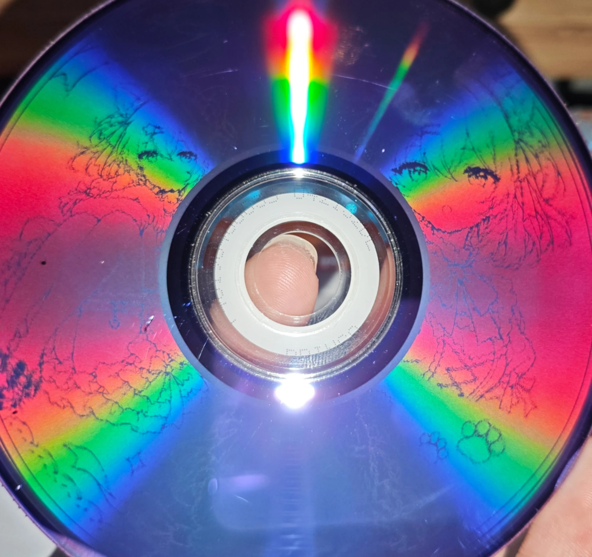

# DVD-R DL 图案实验记录（社区实测，非应用功能）

> 本文记录在双层 DVD-R DL 上刻出可见图案的一次完整实测，供 [#27](https://github.com/JiaFeiMiao-K-Cat/DiscImageStudio/issues/27) 讨论双层支持时参考。
> 应用本身仍然只支持单层盘；`tools/dvd-r-dl/` 下的脚本是独立的 Python 实验工具，不接入 GUI、CLI 或模块目录。

## 硬件与介质

| 项目 | 值 |
|---|---|
| 盘片 | Platinum / PRINCO DVD-R DL，MID `PRINCORDL05`，OTP |
| 容量 | 4,171,712 扇区；L0 = 2,092,896，L1 = 2,078,816 |
| 刻录机 | LG GSA-T50N（HL-DT-ST DVDRAM GSA-T50N RX05），USB |
| 刻录 | ImgBurn，2×，L0 Data Zone Capacity 2,092,896（ECC Block Boundary），开启 Verify |
| 结果 | 写入加封盘 55 分钟，L0/L1 读回校验全部通过 |

图案只画在 L0（半径约 24–58 mm）。L1 放普通文件，读盘时完全可用。

## 和单层流程的差别

1. **几何不能用单层模型推算。** OTP 的 L0 只占容量的一半，而且每家盘的轨距和起点都不一样。PRINCO 上用单层的 `r(s)` 模型推出来的位置，外圈最多偏 100° 以上。
2. **改用读盘计时（DPM）实测每个扇区的角度。** 对刻好的同型号盘，用 `READ(12)`（FUA=1，每次 1 个扇区）测量从参考扇区到目标扇区的完成时间差，取模一圈周期 T，得到相位：
   - 局部 T ≈ 11.56 ms；长距离寻道状态下 T ≈ 15.37 ms，两种状态要分开拟合。
   - 用局部二次外推逐点解包裹相位，整个 L0 共 45,871–45,902 圈。
   - 读完成时刻按 ECC 块量化，相位原点相对块起点还有一个偏移；照片拟合得到 `dn ≈ 14.55` 扇区，即物理圈数 `U(L) = F(L − dn)`。
   - 计时表**不要做全局平滑**：局部真实结构（例如 LBA ~800,800–813,600 处约 0.03 圈的凹陷）会被抹掉，图案就会局部扭曲。
   - 两张盘之间的稳健一致性约为 0.004 圈。修正后剩余的照片误差中位数约 0.001 圈（40 mm 处约 0.25 mm），表现为细线轻微发毛。
3. **调色板必须控制 DSV。** 早期用 0x92/0xA5 等字节时 DSV 失控，刻到一半失败。换成扰码域的低 DSV 七级调色板（亮→暗：`0x60, 0x2D, 0xD0, 0xC1, 0x74, 0xC3, 0x61`），再混入 10% 随机字节后，刻录稳定。
4. **扰码预置值。** ECMA-267 的 16 个预置中，第 F 个是 `0x0005`；早期误写成 `0x0004`，会让每 16 个 ECC 块中有 1 个的图案错乱。

## 工具

`tools/dvd-r-dl/`（需要 Python 3、numpy、scipy、Pillow；Windows SPTI 只读访问光驱）：

| 脚本 | 用途 |
|---|---|
| `dpm_probe.py` | SPTI `READ(12)`+FUA 单点计时（只读） |
| `dpm_v2.py` | stair / window 计时实验，逐条记录原始时间戳 |
| `unwrap_long.py` | 对长距离扫描做局部外推解包裹，搜索最优 T |
| `hidecodec.py` | ECMA-267 扰码预置和数据布局常量 |
| `tone_from_map.py` | 用不平滑的计时表加 `dn` 把线稿映射成每字节的灰度级 |
| `build_final.py` | 组装 L0 图案加 L1 文件的完整 DL 镜像 |
| `candidate_timing_map.csv` | PRINCORDL05 的 V1 计时表（每 800 LBA 一点，共 2,616 点） |

所有脚本都只读光驱，盘符写死为 `G:`（在 `dpm_probe.py` 里改）；刻录仍然用 ImgBurn 完成。

## 并入应用前还缺什么

- 计时表目前只来自同一批 PRINCO 盘，换盘或换刻录机需要重新测量；`dn` 也只在一个型号上用照片拟合过。
- 需要在 `DiscImageStudio.Dvd` 内部加入 L0/L1 布局、层切换点和按计时表定位的几何，并遵守 [ARCHITECTURE.md](ARCHITECTURE.md) 的模块边界。
- 标定流程要从“刻测试环 + 拍照”扩展成“刻测试盘 + 读盘计时”，这需要读命令权限和较长的扫描时间（全盘约数小时）。
