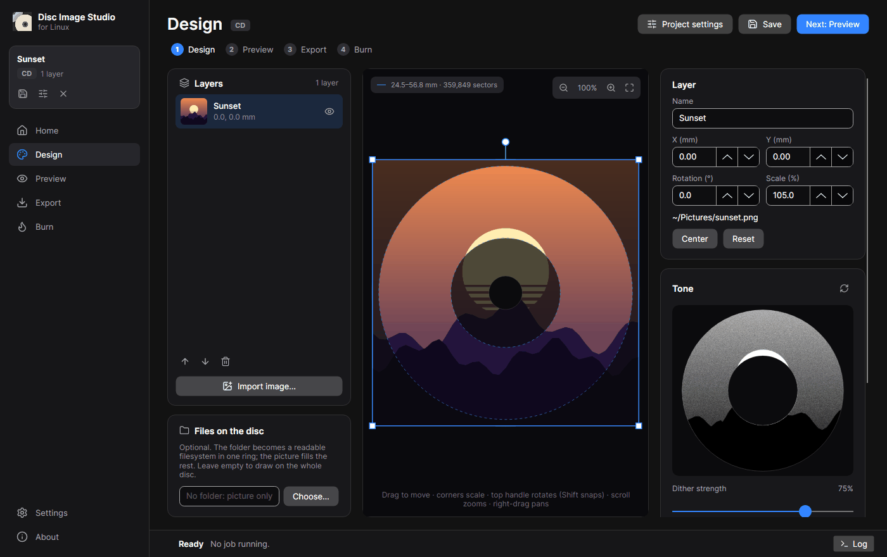
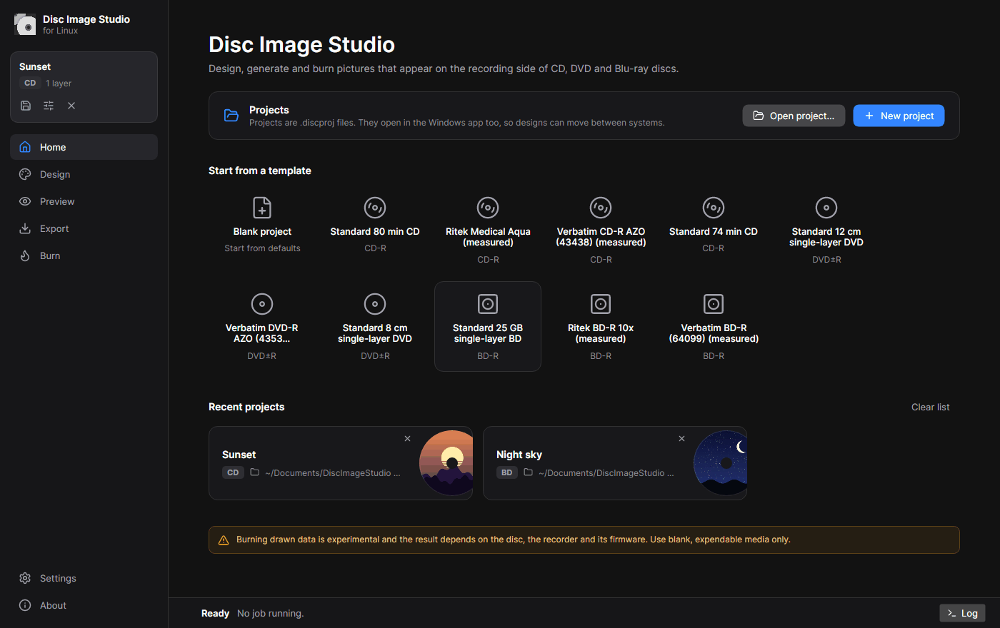
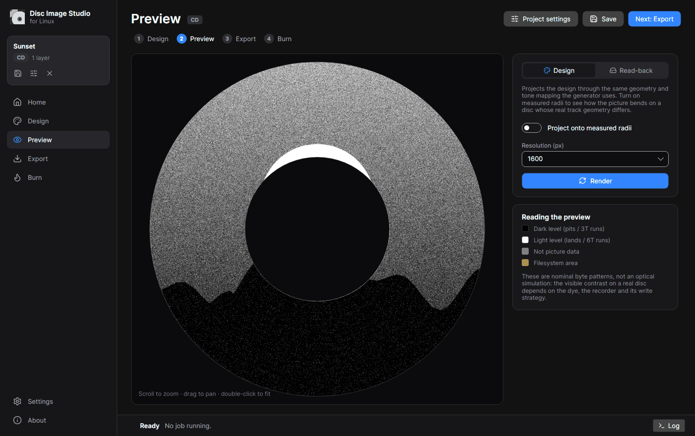
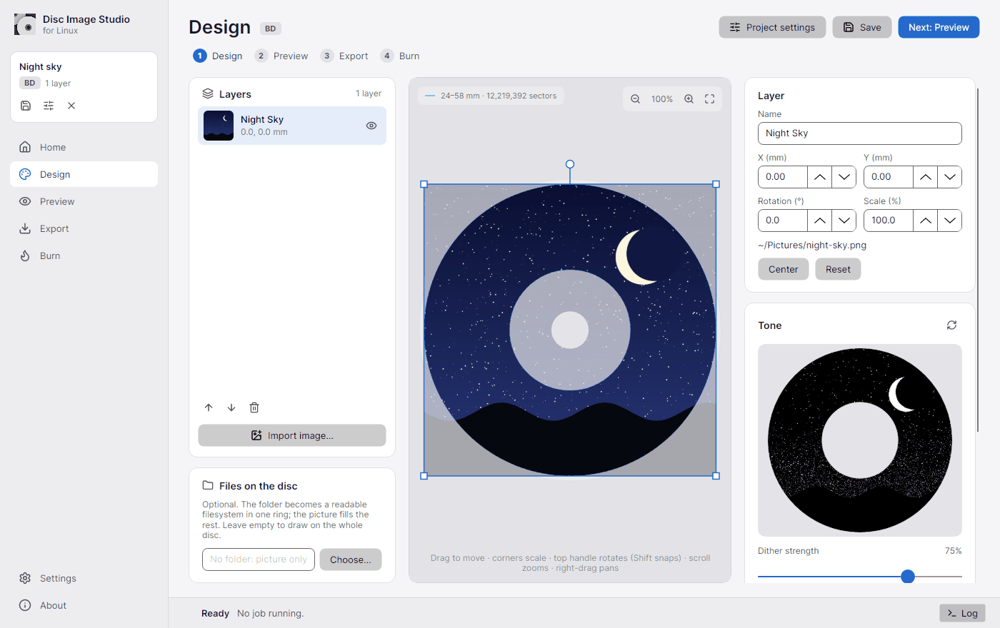
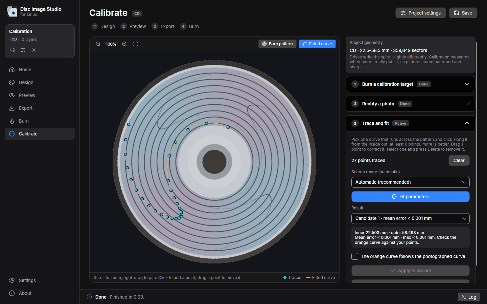

# Disc Image Studio on Linux

The Linux desktop app designs, previews, generates and burns disc pictures, like the Windows app. It hosts the same CD, DVD and Blu-ray engines as the Windows app and the command-line tool, and it reads and writes the same `.discproj` project files. A design started on one system opens on the other.

The Linux app is developed in the fork **[oreo1298/discimagestudio](https://github.com/oreo1298/discimagestudio)** of [Disc Image Studio](https://github.com/JiaFeiMiao-K-Cat/DiscImageStudio). Every command below uses the fork. The Windows app and the standalone CLI archives are published on the [original project's Releases page](https://github.com/JiaFeiMiao-K-Cat/DiscImageStudio/releases).



- [What you need](#what-you-need)
- [Install on Arch Linux](#install-on-arch-linux)
- [Install on other distributions](#install-on-other-distributions)
- [Install from a prebuilt archive](#install-from-a-prebuilt-archive)
- [Using the app](#using-the-app)
- [Burning discs on Linux](#burning-discs-on-linux)
- [Files and folders](#files-and-folders)
- [Troubleshooting](#troubleshooting)
- [Uninstall](#uninstall)
- [For developers](#for-developers)

> Burning drawn data is **experimental**. The visible result depends on the disc, the recorder and its firmware. Use blank, expendable media only.

## What you need

- A 64-bit x86 (x86_64) or ARM (aarch64) computer.
- Any current distribution with glibc (Arch, Debian, Ubuntu, Fedora, openSUSE, Mint and others). musl distributions such as Alpine should work when built from source, but have not been tested.
- An X11 or Wayland desktop. On Wayland the app runs through XWayland, which GNOME, KDE Plasma and most compositors provide out of the box. Sway and Hyprland need the `xwayland` package.
- These X11 and font libraries. Desktop installs already have them:

  | Distribution | Command |
  | --- | --- |
  | Arch, Manjaro, EndeavourOS | `sudo pacman -S --needed libx11 libice libsm libxi libxcursor libxrandr fontconfig` |
  | Debian, Ubuntu, Mint | `sudo apt install libx11-6 libice6 libsm6 libxi6 libxcursor1 libxrandr2 libfontconfig1` |
  | Fedora | `sudo dnf install libX11 libICE libSM libXi libXcursor libXrandr fontconfig` |
  | openSUSE | `sudo zypper install libX11-6 libICE6 libSM6 libXi6 libXcursor1 libXrandr2 fontconfig` |
  | Alpine | `sudo apk add libx11 libice libsm libxi libxcursor libxrandr fontconfig font-dejavu` |

The installed app includes its own .NET runtime, so you do not need .NET to *run* it. You need the .NET 10 SDK only to *build* it, and on Arch `makepkg` installs that for you.

## Install on Arch Linux

The fork contains a PKGBUILD that builds a proper pacman package from your checkout. pacman can then upgrade or remove it like any other package.

```sh
sudo pacman -S --needed git base-devel
git clone https://github.com/oreo1298/discimagestudio.git
cd discimagestudio/packaging/linux/arch
makepkg -si
```

`makepkg -s` installs `dotnet-sdk` as a build dependency. The build takes a few minutes and downloads the NuGet packages it needs. The package installs:

| Path | Contents |
| --- | --- |
| `/usr/bin/disc-image-studio-gui` | the desktop app (also accepts every CLI command) |
| `/usr/bin/disc-image-studio` | the command-line tool (prints help when run without arguments) |
| `/usr/lib/disc-image-studio/` | the app with its bundled .NET runtime |
| `/usr/share/applications/…DiscImageStudio.desktop` | the application-menu entry, also registered for `.discproj` files |

Install the burning tools you want; they are optional dependencies:

```sh
sudo pacman -S cdrtools dvd+rw-tools libisoburn
```

To update later:

```sh
cd discimagestudio
git pull
cd packaging/linux/arch
makepkg -sif
```

`-f` is needed because the package from the previous build is still in the folder, and the version number (from `Directory.Build.props`) usually stays the same between commits. pacman reinstalls the new build in place.

> On aarch64 (for example Arch Linux ARM) the same PKGBUILD builds the arm64 variant.
> If your `dotnet-sdk` is newer than 10 (for example after .NET 11 becomes the default), the PKGBUILD still builds, because it lets the newer SDK build the .NET 10 projects.

## Install on other distributions

On other distributions, build the app from the fork's source and install it with the bundled installer.

1. Install git and the .NET 10 SDK:

   | Distribution | Command |
   | --- | --- |
   | Ubuntu 24.04 and later | `sudo apt install git dotnet-sdk-10.0` |
   | Fedora | `sudo dnf install git dotnet-sdk-10.0` |
   | Debian, openSUSE and others | Microsoft's package feeds: see [Install .NET on Linux](https://learn.microsoft.com/dotnet/core/install/linux) |
   | Any distribution, no root | the install script, below |

   ```sh
   curl -sSL https://dot.net/v1/dotnet-install.sh -o dotnet-install.sh
   bash dotnet-install.sh --channel 10.0
   export PATH="$HOME/.dotnet:$PATH"
   ```

2. Build and install for your user (no root needed):

   ```sh
   git clone https://github.com/oreo1298/discimagestudio.git
   cd discimagestudio
   ./packaging/linux/build.sh --install
   ```

Then open **Disc Image Studio** from your application menu, or run `disc-image-studio-gui`.

`build.sh` detects your CPU and C library (glibc or musl) and publishes a self-contained build to `artifacts/linux/DiscImageStudio-<version>-<rid>/`. It also writes an archive of that folder next to it and runs a smoke test. `--install` then runs the bundled `install.sh`, which:

- copies the app to `~/.local/lib/disc-image-studio/`
- adds `disc-image-studio-gui` and `disc-image-studio` to `~/.local/bin/`
- adds the menu entry, the icons in every size, the AppStream metadata and the `.discproj` file type
- refreshes the desktop, MIME and icon caches when those tools are installed
- warns if a required library is missing

If `~/.local/bin` is not on your `PATH`, the menu entry still works. To type the commands in a terminal, add `export PATH="$HOME/.local/bin:$PATH"` to `~/.profile`.

To install for every user instead, build without `--install` and run the installer with `sudo`. Do not run `build.sh` itself with `sudo`, or the build folders in your checkout end up owned by root.

```sh
./packaging/linux/build.sh
sudo ./artifacts/linux/DiscImageStudio-*/install.sh      # installs into /usr/local
```

To update, run `git pull` and the same commands again. The installer replaces the previous version.

Other `build.sh` options:

| Option | Effect |
| --- | --- |
| `--install --prefix DIR` | install somewhere else, for example `--install --prefix /opt/disc-image-studio` (`--prefix` goes after `--install`) |
| `--rid linux-arm64` | cross-build for another CPU: `linux-x64`, `linux-arm64`, `linux-musl-x64`, `linux-musl-arm64` |
| `--framework-dependent` | use a system-wide .NET 10 runtime instead of bundling it (smaller, about 40 MB) |
| `--no-ready-to-run` | skip ahead-of-time compilation (faster build, slower start-up) |
| `--no-archive` | skip writing the `.tar.gz` |

## Install from a prebuilt archive

A prebuilt archive is a self-contained `DiscImageStudio-Linux-v<version>-<rid>.tar.gz` that installs without .NET or a build. **The fork has not published one yet**, so check the fork's [Releases page](https://github.com/oreo1298/discimagestudio/releases). If no release there lists `DiscImageStudio-Linux-…` files, use one of the methods above. The Linux archives on the original project's releases contain only the command-line tool, not this app.

`build.sh` writes the same archive to `artifacts/linux/`, so you can build once and copy it to other machines with the same CPU. To install an archive:

```sh
tar -xzf DiscImageStudio-Linux-v*-linux-x64.tar.gz
cd DiscImageStudio-*-linux-x64
./install.sh                 # just for you: installs into ~/.local, no root needed
# or
sudo ./install.sh            # for every user: installs into /usr/local
```

`./install.sh --help` lists the options. `--prefix /opt/disc-image-studio` installs elsewhere, and `--destdir` stages the files for distribution packaging. Running `./install.sh` again from a newer archive upgrades in place. A release download can be checked against the release's `SHA256SUMS.txt` with `sha256sum -c --ignore-missing SHA256SUMS.txt`.

The build makes no network requests beyond downloading NuGet packages. Avalonia's optional build telemetry is switched off in the project file.

## Using the app



1. **Home**: start from a template (each built-in disc preset, including the measured ones), open a `.discproj` file, or reopen a recent project.
2. **Design**: import pictures (Ctrl+I, or drop image files onto the disc) and place them on the 120 mm disc.
   - Drag to move a layer. The corner handles scale it and the top handle rotates it; hold Shift to snap to 15°.
   - The arrow keys nudge the selected layer by 0.1 mm (1 mm with Shift). The scroll wheel zooms and right-drag pans.
   - The dashed rings mark the recordable area.
   - The **Tone** panel previews, through the real engine, how grey levels become recordable patterns.
   - **Files on the disc** puts a folder in the inner or outer ring as a normal readable filesystem.
3. **Preview**: projects the design through the generation geometry at up to 3072 px. It can also project onto a disc with different *measured* radii, to see how a mismatch bends the picture, or decode a generated file (**Read-back**) the way a reader follows the spiral.
4. **Export**: composes the design at 8192 × 8192 px and runs the engine. CD projects produce a WAV track with a CUE sheet (or legacy RAW), or a Mode 1 ISO when files are included. DVD and BD-R projects produce an ISO. The job log (Ctrl+L) shows the equivalent `disc-image-studio` command.
5. **Burn**: writes the generated file with a Linux recording tool. See below.
6. **Calibrate**: measures the geometry your drive really writes from a photo of a burned test disc, and applies it to the project. See [Calibrating your drive](#calibrating-your-drive).



Keyboard shortcuts: Ctrl+N new project, Ctrl+O open, Ctrl+S save, Ctrl+Shift+S save as, Ctrl+W close, Ctrl+1 … Ctrl+5 switch pages, Ctrl+0 home, Ctrl+L job log, Ctrl+, settings.

Settings (bottom left) switch between the System, Dark and Light themes. System follows your desktop's dark-mode preference.



The `disc-image-studio-gui` binary also runs every engine command without opening a window, exactly like the standalone CLI. For example, `disc-image-studio-gui cd-generate --input picture.png --output track.wav`. See the command table in the [README](../README.en.md#command-line).

## Burning discs on Linux

The Windows app streams data to the recorder through IMAPI2. On Linux, Disc Image Studio first writes the image file, then burns it with one of the standard recording programs. Because every image starts at the first sector, and the drive applies the same scrambling and channel coding, the disc carries the same picture.

The Burn page detects your drives (`/dev/sr*`) and installed programs. It shows the exact command before it runs, and **Copy** puts that command on the clipboard if you prefer to run it in a terminal. **Test run** keeps the laser off where the program supports it.

| Output | Recommended program | What the app runs, and why |
| --- | --- | --- |
| CD audio track (`.wav`, `.raw`) | `cdrecord` or `wodim` (`cdrskin` for WAV) | `cdrecord -v dev=/dev/sr0 -audio track.wav`. **No `-swab`**: RAW tracks are big-endian, which is what `-audio` expects, and WAV headers state their byte order. See [CD burning compatibility](CD_AUDIO_COMPATIBILITY.md). |
| CD data image (`.iso`) | `cdrecord`, `xorriso` | `-dao -data -nopad`: the image fills the whole disc, so it must be written disc-at-once without padding. |
| DVD image (`.iso`) | `growisofs`, `xorriso` | `growisofs -dvd-compat -Z /dev/sr0=image.iso` closes the disc in a single disc-at-once session. |
| BD-R image (`.iso`) | `growisofs`, `xorriso` | `growisofs -use-the-force-luke=spare:none -Z /dev/sr0=image.iso`. The BD-R **must stay unformatted, with no spare areas**, or every sector moves away from its nominal position (see [ADDING_BLURAY.md](ADDING_BLURAY.md)). xorriso leaves blank BD-R unformatted by default. |

Packages that provide the programs:

| Distribution | Command |
| --- | --- |
| Arch | `sudo pacman -S cdrtools dvd+rw-tools libisoburn` |
| Debian, Ubuntu, Mint | `sudo apt install wodim growisofs xorriso` |
| Fedora | `sudo dnf install dvd+rw-tools xorriso cdrskin` |
| openSUSE | `sudo zypper install dvd+rw-tools xorriso` |

**Drive permissions.** The drive's device node belongs to the `optical` group on Arch and the `cdrom` group on Debian and Ubuntu. Desktop sessions usually give the logged-in user access automatically. If the Burn page says you lack access, add yourself to the group shown there, then log out and back in:

```sh
sudo usermod -aG optical "$USER"   # Arch
sudo usermod -aG cdrom "$USER"     # Debian, Ubuntu
```

Use **Disc information** to confirm the disc is blank before burning. Close file managers that auto-mount discs while a burn is running.

## Calibrating your drive

Recorders write the spiral slightly differently from the nominal geometry, and a few micrometres are enough to bend a picture. The **Calibrate** page (Ctrl+5) is the same assisted workflow as the Windows app's, and it reads and writes the same `.calibration.json` records. [CALIBRATION.md](CALIBRATION.md) explains the method in detail.



1. **Burn a calibration target.** Opening the page builds a target from the project's geometry: nine thin circles and a cross. **Generate** writes it (a `.wav` and `.cue` for CD, an `.iso` for DVD and BD-R) together with a `.calibration.json` record. **Burn…** generates it if needed and opens it on the Burn page. Keep the record next to the file: **Open record…** (or dropping the `.calibration.json` onto the canvas) restores that exact target later.
2. **Rectify a photo.** Photograph the recorded side of the burned disc as straight-on as you can, lit by one small light so the lines show. Import it with **Import photo…** or drop it onto the canvas. Drag the blue points onto the disc's *physical* outer edge and the orange points onto the edge of the centre hole, not onto the edge of the recorded area or the clear plastic ring. Choose 12 cm or 8 cm, then **Calculate rectification**. In the rectified preview the disc should look round and face-on, with its edges on the dashed circles. Confirm it to continue.
3. **Trace and fit.** On the rectified photo, the arms of the cross are now curves. Pick one and click along it from the inside out: at least 6 points (12 for the DVD cubic pitch), and 20 or more is better. Keep neighbouring points close where the curve bends, so it cannot skip a turn between them. Drag a point to correct it, or select it and press Delete. **Fit parameters** fits the inner and outer radii (and the DVD track pitch). The orange curve shows what the result predicts; points far from it turn red. A result with a mean error above 0.35 mm or a maximum above 0.8 mm cannot be applied. When the curve follows the photo, tick the confirmation and **Apply to project**, then save the project.

On the canvas, the scroll wheel zooms, right-drag (or Space + drag) pans, and 0 fits the view. **Burn pattern** shows what the target writes. The whole calculation runs locally; nothing is uploaded.

## Files and folders

| What | Where |
| --- | --- |
| Projects (default location) | `~/Documents/DiscImageStudio Projects/` (or `~/DiscImageStudio Projects/` without a Documents folder) |
| Settings, recent projects | `~/.config/DiscImageStudio/linux-settings.json` |
| Your own disc presets (same format as Windows, see [DISC_PRESETS.md](DISC_PRESETS.md)) | `~/.local/share/DiscImageStudio/disc-presets.json` |
| Cached composites and previews (safe to delete) | `~/.cache/DiscImageStudio/work/` |

Projects store image paths as absolute paths. When you move a project to another computer, keep the images next to it and re-import any layer whose image is reported as missing.

## Troubleshooting

- **The window does not open, or an error mentions libICE, libSM or libX11.** Install the libraries from [What you need](#what-you-need). Running `disc-image-studio-gui` in a terminal shows the error.
- **No file dialog appears.** File dialogs come from the XDG desktop portal (GNOME, KDE and most desktops), with GTK 3 as a fallback. On a bare window manager, install `xdg-desktop-portal` with a backend such as `xdg-desktop-portal-gtk`, or install GTK 3.
- **Everything is tiny or huge on a HiDPI screen.** Set the scale explicitly, for example `AVALONIA_GLOBAL_SCALE_FACTOR=1.5 disc-image-studio-gui`. To make it permanent, add it to the `Exec=` line of a copy of the `.desktop` file in `~/.local/share/applications/`.
- **Chinese or Japanese file names show boxes.** Install a CJK font, for example `noto-fonts-cjk` (Arch) or `fonts-noto-cjk` (Debian/Ubuntu).
- **`build.sh` says no .NET 10 SDK was found.** Your distribution may ship a newer SDK only. Install the 10.0 SDK side by side (for example `dotnet-sdk-10.0` or `dotnet-install.sh --channel 10.0`). The Arch PKGBUILD does not need this.
- **The burn fails at once.** Open the log (Ctrl+L) for the program's own message. Common causes: the disc is not blank, the device is busy because it is mounted, or you are not in the drive's group.
- **The picture on the disc is bent or smeared.** Generic presets use nominal geometry. Use a measured preset for your disc, or measure your own drive on the Calibrate page ([Calibrating your drive](#calibrating-your-drive)).

## Uninstall

| Installed with | Remove with |
| --- | --- |
| Arch package | `sudo pacman -R disc-image-studio` |
| `build.sh --install` or `./install.sh`, for your user | `./artifacts/linux/DiscImageStudio-*/install.sh --uninstall` in your checkout, or `./install.sh --uninstall` in an extracted archive |
| `sudo …/install.sh`, system-wide | the same command with `sudo` (add `--prefix` if you used one) |

Uninstalling keeps your projects, settings and presets. Delete `~/.config/DiscImageStudio`, `~/.local/share/DiscImageStudio` and `~/.cache/DiscImageStudio` to remove them too.

## For developers

```sh
dotnet run --project src/DiscImageStudio.Linux                    # run the GUI from source
dotnet run --project tests/DiscImageStudio.LinuxTests -c Release  # headless regression checks
```

The tests generate small CD, DVD and BD-R images (with and without files) through the same command lines the GUI uses. They also decode the images back, render every preview type, round-trip a project file, and check the burn command rules.

`disc-image-studio-gui --screenshot DIR [--project FILE] [--theme dark|light]` renders every page to PNG and exits. It works under `xvfb-run`, and CI uses it to catch layout regressions.

The source lives in `src/DiscImageStudio.Linux/`:

| Folder | Contents |
| --- | --- |
| `Services/` | composition (Skia port of the Windows composer), engine jobs, previews, burning, presets, settings |
| `ViewModels/` | one view model per page, plus the project model that reads and writes `.discproj` |
| `Views/`, `Controls/` | Avalonia XAML pages and dialogs, the interactive disc canvas and the zoomable preview |

Packaging lives in `packaging/linux/`: `build.sh`, `install.sh`, the desktop, AppStream and MIME files in `data/`, and `arch/PKGBUILD`.
