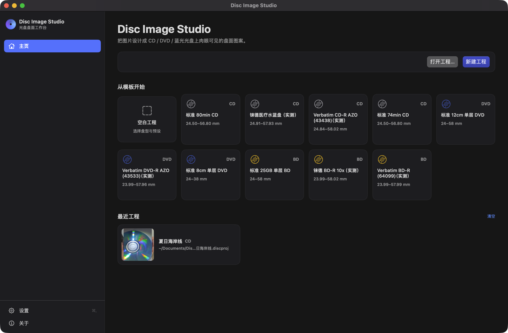
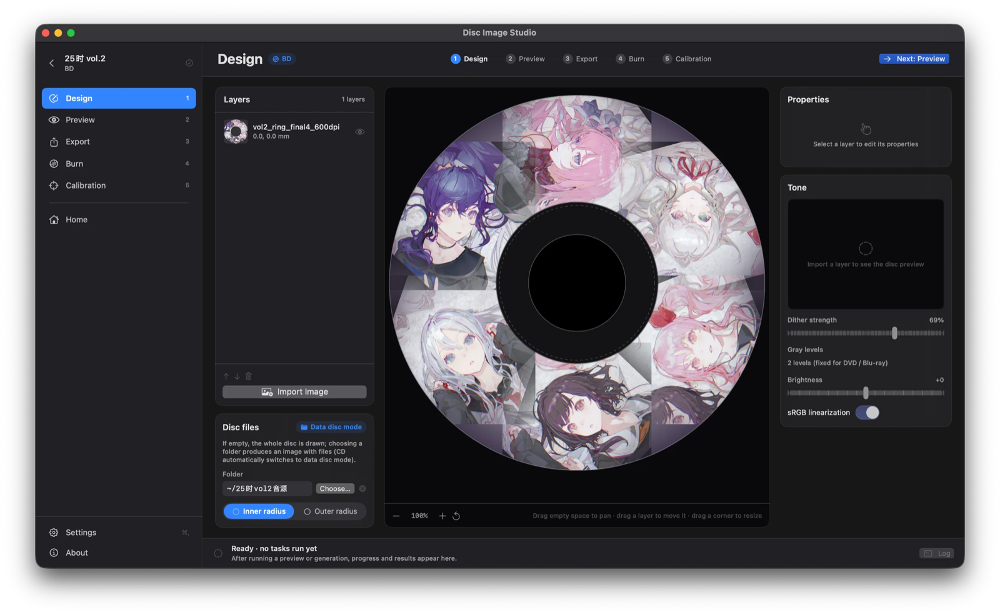
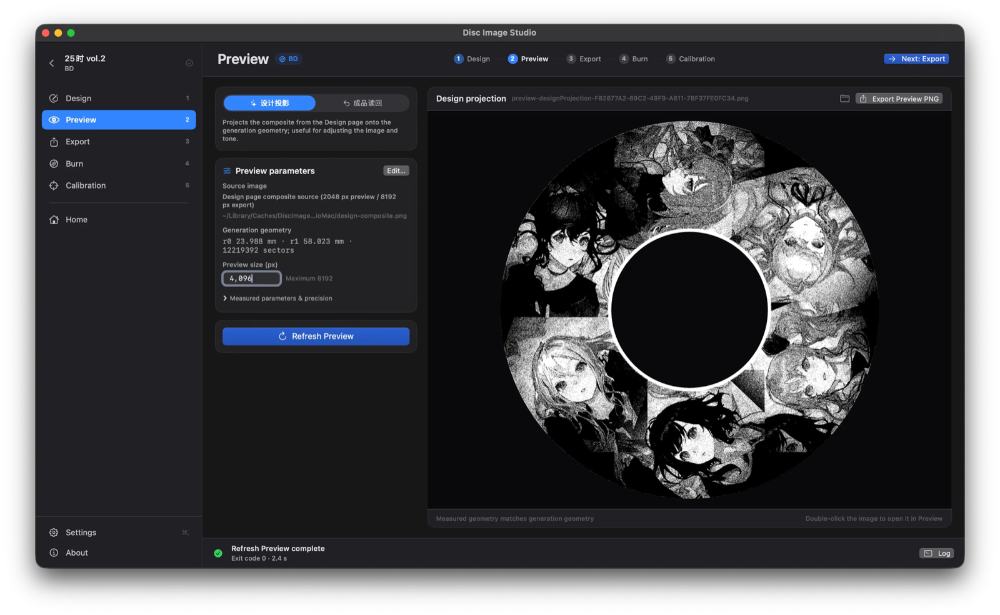
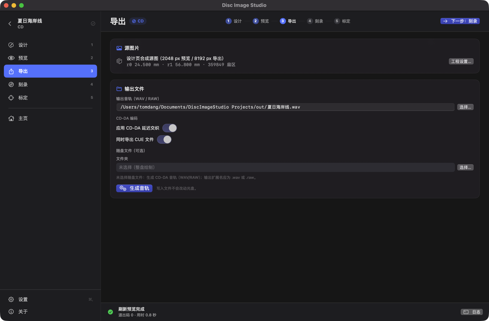
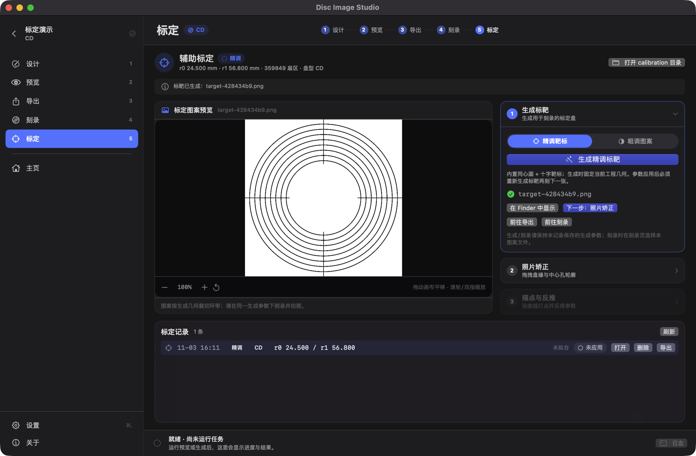
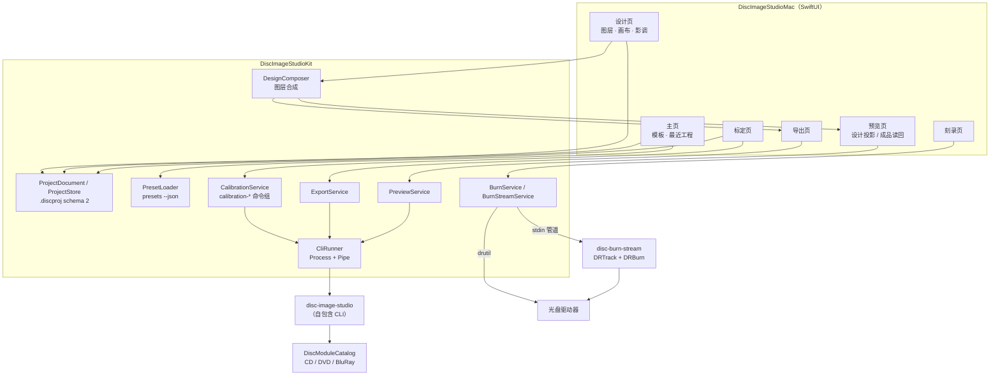
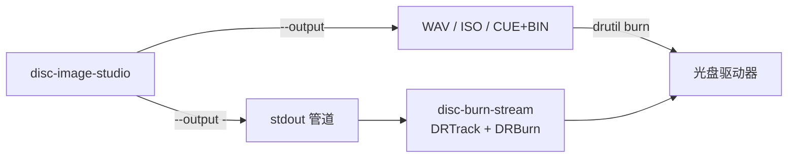

# macOS 图形界面（实验性）

本文说明 `macos/` 下 SwiftUI 客户端的构建、运行、打包与排障。这个客户端不是命令目录浏览器，而是与 Windows 桌面版一致的**工程式工作流界面**：主页选模板或最近工程，设计图层，预览投影与读回，导出镜像，刻录，标定。`macos/WORKFLOW.md` 是这一形态的规范（各页要求、Kit 接口与命令映射），`macos/DESIGN.md` 保留 Swift ↔ CLI 的接口契约（`catalog --json` 数据结构、CLI 发现顺序等）。界面本身不实现任何光盘编码逻辑，全部任务都交给自包含的跨平台 CLI `disc-image-studio` 执行。

与 Linux/macOS CLI 一样，macOS 图形界面目前属于**实验性功能**，行为与 Windows 桌面程序不完全等价，详见文末[已知限制](#已知限制)。

## 功能概述

macOS 客户端（`macos/`，SwiftPM 包）与 Windows 桌面版是**同一套工程式工作流**：侧边栏顺序即工作流顺序——**主页 → 设计 → 预览 → 导出 → 刻录 │ 标定**，设置与关于常驻侧边栏底部。全部页面按 `macos/WORKFLOW.md` 的分工实现。

- **主页**：打开工程、新建工程（⌘N），从模板开始（空白工程 + CD/DVD/BD 预设，预设来自 `presets --json`），最近工程带缩略图、盘型与路径。
- **设计**：三栏——图层列表（导入 PNG/JPEG、上移/下移/删除、可见性）、毫米坐标画布（盘体与中心孔轮廓，图层拖动/旋转/缩放）、属性与影调（抖动强度 0–100%、灰阶档位、亮度、sRGB 线性化、实时盘面缩略预览）；随盘文件的文件夹与内圈/外圈也在这一页。
- **预览**：「设计投影」把图层合成图按几何投到盘面；「成品读回」从已生成的音轨或 ISO 渲染校验图；可调实测内/外半径、DVD 三次项、BD 极性与预览尺寸，并显示生成几何与实测几何的偏差。
- **导出**：CD 写音轨（WAV+CUE 或 RAW）或数据盘（ISO，可带随盘文件），DVD/BD 写 ISO；输出路径、交织、卷标、随盘文件位置都在这一页，生成成功即回填到预览的「成品读回」。
- **刻录**：文件模式（系统 `drutil`）与实验性流式模式（DiscRecording `DRTrack` + `DRBurn`，经内置助手 `disc-burn-stream`），详见[刻录](#刻录)。
- **标定**：完整辅助标定向导——生成精调靶标或粗调半黑白图案、照片双椭圆矫正、沿曲线/分界描点反推（精调/粗调）、按阈值应用实测参数；支持 issue #49 的「两张法」（粗调 → 精调），标定会话与 Windows 双向兼容。详见[辅助标定（完整流程）](#辅助标定完整流程)。
- **设置 / 关于**：外观、默认工程位置、缓存位置、CLI 路径（自动/自定义/源码 `dotnet run`）；版本、GPL-3.0-or-later、上游仓库与第三方声明。

工程文件是 `.discproj`（UTF-8 JSON，schemaVersion 2），**与 Windows 桌面版双向兼容**：字段名、单位、图层与影调定义一致，同一工程可以在两个平台打开；读 schema 1 时按 CD/DVD 处理，保存统一写 2。

所有编码只由 `disc-image-studio` 子进程完成（`cd-generate`、`solve`、`bd-generate`、`cd-preview-warp`、`cd-preview-track`、`calibrate`、`simulate`、`bd-preview`、`bd-preview-readback`，以及标定命令组 `calibration-target` / `calibration-photo` / `calibration-fit` / `calibration-coarse-target` / `calibration-coarse-fit` / `calibration-session-write` / `calibration-session-read`）。Swift 侧只做工程模型、图层合成、参数拼装与进程管理，参数构造逐字对齐 Windows 的 `ExportViewModel` / `LivePreviewViewModel`。本轮 CLI 新增 `presets --json`、`bd-preview`、`bd-preview-readback` 与标定命令组，`catalog --json` 保留用于命令自检、快照回归与排障。

## 界面预览











## 架构

SwiftUI 视图 → Kit 工作流层（工程、设计合成、导出/预览/刻录/标定）→ CLI 子进程。编解码、纠错与文件系统写入仍然只在 C# 一侧。



- **工程层**：`ProjectDocument` + `ProjectStore` 读写 `.discproj`（camelCase、schemaVersion 2、原子写、忽略未知字段、读 1 视为 CD/DVD），与 Windows 的 `ProjectJsonStore` 同一格式；`RecentProjectsStore` 管理最近工程与缩略图，`PresetLoader` 用 `presets --json` 读预设目录。
- **设计层**：`DesignComposer` 按图层顺序自下而上合成正方形 PNG（中心即盘心、mm 坐标；预览 2048 px、导出 8192 px）；合成图是预览与导出共用的唯一输入，因此预览验证的素材就是写入盘片的素材。
- **命令层**：`ExportService` / `PreviewService` 把工程与参数拼成 `ExportPlan` / `PreviewPlan`，`CliRunner` 启动子进程并逐行回传日志与进度（取消先 `SIGTERM`，3 秒后 `SIGKILL`）；`BurnService` 驱动 `/usr/bin/drutil`，`BurnStreamService` 驱动内置 `disc-burn-stream`。
- **标定层**：`CalibrationService` 封装标定命令组（靶标/粗调图案生成、照片矫正、精调与粗调反推、会话读写），`CalibrationRecord` / `CalibrationRecordStore` 保存 GUI 侧的 `.mac.json` 记录；标定会话 `.calibration.json` 由 CLI 写，与 Windows 双向兼容。
- **契约层**：命令行与参数的权威实现在 Windows 的 `ExportViewModel` / `LivePreviewViewModel`，macOS 侧逐字对齐；`catalog.json` 快照与 Kit 单测防止 CLI 输出漂移。
- 子进程工作目录固定为用户主目录，环境变量强制 `DOTNET_CLI_TELEMETRY_OPTOUT=1`、`DOTNET_NOLOGO=1`、`DOTNET_SKIP_FIRST_TIME_EXPERIENCE=1`。

## 前置条件

| 依赖 | 版本 | 用途 |
| --- | --- | --- |
| macOS | 14.0 或更高 | 应用最低系统版本（`LSMinimumSystemVersion=14.0`），`@Observable` 要求 |
| Xcode / Swift | Xcode 26+、Swift 6（`swift-tools-version: 6.0`） | 编译 Swift 包与 DiscRecording 刻录助手 |
| .NET SDK | 10.0.x | **仅**构建内置 CLI 时需要；只编译 Swift UI 不需要 .NET |
| Python 3 | 系统自带即可 | 可选：在发布前跑 `tests/test_cli_package.py` 冒烟测试 |

.NET SDK 必须是 10.0.x：仓库根目录的 `global.json` 要求 `10.0.100`（`rollForward: latestFeature`）。没有 SDK 时脚本会提示安装方式，也可以手动安装：

```sh
curl -sSL https://dot.net/v1/dotnet-install.sh -o /tmp/dotnet-install.sh
bash /tmp/dotnet-install.sh --channel 10.0 --install-dir "$HOME/.dotnet"
```

所有命令都在**仓库根目录**执行。

## 三步构建

```sh
# 1. 构建自包含 CLI（需要 .NET 10 SDK）→ macos/build/cli/osx-arm64/disc-image-studio
macos/scripts/build-cli.sh

# 2. 编译 Swift 应用并组装 .app（自动带上上一步的 CLI 与 disc-burn-stream 助手）→ macos/build/DiscImageStudio.app
macos/scripts/build-app.sh

# 3. 启动
open macos/build/DiscImageStudio.app
```

版本号来自仓库根目录 `Directory.Build.props` 的 `VersionPrefix` / `VersionSuffix`（当前 `1.3.6` 对应 `CFBundleShortVersionString=1.3.6`）；`CFBundleVersion` 取 `git rev-list --count HEAD`，无法读取 git 信息时回落为 `1`。

### build-cli.sh

| 参数 | 默认值 | 说明 |
| --- | --- | --- |
| `--rid osx-arm64\|osx-x64` | 按 `uname -m` 推断（arm64 → `osx-arm64`，x86_64 → `osx-x64`） | 目标运行时 |
| `--configuration Release\|Debug` | `Release` | 发布配置 |
| `--output <dir>` | `macos/build/cli/<rid>` | 输出目录 |
| `--update-fixtures` | 关闭 | 成功后用 `catalog --json` 覆盖 `catalog.json` 快照 |
| `-h`, `--help` | — | 帮助 |

脚本按 `$DOTNET` → `$HOME/.dotnet/dotnet` → `PATH` 中的 `dotnet` 顺序解析 SDK，然后执行与上游 CI 完全相同的发布命令：

```sh
dotnet publish src/DiscImageStudio.Cli/DiscImageStudio.Cli.csproj \
  -c Release -r osx-arm64 --self-contained true -o macos/build/cli/osx-arm64 \
  -p:PublishSingleFile=true -p:IncludeNativeLibrariesForSelfExtract=true
```

发布结束后校验 `<out>/disc-image-studio --help` 退出码为 0，并打印可执行文件路径与大小。默认**不会**改动 `catalog.json`，只有显式传 `--update-fixtures` 才会写快照。

### build-app.sh

| 参数 | 默认值 | 说明 |
| --- | --- | --- |
| `--configuration release\|debug` | `release` | SwiftPM 配置 |
| `--cli <path>` | 自动查找 `macos/build/cli/<rid>/disc-image-studio` | 内置哪个 CLI |
| `--no-cli` | 关闭 | 不内置 CLI（应用仍可启动） |
| `--no-sign` | 关闭 | 跳过 ad-hoc 签名（仅排障用） |
| `-h`, `--help` | — | 帮助 |

组装内容：

```text
macos/build/DiscImageStudio.app/Contents/
├── Info.plist                 # 由 macos/Resources/Info.plist.in 生成
├── MacOS/DiscImageStudioMac   # swift build 产物（路径取自 --show-bin-path）
├── Resources/AppIcon.icns     # 由 sips + iconutil 从 256×256 PNG 生成
├── Resources/bin/disc-burn-stream    # 内置的原生流式刻录助手（始终构建）
├── Resources/cli/disc-image-studio   # 可选：内置的 CLI
├── Resources/LICENSE                 # 可选：内置 CLI 时一并复制
├── Resources/THIRD-PARTY-NOTICES.txt # 可选：同上
└── _CodeSignature/            # ad-hoc 签名
```

- 可执行文件路径通过 `swift build -c release --package-path macos --show-bin-path` 获取，不硬编码 `.build/release`（新版 SwiftPM 可能输出到 `.build/out/Products/Release` 等位置）。
- `AppIcon.icns` 在临时 iconset 目录里用 `sips` 生成各尺寸后由 `iconutil` 合成，结束后清理；缺少源图或工具时只警告、不中断构建。
- 无论是否 `--no-cli`，脚本都会额外构建 SwiftPM 产品 `disc-burn-stream` 并放进 `Contents/Resources/bin/`（Objective-C + DiscRecording，不依赖 .NET）。`Package.swift` 里还没有该产品时只警告并跳过，构建仍可完成。
- 内置 CLI 时同时复制 `LICENSE` 与 `THIRD-PARTY-NOTICES.txt`，满足 GPL 的声明分发要求；没有 CLI 时给出警告，应用照常启动，只是执行任务时会提示找不到 CLI。
- 最后执行 `codesign --force --deep --sign -` 做 ad-hoc 签名，并打印 `.app` 路径、`du -sh` 体积以及内置 CLI / 刻录助手的实际路径。

## 开发运行

```sh
# 已有 .app → 直接打开；没有 → 用 swift run 前台运行
macos/scripts/run-dev.sh

# 强制重新构建 .app 再打开（-- 之后是 build-app.sh 的参数）
macos/scripts/run-dev.sh --rebuild
macos/scripts/run-dev.sh --rebuild -- --no-cli

# 只编译不打包
cd macos && swift build

# 直接跑可执行文件（debug，前台，无 .app 包）
swift run --package-path macos DiscImageStudioMac
```

`swift run` 不是 `.app` 包，因此没有 `Contents/Resources/cli`，CLI 只能通过环境变量、设置里的自定义路径或 `PATH` 提供；需要验证内置 CLI 时请用 `build-app.sh` 生成包再打开。

## 打包分发

```sh
macos/scripts/build-app.sh
macos/scripts/package-app.sh
```

| 参数 | 默认值 | 说明 |
| --- | --- | --- |
| `--rid osx-arm64\|osx-x64` | 按 `uname -m` 推断 | 只影响压缩包文件名 |
| `--app <path>` | `macos/build/DiscImageStudio.app` | 要打包的 `.app` |
| `--output <dir>` | `macos/build` | 输出目录 |

产物（版本号同样取自 `Directory.Build.props`）：

```text
macos/build/DiscImageStudio-1.3.6-osx-arm64.zip
macos/build/DiscImageStudio-1.3.6-osx-arm64.zip.sha256
```

校验与解包：

```sh
(cd macos/build && shasum -a 256 -c DiscImageStudio-1.3.6-osx-arm64.zip.sha256)
unzip -q macos/build/DiscImageStudio-1.3.6-osx-arm64.zip -d ~/Downloads
```

### 未公证说明（Gatekeeper）

发布包**没有经过 Apple 公证**，签名是 ad-hoc（`codesign --sign -`），只保证包内文件未被损坏、不提供身份验证。首次打开会被 Gatekeeper 拦下（「无法打开"Disc Image Studio"，因为 Apple 无法检查其是否包含恶意软件」）。本机测试可以用任意一种方式打开：

- 在 Finder 里**右键**（或 Control-单击）`Disc Image Studio.app` → **打开** → 再确认一次「打开」；
- 或在「系统设置 → 隐私与安全性」页面下方点击「仍要打开」；
- 或去掉隔离属性后直接打开：

```sh
xattr -dr com.apple.quarantine ~/Downloads/DiscImageStudio.app
open ~/Downloads/DiscImageStudio.app
```

只对你自己构建或信任来源的包使用 `xattr` 命令；正式分发应补齐开发者 ID 证书签名与公证（见[已知限制](#已知限制)）。

## 刻录

macOS 侧不引入第三方刻录库，只使用系统自带的 DiscRecording（`drutil` 与 `DRTrack`/`DRBurn`）。有两条路径：

| 路径 | 实现 | 覆盖范围 | 状态 |
| --- | --- | --- | --- |
| 文件模式 | CLI 生成镜像或音轨文件 → `/usr/bin/drutil` 写入 | CD-DA 音频、CD/DVD 数据镜像 | 可用 |
| 流式模式 | 内置助手 `Contents/Resources/bin/disc-burn-stream` 读取 CLI 的 stdout 管道，用 DRTrack producer + DRBurn 写入 | CD-DA、DVD 数据 | 实验性 |



流式模式的命令契约见 `macos/DESIGN.md` §5.2；下面「流式模式」给出可直接使用的命令行。

### 文件模式

CLI 先把成品写到磁盘，再由系统工具写入盘片。`drutil` **只接受文件或目录路径，不能从 stdin 读数据**，所以这条路径必须先落盘。

```sh
# 音频 CD：CLI 生成 WAV，再以红皮书音频写入
macos/build/cli/osx-arm64/disc-image-studio cd-generate \
  --input artwork.png --output track.wav --sectors 300
mkdir -p /tmp/dis-audio && rm -f /tmp/dis-audio/*
cp track.wav /tmp/dis-audio/            # 目录里只放要烧成音轨的文件
drutil burn -audio /tmp/dis-audio

# 数据盘：CLI 生成 ISO（或 CUE+BIN / TOC），直接烧录镜像
macos/build/cli/osx-arm64/disc-image-studio solve \
  --image artwork.png --iso-output disc.iso --total-sectors 160 --fill-sectors 160
drutil burn -eject disc.iso             # 等价：hdiutil burn disc.iso
```

- 音频 CD 用 `drutil burn -audio <目录>`：目录里的**每个**音频文件都会成为一条音轨，多余文件会被一起烧进去，所以请使用干净的空目录。
- 数据盘用 `drutil burn <镜像>`（或 `hdiutil burn <镜像>`）：`.iso`、`.dmg`、`.toc`、`.cue`+`.bin` 等 DiscRecording 认识的格式都可以。
- 应用内的文件模式由 `BurnService` 封装：`drutil list` 发现刻录机、`drutil status` / `drutil toc` 读取介质状态、按扩展名决定 `burn -audio <目录>` 还是 `burn <镜像>`，并实时回显 `drutil` 的输出。

### 流式模式

流式模式不落盘：`BurnStreamService` 启动 CLI（`--output -`，stdout 只输出原始块，日志改走 stderr），把 stdout 接到内置助手 `disc-burn-stream` 的 stdin；助手用 `DRTrack` 的 producer 回调向前取数据、`DRBurn` 负责写入，并把进度写到 stderr。

```sh
# 列出刻录机与介质状态（stdout 为 JSON 数组）
macos/build/DiscImageStudio.app/Contents/Resources/bin/disc-burn-stream --list-drives

# 写入：stdin 读原始块（cd-audio 每块 2352 字节，dvd-data 每块 2048 字节）
macos/build/cli/osx-arm64/disc-image-studio cd-generate \
  --input artwork.png --output - --sectors 300 \
  | macos/build/DiscImageStudio.app/Contents/Resources/bin/disc-burn-stream \
      --kind cd-audio --sectors 300 --drive 1
```

- 参数：`--kind cd-audio|dvd-data`、`--sectors N`，可选 `--drive I`、`--speed N`、`--no-verify`、`--no-eject`、`--test`；stderr 进度行是 `state:` / `percent:` / `error:`，退出码 0 成功、1 失败、2 参数/设备/介质问题。
- 介质非空白、没有介质或没有刻录机时，助手直接拒绝（退出码 2 并写 `error:`），界面展示原因而不是静默失败。
- 支持 CD-DA 与 DVD 数据；**BD-R 默认不提供**（DiscRecording 的 BD 写入路径未在实机验证），蓝光请生成 ISO 后用第三方软件刻录。
- 该路径与 `--output -` 同属实验性能力，尚未在实机验证；CI 只覆盖助手构建与 `--list-drives` 自检。

### 安全要求

刻录会**不可逆地写入或擦除介质**，因此：

- 只使用**空白或可报废**的介质；重要数据先保存镜像，确认无误后再写盘。
- 界面在开始写入前要求**二次确认**，确认框中列出刻录机、介质类型和将写入的内容；用户取消时不执行任何 `drutil` 命令。
- 没有刻录机时：`drutil list` 为空 → 界面禁用刻录动作并提示「未检测到光盘驱动器」，不尝试调用 `drutil`。
- 没有介质时：`drutil status` 报告无盘 → 提示放入空白介质，不自动重试。
- 介质不是空白时：界面直接拒绝写入并显示现有轨道信息（`drutil toc`），不做「擦除后继续」的隐式操作。
- 蓝光介质：`BurnKind.kind(forMediaType:)` 返回 nil，界面提示改用镜像文件与第三方软件，绝不尝试写入。

## 辅助标定（完整流程）

标定页覆盖与 Windows 版相同的「生成标定盘 → 照片矫正 → 曲线标定」流程，并额外提供 issue #49 的**粗调**入口。权威契约是 [`macos/CALIBRATION.md`](../macos/CALIBRATION.md)（GUI 交互、Kit 接口、CLI 参数与 JSON 字段）；产品说明、公式与判定阈值的来源是 [`docs/CALIBRATION.md`](CALIBRATION.md)。

### 三步向导

顶部固定显示工程盘型与生成几何摘要。三步是串行依赖的：修改轮廓、盘片规格或任一描点后，后面的「已确认矫正 / 拟合结果」全部失效，必须重做（与 Windows 一致）。

1. **标靶**：分段控件选「精调靶标」（内置同心圆 + 十字）或「粗调图案」（半黑白，issue #49）。
   - 精调 → `calibration-target`：按当前几何把内置 `target_slim.png` 缩放并裁切刻录环带，输出 2400×2400 灰度 PNG 和 `.calibration.json` 会话骨架（schema 6）。
   - 粗调 → `calibration-coarse-target`：输出「左黑右白、分界过盘心」的图案与 P0 记录（`p0.json`：family、r0/r1、sectors、density、pitch、drawing 起止）。
   - 快捷动作：导出到项目 `calibration/`、跳导出页刻录、跳刻录页；每次生成都新建带时间戳/短 ID 的文件，不覆盖旧记录。
2. **照片矫正**：导入照片并选择 12 cm / 8 cm。
   - CLI（`calibration-photo`）先把照片缩到最长边 2000 px 并返回 `--resized-out`；**所有轮廓点坐标都基于这张缩小图**。
   - 在照片上拖动 8 个外缘控制点 + 8 个中心孔控制点（初始按图像范围 0.43 / 0.125 布置），支持缩放、平移、重置轮廓。
   - 「计算矫正」→ 双椭圆联合拟合 + 透视重采样，输出正方形矫正图（中心即盘心、+x 右、+y 下）；「确认矫正」进入下一步。失败时显示中文原因，并保留缩小照片供继续调整。
3. **标定反推 → 应用参数**：
   - 精调：在矫正图上沿一条径向曲线从内到外描点（最少 6 点；DVD 建议 ≥12 点并覆盖环带 ≥60%）→ `calibration-fit`。
   - 粗调：沿黑白分界描点（≥8 点，覆盖生成环带径向宽度 ≥30%）→ `calibration-coarse-fit`。
   - 候选列表展示平均偏差、最大偏差、偏离点数、是否被搜索边界限制以及 `warnings`；选中候选后在矫正图上叠加预测折线（青色=描点、橙色=预测、偏离点红色）。
   - 「应用参数」：更新工程几何（CD/DVD/BD 半径、DVD 三次项、扇区保持不变、BD 极性按会话），同步预览页的实测参数，写 Windows 兼容 `.calibration.json`（`calibration-session-write`），更新工程 `calibrationSessionPath`，并把工程标记为脏。

### 判定阈值

| 项目 | 阈值 | 说明 |
| --- | --- | --- |
| 精调平均偏差 | ≤ 0.35 mm | 超过则禁用「应用参数」 |
| 精调最大偏差 | ≤ 0.8 mm | 超过则禁用「应用参数」 |
| 粗调 | `succeeded` 为真且 `warnings` 为空 | 只用于把累计绕圈降到可继续精调；应用前必须核对叠加图 |

阈值与 Windows 版、`docs/CALIBRATION.md` 一致。CLI 只返回数据（平均/最大偏差、偏离点数、边界限制标志），是否允许应用由界面判定。

### 两张法（粗调 → 精调）

依据上游 issue #41（实测经验：粗标定三次 + 精标定两次）与 issue #49（半黑白粗调盘 + 内置靶标精调盘，附录给出粗调拟合公式）。完整公式与参数见 `docs/CALIBRATION.md` 和 `macos/CALIBRATION.md` §1.5。

1. **粗调盘（P0 → P1）**：用当前（通常是名义）几何执行 `calibration-coarse-target`，刻录半黑白图案；拍摄并完成照片矫正后，沿**黑白分界**从内到外描点（≥8 点、覆盖 ≥30% 环带径向宽度）；`calibration-coarse-fit` 在恒定轨距近似下反推内外半径与整体旋转，返回最多 5 个候选。
2. **叠加核对**：把候选的 `predicted` 折线叠到矫正照片上，检查分界是否贴合。`warnings` 非空（例如方向/绕数无法唯一确定、`bestIndex: -1`）时禁止应用，需要补点或重拍。
3. **应用 P1**：把粗调结果写入工程几何，再用这套新参数（P1）回到步骤 1 重新生成**精调靶标**并刻录第二张盘。应用 P1 后不能继续使用旧标靶。
4. **精调盘（P1 → P2）**：在矫正图上沿一条径向曲线描点（CD ≥6 点、建议 20+；DVD ≥12 点且覆盖 ≥60%），`calibration-fit` 反推内外半径、DVD 三次项与整体旋转，按上面的阈值检查后应用 P2 参数。

- 粗调用恒定轨距近似，只求「把累计绕圈降到可继续精调」；精调才拟合 DVD 三次轨距与最终半径。
- 标定图案与刻录必须在同一生成参数下进行；每张盘都要用生成时保存的记录，改参不会改写已有记录的含义。
- 常见重拍原因：照片里看不清分界/曲线、轮廓点贴错（把刻录区边界当成实体边缘）、描点覆盖范围不足。

### 会话文件与记录

```text
<项目目录>/
├── <project>.discproj               # 工程，calibrationSessionPath 指向下方会话文件
├── calibration/
│   ├── target-<id>.png              # 精调标靶 2400×2400（按生成几何裁切环带）
│   ├── coarse-<id>.png              # 粗调半黑白图案
│   ├── <session>.calibration.json   # Windows 兼容会话（schema 6，由 CLI 读写）
│   ├── photo-<id>.png               # 缩小后的原照片（最长边 ≤2000 px）
│   ├── rectified-<id>.png           # 矫正后盘面图（正方形，中心即盘心）
│   └── <session>.mac.json           # GUI 补充状态（候选、选中项、参数快照）
└── <输出文件>
```

- `.calibration.json` 是 **Windows 双向兼容**的标定会话（schema 6：内嵌照片、轮廓点、描线点与生成参数），只由 CLI 写（`calibration-session-write`），GUI 不手写；工程用 `calibrationSessionPath` 指向它，重开工程时据此恢复。
- `.mac.json` 只是 GUI 的补充状态。丢失时（例如从 Windows 拷来 `.calibration.json`）目前只能通过 `calibration-session-read` 显示摘要，需要在 GUI 重新导入照片并描点；后续会支持从会话解码照片与描线自动恢复。
- 页脚是**本工程的标定记录列表**（生成时间、盘型、r0/r1、候选 RMS、是否已应用）；每条可以打开（恢复 UI 状态）、删除（只删本工程 `calibration/` 下的记录）或导出会话。
- 修改轮廓或盘片规格会让「已确认矫正 + 描线 + 拟合」全部失效；修改任一曲线点或搜索范围会让旧拟合失效。

### 限制

- **不内置「密集环相位自动提取」**：粗调必须人工沿黑白分界描点，精调也必须人工沿一条径向曲线描点；没有自动识别同心圆或环数的能力。
- **需要实机刻录与拍摄**：CI 与脚本只能验证图案生成、矫正算法、拟合计算与命令拼装；真实盘面的可见度、镜头状态、描点精度和最终物理标定精度无法在构建机上回归。
- 矫正只处理拍摄角度引起的透视形变，不估计镜头径向畸变；严重广角畸变、遮挡或误选边界会降低可靠性。
- 应用参数会改变工程几何（因此改变生成结果），必须提示并标记脏；不会自动重新生成已有镜像。

## CLI 发现顺序

应用启动时按以下顺序挑选**第一个存在且可执行**的候选，界面状态栏显示实际来源：

1. 环境变量 `DIS_IMAGE_STUDIO_CLI`（绝对路径）；
2. 设置里的「自定义 CLI 路径」；
3. 应用内置：`DiscImageStudio.app/Contents/Resources/cli/disc-image-studio`；
4. `PATH`（含 `/usr/local/bin`、`/opt/homebrew/bin`、`~/.local/bin`、`~/.dotnet/tools`）；
5. 设置里的开发工程路径 → `dotnet run --project src/DiscImageStudio.Cli/DiscImageStudio.Cli.csproj -c Release --`（`dotnet` 从 `~/.dotnet/dotnet` 或 `PATH` 解析）。

例如临时用源码目录的 CLI 调试界面：

```sh
DIS_IMAGE_STUDIO_CLI="$HOME/.dotnet/tools/disc-image-studio" open macos/build/DiscImageStudio.app
```

解析成功后主页通过 `presets --json` 加载预设目录，并按需执行 `catalog --json` 做命令自检与排障；解析失败或加载失败时界面进入引导页（选择 CLI、放入内置目录、使用源码 `dotnet run`），不会崩溃。

## 目录结构

```text
macos/
├── DESIGN.md                        SwiftUI ↔ CLI 接口契约（catalog 数据结构、CLI 发现顺序）
├── WORKFLOW.md                      与 Windows 一致的工程式工作流规范（本文件的依据）
├── Package.swift                    SwiftPM 清单（6.0 工具链、macOS 14、Swift 6 语言模式）
├── Sources/
│   ├── DiscImageStudioKit/          工作流层：ProjectStore / PresetLoader / DesignComposer /
│   │                                ExportService / PreviewService / BurnService / CliRunner /
│   │                                CalibrationService / CalibrationRecord / CalibrationModels …
│   ├── DiscImageStudioMac/          SwiftUI 界面：主页、设计、预览、导出、刻录、标定、设置、关于
│   │                                （标定为 CalibrationView.swift 向导）
│   └── DiscBurnStream/              流式刻录助手 disc-burn-stream（Objective-C + DiscRecording）
├── Tests/DiscImageStudioKitTests/
│   ├── Fixtures/catalog.json        catalog --json 快照
│   └── …                            工程读写、设计合成、参数拼装、CLI 发现等单测
├── Resources/Info.plist.in          打包模板（__VERSION__ / __BUILD_NUMBER__ / __COPYRIGHT__）
├── scripts/
│   ├── build-cli.sh                 构建自包含 CLI
│   ├── build-app.sh                 组装并签名 .app（含 CLI 与 disc-burn-stream）
│   ├── package-app.sh               zip + SHA-256
│   └── run-dev.sh                   开发期启动
├── .build/                          SwiftPM 构建缓存（已忽略）
└── build/                           脚本输出：cli/、DiscImageStudio.app、*.zip（已忽略）
```

应用包内的对应位置：`Contents/Resources/cli/disc-image-studio`（编码后端）与 `Contents/Resources/bin/disc-burn-stream`（流式刻录助手）。`BurnService` 负责文件模式（`drutil`），`BurnStreamService` 负责流式模式（子进程 + stdin 管道）。

Kit 的 `CalibrationService` / `CalibrationRecord` / `CalibrationModels` 封装 CLI 的标定命令组：`calibration-target`、`calibration-photo`、`calibration-fit`、`calibration-coarse-target`、`calibration-coarse-fit`、`calibration-session-write`、`calibration-session-read`。工作目录是 `<项目目录>/calibration/`，照片轮廓点用缩小照片的像素坐标，描线点与预测折线用毫米坐标（+x 右、+y 下，原点盘心）。

## 测试

```sh
# Swift 侧：工程读写、设计合成、导出/预览/标定参数拼装、CLI 发现、设置、进度解析、BurnService 命令拼装
cd macos && swift test

# 发布后的 CLI 冒烟测试（在仓库目录之外跑真实生成任务）
python3 tests/test_cli_package.py macos/build/cli/osx-arm64/disc-image-studio

# 用真实 CLI 刷新 catalog.json 快照（提交前确认 diff 只包含预期变化）
macos/scripts/build-cli.sh --update-fixtures
cd macos && swift test

# 流式刻录助手自检：列出刻录机（不需要空白介质，但需要一台机器）
macos/build/DiscImageStudio.app/Contents/Resources/bin/disc-burn-stream --list-drives
```

`tests/test_cli_package.py` 依次运行 `--help`、`selftest`、catalog 目录检查和 CD 音轨、DVD 镜像、蓝光镜像的最小生成任务，并核对输出字节数；它在临时目录里执行，不依赖仓库内的相对路径。CI 中该脚本在当前构建产出的 CLI 上运行。新增的 `presets --json`、`bd-preview`、`bd-preview-readback` 由同一套冒烟测试逐步覆盖；标定命令组（`calibration-*`）的图案生成、矫正、拟合与会话读写计划由 CLI 单测与 `macos/Tests` 的合成照片用例覆盖（随实现落地补充），真实刻录与拍摄不在自动化范围。

刻录相关的验证边界：CI 与脚本只能确认 `disc-burn-stream` 能构建、能启动、能列出刻录机；`drutil` 的实际写入需要实机刻录机与空白介质，无法在构建机上回归。`swift test` 覆盖 `BurnService` 的参数拼装与 `drutil` 输出解析（纯逻辑部分），不驱动真实硬件。

## CI

`.github/workflows/macos-gui.yml` 在 `macos/**`、CLI/Core/ImageIO/CD/DVD/BluRay/Iso/DvdImageSolver 源码、`tests/test_cli_package.py` 或该工作流自身变化时触发（`push` 到 `main` 与所有 `pull_request`，也可 `workflow_dispatch` 手动运行）。单个 job `macos`（`macos-15`，超时 45 分钟）依次执行：

1. `actions/checkout@v4`；
2. `actions/setup-dotnet@v4`（`10.0.x`）；
3. `macos/scripts/build-cli.sh`；
4. `python3 tests/test_cli_package.py macos/build/cli/osx-arm64/disc-image-studio`；
5. `cd macos && swift test`；
6. `macos/scripts/build-app.sh`（带内置 CLI 与 `disc-burn-stream` 助手）；
7. `macos/scripts/package-app.sh`；
8. `actions/upload-artifact@v4` 上传 `macos/build/*.zip` 与 `macos/build/*.sha256`。

该工作流只做构建与测试，不创建 GitHub Release；正式发布流程仍以 [RELEASING.md](RELEASING.md) 为准。

## 故障排查

| 现象 | 原因 | 处理 |
| --- | --- | --- |
| `error: 找不到 .NET SDK（dotnet）` | 只装了运行时、SDK 不在 `$DOTNET` / `~/.dotnet` / `PATH` | 按提示安装 .NET 10 SDK；或 `export DOTNET="$HOME/.dotnet/dotnet"` 后重跑 |
| `dotnet publish` 报 `global.json` SDK 不匹配 | 安装的 SDK 不是 10.0.x | 装 10.0.x；`dotnet --list-sdks` 确认 |
| 应用启动后「未找到 CLI」 | `.app` 是 `--no-cli` 或 `swift run` 构建的 | `macos/scripts/build-cli.sh && macos/scripts/build-app.sh`，或在设置里指定 CLI 路径 |
| 内置 CLI 运行失败、`Bad CPU type` | CLI 架构与主机不一致（arm64 机器上是 x86_64 二进制，或反之） | `--rid osx-arm64`（Apple Silicon）/ `--rid osx-x64`（Intel）重新构建，再重跑 `build-app.sh` |
| `Permission denied` 运行 CLI | 内置副本丢了执行位，或从 zip/网盘解出后权限被剥掉 | `chmod +x macos/build/DiscImageStudio.app/Contents/Resources/cli/disc-image-studio`，再重跑 `build-app.sh` |
| 生成任务报「输出目录无写权限」 | 默认输出目录位于受保护位置（如 `/`、其他用户目录）或外置只读卷 | 在设置里改为 `~/Movies`、`~/Downloads` 等可写目录 |
| 打开 `.app` 被 Gatekeeper 阻止 / 提示已损坏 | 未公证 + 隔离属性 | 右键「打开」，或 `xattr -dr com.apple.quarantine <app>`（只对信任来源） |
| 杀软/EDR 拦截首次运行 | 单文件 CLI 首次运行会解压原生库到临时目录（`IncludeNativeLibrariesForSelfExtract`） | 为临时目录与应用加白名单；或在设置里指定 `PATH` 中的 CLI |
| `swift build` 报 macOS 平台不匹配 | 系统低于 14.0 | 升级系统；`LSMinimumSystemVersion` 与 `Package.swift` 平台都是 14 |
| `codesign` 失败 | 包内文件被修改或存在扩展属性 | 重跑 `build-app.sh`；排障可加 `--no-sign`（生成的包不能分发） |
| 界面提示「未检测到光盘驱动器」 | 没有刻录机，或外置驱动器未被系统识别 | `drutil list` 确认；检查连接/供电，必要时重新插拔后重开应用 |
| `drutil` 报媒体错误 / 写入立即失败 | 无介质、介质类型与镜像不匹配、或介质不可写 | `drutil status` 查看 `Type:`；换成匹配的空白介质重试 |
| 界面拒绝写入并提示介质非空白 | 盘上已有轨道/会话 | `drutil toc` 查看现有内容，换一张空白盘；不要强行擦除不可报废的介质 |
| 蓝光无法写入 | DiscRecording 不支持 BD 写入 | 生成 `.iso` 后用第三方刻录软件；应用不会尝试写入 BD-R |
| 编译时出现 DiscRecording 弃用警告 | Apple 已把 DiscRecording 标记为弃用头文件 | 只是警告，不影响构建与运行；升级系统后如完全移除该框架，文件模式仍可用 `drutil` |
| `disc-burn-stream --list-drives` 没有输出或报错 | 应用是旧包（没有内置助手），或助手启动失败 | 重新 `macos/scripts/build-app.sh`；报错时看 stderr 的 `error:` 行，无刻录机时返回空数组属正常 |

## 已知限制

- **实验性**：与上游发布说明一致，macOS/Linux CLI 及本图形界面均为实验性功能，行为可能随版本变化。
- **刻录覆盖范围有限**：文件模式复用系统 `drutil`，可写 CD-DA 与 CD/DVD 数据镜像；流式模式（`disc-burn-stream`）覆盖 CD-DA 与 DVD 数据；**BD-R 不在支持范围**（Apple 的 DiscRecording 未提供可靠的 BD 写入路径，请生成 ISO 后用第三方软件）。刻录属于实验性功能，只能使用空白或可报废介质。
- **随盘文件工程的投影范围是近似值**：DVD `calibrate` 需要显式的绘图起止（`--lba/--fill-sectors`），当前 GUI 固定按整盘（0..总扇区）预览；BD `bd-preview` 同样固定整盘绘图区间。未选择随盘文件时与真实生成完全一致，选择文件夹后预览的文件区高亮可能偏大，以导出后的成品读回为准。
- **标定不内置自动环数识别**：粗调需人工沿黑白分界描点，精调需人工沿一条径向曲线描点；没有「密集环相位自动提取」，也不自动识别同心圆。
- **标定需要实机刻录与拍摄**：自动化只能覆盖图案生成、矫正与拟合算法；真实盘面可见度、镜头状态与描点精度需人工确认。
- **页面逐步对齐 Windows**：各工作流页面按 `macos/WORKFLOW.md` 与 `macos/CALIBRATION.md` 落地；标定向导依赖 UI/CLI 合并后可用，命令与字段以契约为准。
- **刻录无法在构建机验证**：CI 与脚本只能确认助手能构建、能启动、能列出刻录机；真正的写入需要实机刻录机与空白介质，相关分支（无介质、非空白、写入中断）只能靠人工回归。
- **仅简体中文界面**：`Package.swift` 的 `defaultLocalization` 为 `zh-Hans`，界面文案尚未提供其他语言；CLI 输出保持英文。
- **无公证、ad-hoc 签名**：只保证完整性，不提供开发者身份验证；首次运行需要手动放行。
- **图标为放大生成**：源图是 256×256 的 `src/DiscImageStudio.App/Assets/DiscImageStudio-256.png`，512/1024 由 `sips` 放大，高分辨率下会略显模糊。提供 1024×1024 源图即可改善。
- **CLI 与主机架构需匹配**：内置的 CLI 是发布时确定 RID 的单文件，Apple Silicon 与 Intel 需要各自构建；通用二进制（universal）暂未提供。
- **不改变 Windows 行为**：本目录的改动不影响 WPF 桌面程序与 CLI 的既有行为；契约发生变化时以 `macos/DESIGN.md` 为准。
